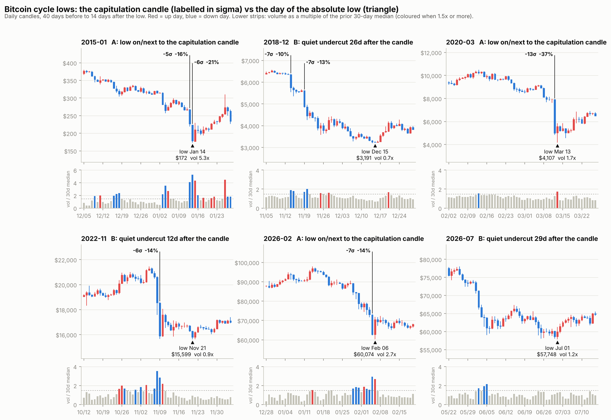

# 비트코인 저점 해부 보고서 — "피날레 음봉"은 실제였는가 (2026-11-14)

재현: `python research/bottom_anatomy.py` → 전체 표 `research/output/bottom_anatomy.txt`, 차트 `research/charts/bottom_anatomy_cycles.png`, 현재 국면 `research/bottom_phase_state.json`
자료: Yahoo 일봉(2014-09~), Bitstamp 일봉·시간봉(2011-08~), Binance 시간봉(2017-08~), 공포탐욕지수(2018-02~), Binance 펀딩비(2020-01~), Coin Metrics 거래소 유입·해시레이트·발행액·MVRV, Deribit DVOL(2021-03~). 추가 자료는 `scripts/fetch_bottom_extra.py` 가 GitHub Actions 에서 받아 `data/crypto/extra/` 에 저장.

(차트: 빨강 = 양봉, 파랑 = 음봉. 숫자 라벨 = 5σ 음봉의 크기, 삼각형 = 일중 최저일. 아래 띠 = 거래량 ÷ 직전 30일 중앙값. 이 환경에 한글 글꼴이 없어 차트 글자는 영문.)

---

## 0. 결론

1. **기억은 절반이 맞다.** 다섯 번의 사이클 종말부(2015, 2018, 2020, 2022, 2026) 모두에 극단적인 투매 음봉이 있었다. 하루 -14% ~ -37%, 직전 60일 변동성의 5.7 ~ 13.3배(이하 "5σ 음봉")다.
2. **그러나 절대 저점이 그 음봉에서 찍힌 것은 2015년과 2020년 두 번뿐이다.** 2018, 2022, 2026년은 그 음봉 12 ~ 146일 뒤에, 거래량이 평소 수준(0.7 ~ 1.2배)인 작은 봉에서 조용히 신저가를 찍었다. 공포는 음봉 날에 있었고, 진짜 저점은 아무 일도 없는 날이었다.
3. **5σ 음봉은 저점 "날짜"가 아니라 "종말 구간 진입"을 알린다.** 약세 구간(고점 대비 -45% 이하)의 5σ 음봉 11건(2011년 이후)에서 종가 매수 뒤 추가 하락 중앙값은 -8%다. 약세 구간 아무 날의 -21%보다 낫다. 다만 2018-11-14는 -44%가 더 빠졌다.
4. **저점은 두 막으로 온다.** 1막(투매)은 5σ 음봉, 시간당 거래량 20 ~ 60배, 거래소 유입 급증으로 시끄럽다. 2막(최종 저점)은 그 저가를 다시 건드리거나 살짝 깨는데, 거래량·거래소 유입·내재변동성이 모두 1막보다 낮고 RSI는 더 높다. 이 2막 서명이 난 6번은 모두 최종 저점까지 -9% 이내였다.
5. **지금(2026-11-14, $66,545)은 어느 막도 아니다.** 11/13의 -6.2%는 3.2σ짜리 일반 투매일이다. 오늘 봉이 5σ 음봉이 되려면 종가가 약 $61,000 이하여야 한다. 2 ~ 7월에 만든 저점 선반($57,748 ~ $60,074)까지 10 ~ 13% 남았다.

6. **7월 1일 저점이 사이클 저점일 확률은 약 45%(범위 35 ~ 55%)로 본다.** 5σ 음봉을 거친 저점은 10곳 중 8곳이 지켜졌지만, 지금처럼 136일 뒤 가격이 저점 +15%에 200일선 아래였던 저점은 3곳 모두 깨졌다(§8).

표본이 다섯 사이클뿐이라 모든 수치는 통계적 증명이 아니라 관찰이다. §9에 한계를 적었다.

---

## 1. 사이클별로 실제 일어난 일

| 사이클 | 최대 투매 음봉 (일봉) | 일중 최저일 | 간격 | 음봉 저가 대비 최종 저점 | 저점일의 모습 | 유형 |
|---|---|---|---|---|---|---|
| 2015 | 01-14: -21.1%, 5.9σ, 거래량 5.3배 | 01-14 $172 | 0일 | 0% | 그 음봉 자체. 다음 날 +18% | A 투매형 |
| 2018 | 11-19: -13.4%, 7.3σ (11-14에 -9.8%, 7.0σ 선행) | 12-15 $3,191 | 26일 | -34% | -0.2%, 거래량 0.7배, RSI 27 | B 재이탈형 |
| 2020 | 03-12: -37.2%, 13.3σ | 03-13 $4,107 | 1일 | -15.5% | 긴 아래꼬리 뒤 +11.9% 양봉 | A 투매형 |
| 2022 | 11-09: -14.3%, 5.7σ, 거래량 2.8배 | 11-21 $15,599 | 12일 | -0.5% | -3.1%, 거래량 0.9배, RSI 31 | B 재이탈형 |
| 2026 1차 | 02-05: -14.1%, 7.1σ, 거래량 2.9배 | 02-06 $60,074 | 1일 | -3.7% | 아래꼬리 뒤 +12.5% 양봉 | A 투매형 |
| 2026 최종(후보) | 06-02: -6.5%, 3.8σ (5σ 음봉은 2월) | 07-01 $57,748 | 29일 | 6/5 저가 대비 -2.3%, 2월 저가 대비 -3.9% | +2.5% 양봉, 거래량 1.2배, RSI 37 | B 재이탈형 |

참고로 2022-06-18 $17,709(사이클 1차 저점)도 06-13의 -16.0%(4.6σ) 음봉 5일 뒤였다.

**당시 사건**
- 2015-01: 비트스탬프 해킹(1/4~5)과 거래 중단, 300달러 지지 붕괴 뒤 마진콜 연쇄. Bitstamp 기준 저가는 $152.
- 2018-11~12: 9개월 지켜진 6,000달러 지지선 붕괴(11/14), 비트코인캐시 해시 전쟁(11/15), 채굴자 항복. 투매가 네 번의 파동으로 이어졌다.
- 2020-03: 코로나 유동성 위기. 비트멕스 강제청산 연쇄가 거래소 장애로 멈춘 직후가 저점.
- 2022-11: FTX 붕괴(11/8~9). 11/21의 신저가는 제네시스 전염 우려 속에서 나왔지만 가격 반응은 작았다.
- 2026-02: 귀금속 급락발 마진콜과 ETF 유출 뒤 청산 연쇄. 보도 기준 24시간 청산 18 ~ 27억 달러, 실현손실 32억 달러(사상 최대), CMC 공포탐욕 5. 출처는 §10.
- 2026-06~07: 6/5 고용지표와 스트래티지 매도 보도로 1차 투매(주간 청산 약 70억 달러 보도), 6/25 PCE 물가로 2차. 6/30의 롱 청산은 9,150만 달러에 그쳤다(보도). 투매 때의 1/20 ~ 1/30 수준이다.

**2018년의 파동 축소**: 저점이 낮아질수록 투매 강도가 줄었다.

| 날짜 | 저가 | 종가 수익 | 거래량 | 일간 RSI | 거래소 유입 z | 공포탐욕 |
|---|---|---|---|---|---|---|
| 11-20 | $4,272 | -8.6% | 2.0배 | 10 | +5.9 | 21 |
| 11-25 | $3,585 | +3.3% | 1.6배 | 17 | +2.3 | 9 |
| 12-07 | $3,280 | -2.9% | 1.3배 | 25 | +1.6 | 11 |
| 12-15 (최종) | $3,191 | -0.2% | 0.7배 | 27 | -0.6 | 11 |

---

## 2. 저점 "그 시간"에 일어난 일 (Bitstamp 시간봉)

| 저점 | 시각 (UTC / 한국) | 저점가 | 72시간 낙폭 | 저점 시간 거래량 | 1시간 뒤 | 24시간 뒤 |
|---|---|---|---|---|---|---|
| 2015-01 (A) | 01-14 07시 / 16시 | $152 | -46% | 62배 | +26.6% | +27.8% |
| 2020-03 (A) | 03-13 02시 / 11시 | $3,850 | -53% | 34배 | +39.4% | +45.6% |
| 2026-02 (A) | 02-06 00시 / 09시 | $59,930 | -24% | 20배 | +9.5% | +16.7% |
| 2018-11 1차 | 11-25 10시 / 19시 | $3,475 | -23% | 24배 | +8.8% | +12.7% |
| 2018-12 최종 (B) | 12-15 15시 / 16일 00시 | $3,122 | -11% | 1배 | +0.9% | +2.8% |
| 2022-11 1차 | 11-09 23시 / 10일 08시 | $15,632 | -26% | 9배 (28시간 전 56배) | +4.2% | +12.3% |
| 2022-11 최종 (B) | 11-21 21시 / 22일 06시 | $15,479 | -8% | 6배 | +1.6% | +4.2% |
| 2026-06 1차 | 06-05 19시 / 6일 04시 | $59,100 | -13% | 11배 (13시간 전 28배) | +4.3% | +2.5% |
| 2026-07 최종 (B) | 07-01 01시 / 10시 | $57,735 | -5% | 5배 | +2.2% | +4.1% |

거래량 배수는 직전 30일 시간당 거래량 중앙값 대비다.

- **투매형 저점은 시간 단위로 보인다.** 시간당 거래량이 평소의 20배를 넘고, 그 시간 봉이 꼬리를 달고 끝나며, 1시간 안에 +9 ~ +39% 튄다. 사이클 저점이 아닌 국지 저점(2021-05 22배, 2022-05 53배, 2024-08 19배)도 같은 모양이다. 즉 20배 꼬리는 "그 파동의 저가"는 확정해 주지만 "사이클 저점"인지는 말해 주지 않는다.
- **재이탈형 저점은 시간봉으로도 조용하다.** 거래량 1 ~ 6배, 직전 96시간 최대 시간 음봉이 -1.3 ~ -2.1%, 1시간 뒤 반등 +1 ~ 2%.
- 투매형 저점 시각은 UTC 00 ~ 07시(한국 오전 9시 ~ 오후 4시)에 몰렸다(2015-01, 2015-08, 2020-03, 2026-02, 2022-05, 2025-04). 요일에는 규칙이 없었다(수, 토, 금, 토, 월, 금, 수).
- Binance 시장가 매도 비중은 저점 시간에 45 ~ 61%로 평소 분포(5% ~ 95% 구간 40 ~ 61%) 안이었다. 구분력이 없다.

---

## 3. 1막(투매)과 2막(조용한 최종 저점) 지표 비교

| | 날짜 | 저가 | 종가 수익(σ) | 거래량 | RSI | 거래소 유입 z | 7일 순유입(BTC) | 공포탐욕 | DVOL | MVRV |
|---|---|---|---|---|---|---|---|---|---|---|
| 2018 1막 | 11-20 | $4,272 | -8.6% (-3.5σ) | 2.0배 | 10 | +5.9 | +63,082 | 21 | - | 0.89 |
| 2018 2막 | 12-15 | $3,191 | -0.2% (0.0σ) | 0.7배 | 27 | -0.6 | +9,790 | 11 | - | 0.69 |
| 2022 1막 | 11-09 | $15,683 | -14.3% (-5.7σ) | 2.8배 | 24 | +1.7 | +38,077 | 29 | 115 | 0.75 |
| 2022 2막 | 11-21 | $15,599 | -3.1% (-1.0σ) | 0.9배 | 31 | +0.1 | -7,554 | 21 | 81 | 0.78 |
| 2026 1막 | 06-05 | $59,109 | -4.5% (-2.3σ) | 2.2배 | 15 | +2.9 | +16,395 | 12 | 49 | 1.14 |
| 2026 2막 | 07-01 | $57,748 | +2.5% (+1.3σ) | 1.2배 | 37 | +0.2 | -10,520 | 11 | 43 | 1.13 |
| 2015 (A형) | 01-14 | $172 | -21.1% (-5.9σ) | 5.3배 | 20 | +6.9 | -5,201 | - | - | 0.56 |
| 2020 (A형) | 03-12 | $4,860 | -37.2% (-13.3σ) | 1.3배* | 14 | +11.6 | +51,329 | 14 | - | 0.88 |
| 2026-02 (A형) | 02-05 | $62,354 | -14.1% (-7.1σ) | 2.9배 | 16 | +4.9 | +38,241 | 12 | 83 | 1.15 |

*Yahoo 합산 거래량 기준. Bitstamp 단일 거래소 기준으로는 9.4배.

**2막의 공통 서명** (세 번 모두 같았다)
- 가격은 1막 저가보다 낮거나 같다(-0.5%, -2.3%, 2018년은 -25%).
- 거래량은 1막의 1/2 ~ 1/3로 평소 수준이다.
- 일간 RSI는 1막보다 7 ~ 22 높다(상승 다이버전스).
- 거래소 유입 z가 0 근처로 돌아왔고, 2022·2026년은 7일 순유출이다(코인이 거래소를 떠나는 중).
- 내재변동성(DVOL)은 1막보다 낮다(115 → 81, 49 → 43).
- 공포탐욕은 더 낮아지지 않는다. 2022-11 최종 저점의 21은 6월 1차 저점의 6보다 한참 높았고, 2026-07의 11도 2월의 5 ~ 9보다 높았다.

**쓸모가 약했던 것**
- 공포탐욕 10 이하는 "구간"만 알려 준다. 2022년에 19일, 2026년에 29일 있었고, 2026년 역대 최저(5)는 2월 저점 6 ~ 17일 뒤에 나왔다.
- 펀딩비는 투매 당일에만 음수였다(2020-03-13 일 합계 -38bp, 2022-11-09 -4.0bp, 2026-02-06 -2.9bp). 2막에서는 소폭 양수라 신호가 없다.
- 거래소 유입 급증(z ≥ +5) 단독은 약세장 중간에도 자주 나왔다(2019-10, 2022-05, 2022-09 뒤 -23 ~ -51%).
- 주봉 기준 최대 음봉(-22 ~ -34%)은 2018-11-25, 2020-03-15, 2022-06-19, 2022-11-13, 2015-01-18 주에 있었지만, 주 종가 대비 -5 ~ -24%가 더 빠졌다.
- 퓨엘 배수 0.5 이하는 2011·2015·2018·2022 저점에서 충족됐으나 2026년은 0.55 ~ 0.71로 한 번도 닿지 않았다.

---

## 4. "5σ 음봉" 전수 검증

정의: 종가 수익률 ÷ 직전 60일 일간 변동성 ≤ -5, 종가가 사상 최고가 대비 -45% 이하. Bitstamp 일봉 2011-08 이후 전부.

| 날짜 | 종가 수익 | σ | MVRV | 종가 대비 추가 하락 | 저점까지 | 1년 뒤 |
|---|---|---|---|---|---|---|
| 2012-08-19 | -30.2% | -9.6 | 1.37 | -2% | 1일 | +1,176% |
| 2013-04-11 | -48.5% | -6.5 | 2.10 | -46% | 1일 | +407% |
| 2013-10-02 | -18.4% | -9.0 | 1.82 | -2% | 1일 | +261% |
| 2015-01-14 | -24.5% | -5.8 | 0.56 | -2% | 1일 | +151% |
| 2015-08-18 | -12.3% | -5.5 | 0.77 | -12% | 7일 | +154% |
| 2016-01-15 | -16.2% | -5.7 | 1.21 | -2% | 1일 | +127% |
| 2018-11-14 | -10.6% | -7.2 | 1.13 | **-44%** | 31일 | +54% |
| 2018-11-19 | -14.8% | -7.6 | 0.98 | **-34%** | 26일 | +72% |
| 2020-03-12 | -39.0% | -12.9 | 0.88 | -20% | 1일 | +1,083% |
| 2022-11-09 | -14.4% | -5.5 | 0.75 | -3% | 12일 | +131% |
| 2026-02-05 | -14.0% | -7.1 | 1.15 | -8% | 146일 | 진행 중 |

- 종가 매수 뒤 추가 하락: 중앙값 -8%, -10% 이내 55%, 최악 -46%. 기준선(약세 구간 아무 날 2,929일)은 중앙값 -21%, -10% 이내 34%.
- Yahoo 일봉(2014-09 이후, 8건)으로 같은 계산을 하면 중앙값 -13%, -10% 이내 50%, 기준선은 -19%, 32%다. 우위는 있으나 크지 않다.
- 1년이 지난 10건 모두 1년 뒤 가격이 더 높았고, 그 뒤 만든 저점은 이후 1년 동안 깨지지 않았다(2026-02는 진행 중).
- 2026년을 뺀 10건은 저점이 31일 안에 나왔다.
- **위험한 예외는 2018-11-14다.** 오래 지켜진 지지선이 처음 깨진 날의 5σ 음봉이었고(직전 60일 변동성 1.4%/일로 사례 중 최저, 음봉 크기 -9.8%로 최소, 30일 고점 대비 -17%에 불과), 그 뒤 31일 동안 -44%가 더 빠졌다. 변동성이 극도로 눌린 뒤 지지선이 처음 깨지는 5σ 음봉은 종말이 아니라 폭포의 시작일 수 있다.

**일반 투매 음봉(2.5σ + 거래량 1.5배)은 저점 신호가 아니다.** 약세 구간에서 이런 날 종가에 사면 추가 하락 중앙값이 Yahoo 16건 -19%, Bitstamp 37건 -26%로 기준선과 같거나 더 나빴다(2019-09 -52%, 2022-01 -57%, 2022-05 -57%, 2022-06 -31% 포함).

---

## 5. 주요 저점 24곳 통계 (2014-12 이후, 90일 고점 대비 -25% 이상 하락한 저점)

- 직전 30일 최대 음봉과 저점의 간격: 같은 날 3곳, 다음 날 4곳, 2 ~ 8일 뒤 9곳, 9일 이상 뒤 8곳. **최대 음봉 당일이 저점인 경우는 1/8이다.**
- 저점 당일이 양봉으로 끝난 곳 12/24, 종가가 일중 범위 위쪽 절반에서 끝난 곳 17/24. 저점일은 대개 "큰 음봉"이 아니라 "꼬리 달린 봉"이다.
- 저점 당일 거래량이 평소의 1.5배 미만인 곳 13/24.
- 저점일 RSI가 직전 30일 최저 RSI보다 5 이상 높은 곳(상승 다이버전스) 16/24.
- 최대 음봉의 저가 대비 최종 저점: 중앙값 -7.2%, 사분위 -9.8% ~ -3.5%.

---

## 6. 저점 탐지 절차 (세 단계)

**0단계 — 구간.** 기존 탐지기(`bottom_detector.py`)의 저점 구간. 고점 대비 -45% 이하, 고점 후 240일 이상, 점수 5 이상.

**1단계 — 피날레 음봉(1막).** 약세 구간에서 일봉 종가가 5σ 이상 하락.
- 확인 보조: 시간당 거래량 20배 이상인 봉이 꼬리를 달고 끝나고 1시간 안에 +5% 이상 반등, 전후 1 ~ 2일 거래소 유입 z +5 이상, 공포탐욕 12 이하, 펀딩비 음전.
- 의미: 최종 저점까지 0 ~ 31일(2026년만 146일). 투매 저가 대비 최종 저점은 0%(2015), -15.5%(2020, 다음 날), -5.5%(2015-08), -0.5%(2022), -3.9%(2026), -25%(2018).
- 직후 +10% 이상 급반등은 A형·B형 모두에서 나왔으므로 유형을 구분해 주지 않는다(2015-01-15 +18%, 2018-11-28 +11%, 2022-11-10 +11%, 2026-02-06 +13%).

**2단계 — 조용한 재이탈(2막).** 아래를 모두 충족하는 날.
- 마지막 투매일(2.5σ + 거래량 1.5배)에서 7일 이상 지남
- 그날 저가가 투매 저가의 +3% 이내 또는 그 아래
- 거래량이 30일 중앙값의 1.3배 이하
- 일간 RSI가 투매 구간 최저 RSI보다 5 이상 높음
- 보조: 거래소 유입 z가 +2 미만, DVOL이 투매 때보다 낮음, 공포탐욕이 투매 때보다 낮지 않음

이 신호가 난 날(Yahoo, 5일 이상 떨어진 것만 따로 셈)은 6번이고, 신호일 종가 대비 추가 하락은 -9%, -4%(2018-12), -1%, 0%(2022-11), -6%, -4%(2026-06)였다.

**신호별 매수가가 최종 저점(일중)보다 얼마나 위였는가**

| 사이클 | 기존 탐지기 2단계 첫 발생 | 첫 5σ 음봉 종가 | 마지막 5σ 음봉 종가 | 조용한 재이탈 첫 신호 |
|---|---|---|---|---|
| 2015 | +54% | +32% | +4% | 없음 (V자) |
| 2018 | +53% | +80% | +53% | +10% |
| 2020 | +72% | +21% | +21% | 없음 (V자) |
| 2022 | +26% | +2% | +2% | +1% |
| 2026 | +5% | +9% | +9% | +7% (6/27 신호는 +4%) |

- 5σ 음봉만 기다리면 2015·2020·2022·2026은 저점 근처에서 잡지만 2018형에서 크게 물린다.
- 조용한 재이탈만 기다리면 2018·2022·2026은 잘 잡지만 2015·2020형(V자)은 재이탈이 오지 않아 놓친다.
- 그래서 둘을 나눠 쓰는 것이 자료와 맞는다. 다만 분할 비율을 최적화하지는 않았다. 다섯 번의 표본으로 비율을 고르면 과최적화다.

---

## 7. 현재 상태 (2026-11-14, 일봉 진행 중)

| 항목 | 값 |
|---|---|
| 가격 | $66,545 (11/13 종가 $68,249, 11/12 종가 $72,784) |
| 11/13 봉 | -6.2%, 3.2σ, 거래량 1.7배 → 일반 투매일(피날레 아님) |
| 일간 RSI / 공포탐욕 | 23 / 13 |
| 고점 대비 | -47% (약세 구간 안) |
| 거래소 유입 z | +0.7 (투매 수준 아님) |
| MVRV | 1.24 ~ 1.27 (실현가격 약 $53,800) |
| 기존 탐지기 | 점수 2, 단계 0. 저점 구간 발동가 약 $62,000 |
| 국면 추적기 | 0 (2월 5σ 음봉의 180일 창이 8월 초에 끝남) |
| 오늘 봉이 5σ 음봉이 되는 종가 | 약 $61,000 이하 (-10.6%). 변동성에 따라 매일 바뀜 |
| 저점 선반 | 2/6 $60,074, 6/5 $59,109, 7/1 $57,748 |

읽는 법:
- 7월 저점은 2막 서명을 모두 갖췄다(§3). 서명만 보면 2022-11, 2018-12와 같은 종류다. 반대 근거는 이전 연구에 있다. MVRV가 1 아래로 간 적이 없고(저점일 1.10 ~ 1.13), 고점 후 268일로 역대 최단이다.
- **선반 위에서 멈추는 경우**: 5σ 음봉 없이 $58,000 ~ $62,000에서 작은 봉, 거래량 1.3배 이하, RSI가 지금(23)보다 높은 저점이 나오면 2막 서명의 반복이다. 이 경우 국면 추적기는 신호를 내지 않으므로(180일 창 밖) 서명을 직접 대조해야 한다.
- **선반이 깨지는 경우**: $57,748 아래 종가는 9개월 선반 붕괴로, 구조상 2018-11-14(6,000달러 선반 붕괴)와 같다. 그때의 5σ 음봉은 종말이 아니라 폭포의 시작이었다. 이 경우 1단계에서 서두르지 않고 2단계 서명을 기다리는 쪽이 2018년 자료와 맞는다. 이전 연구의 온체인 추정(MVRV 0.85 ~ 0.90 = 약 $46,000 ~ $48,500)이 이 경로의 참고 범위다.
- 200일선(약 $73,000) 아래 종가는 진행 중인 봉을 포함해 3일째다. 이전 기록의 사전 규칙은 5일 연속이면 엔진 현금화다.
- 11/13 ~ 14 하락의 원인 보도는 검색으로 확인하지 못했다.

---

## 8. 지켜진 저점과 깨진 저점 전수 비교 — 7월 저점이 사이클 저점일 확률 (2차 분석)

질문을 바꿨다. "저점에서 무슨 일이 있었나"가 아니라 "약세장에서 만들어진 저점 가운데 어떤 것이 끝까지 지켜졌고 어떤 것이 깨졌나"다. 2011년 이후 약세 구간(고점 대비 -45% 이하)의 주요 저점 23곳을 모두 모았다(전체 표는 `research/output/bottom_anatomy.txt` 9절). 지켜짐 = 이후 1년 동안 그 저가가 깨지지 않음.

### 8-1. 가장 강한 구분자는 "5σ 음봉이 먼저 있었는가"

| 구분 | 지켜진 저점 | 깨졌을 때 추가 하락 |
|---|---|---|
| 전체 | 10 / 23 | |
| **180일 안에 5σ 음봉이 선행한 저점** | **8 / 10** | -6%, -4% (둘 다 얕음) |
| **5σ 음봉 없이 만든 저점** | **2 / 13** | -12% ~ -55% (11곳) |
| 저점일 MVRV 1 미만 | 6 / 10 | -6% ~ -45% |
| 저점일 MVRV 1 이상 | 4 / 13 | -4% ~ -55% |

- 5σ 음봉 없이 만들어진 저점(2014-04, 2014-10, 2018-02·04·06·08, 2019-12, 2021-06, 2022-01·06·09)은 13곳 중 11곳이 깨졌고, 깨지면 깊게 깨졌다.
- 5σ 음봉 뒤에 만들어진 저점은 10곳 중 8곳이 지켜졌고, 깨진 2곳(2015-04, 2026-02)도 -6%, -4%에 그쳤다.
- 이것이 "피날레 음봉"의 진짜 쓸모다. 그 음봉 자체가 저점은 아니지만, **그 음봉을 거친 뒤의 저점만이 믿을 만했다.**
- 2011년 저점은 예외다. 가장 큰 음봉이 -4.3σ(2011-10-20, -43%)로 기준에 못 미쳤는데 저점은 지켜졌다. 당시 자료는 하루 종가 한 개뿐이라 품질이 낮다.

### 8-2. 사이클 저점의 공통 규칙 채점표

| 규칙 | 2015 | 2018 | 2022 | (2020) | 2026-07 후보 |
|---|---|---|---|---|---|
| ① 종말부에 5σ 음봉 | O (당일) | O (26일 전) | O (12일 전) | O (전날) | O (146일 전, 2월) |
| ② 투매 구간 일간 RSI 24 이하 | 19 | 10 | 24 | 14 | 15 |
| ③ 저점 뒤 7일 반등 | +32% | +26% | +4% | +51% | +8% |
| ④ 저점일이 조용하거나(B형) 꼬리 달린 투매봉(A형) | A | B | B | A | B |
| ⑤ 저점 뒤 200일선 회복 | O | O | O | O | O (8/19) |
| ⑥ 저점 136일 뒤 가격 (저점 대비) | +52% | +69% | +81% | +187% | **+15%** |
| ⑦ 100일 지난 뒤 저점에 가장 가까웠던 가격 | +30% | +23% | +26% | - | **+15% (진행 중)** |
| ⑧ 저점일 MVRV 1 미만 | 0.50 | 0.68 | 0.76 | 0.69 | **1.09 (미충족)** |
| ⑨ 고점 대비 낙폭 | -87% | -84% | -78% | -80% | **-54%** |
| ⑩ 고점 후 일수 | 410 | 363 | 376 | - | **268** |

- ① ~ ⑤(투매와 저점의 모양, 직후 회복)는 7월 저점이 모두 충족한다.
- ⑥ ~ ⑦(저점 이후의 힘)은 과거 어느 사이클보다 약하다. 확정된 사이클 저점 뒤에는 100일이 지난 다음 가격이 저점 +23% 안쪽으로 돌아온 적이 없다. 지금은 +15%다.
- ⑧ ~ ⑩(깊이와 시간)은 모두 미충족이다. 다만 사이클마다 얕아지는 추세가 있다(MVRV 0.41 → 0.50 → 0.68 → 0.76, 낙폭 -92% → -87% → -84% → -78%).

### 8-3. 지금과 같은 위치에 있던 저점들

7월 1일 저점에서 136일이 지났다. 과거 저점 가운데 136일째까지 안 깨지고 살아남은 것은 15곳이고, 그중 10곳이 끝까지 지켜졌다. 그 15곳을 136일째의 상태로 나누면:

| 136일째 상태 | 지켜진 저점 | 사례 |
|---|---|---|
| 가격이 저점 +60% 이상이거나 200일선 위 | 9 / 10 | 깨진 1곳은 2021-06 (사상 최고가를 새로 쓴 뒤 323일째에 깨짐) |
| 가격이 저점 +60% 미만이고 200일선 아래 | 1 / 5 | 지켜짐: 2015-01 (+52%). 깨짐: 2014-04 (+48%), 2018-02 (+2%), 2018-06 (+9%), 2022-06 (+16%) |
| 그중 저점 +20% 미만 | 0 / 3 | 2018-02, 2018-06, 2022-06. 각각 138일, 138일, 143일째에 깨짐 |

- 지금(저점 +15%, 200일선 아래)은 가장 불리한 칸에 있다.
- 다만 이 칸에서 깨진 4곳은 모두 5σ 음봉 없이 만든 저점이었고, 지켜진 1곳(2015-01)만 5σ 음봉을 거친 저점이었다. 7월 저점은 5σ 음봉을 거친 쪽이다. 표본이 1곳뿐이라 근거로는 약하다.

### 8-4. 확률

세 가지 참조 집단이 서로 다른 답을 준다.

| 관점 | 근거 | 지켜질 빈도 |
|---|---|---|
| 모양 (5σ 음봉을 거친 저점인가) | 8 / 10 | 80% |
| 위치 (136일째에 저점 근처·200일선 아래) | 1 / 5 (좁게 보면 0 / 3) | 약 20% |
| 깊이 (저점일 MVRV 1 이상) | 4 / 13 | 약 31% |

- 세 관점을 같은 무게로 두면 약 44%다. **7월 1일 $57,748이 이번 사이클 저점일 확률은 약 45%(범위 35 ~ 55%)로 본다.** 이전 기록(11/12, 50%)보다 낮다. 그 뒤 가격이 9% 더 내려 저점 선반에 가까워졌고, 위치 관점의 과거 빈도가 불리하기 때문이다.
- 이 숫자는 통계가 아니라 판단이다. 각 칸의 표본이 3 ~ 13곳이고, 세 관점에 같은 무게를 둔 것도 임의다.
- **깨질 경우의 깊이는 관점마다 다르다.** 모양 관점(5σ 음봉 뒤 저점이 깨진 2번)은 -4 ~ -6%, 즉 약 $54,000 ~ $55,500이다. 실현가격(MVRV 1.0, 약 $53,800) 바로 위다. 깊이 관점은 MVRV 0.85 ~ 0.90인 $46,000 ~ $48,500, 2018년형 선반 붕괴는 그보다 훨씬 아래다.

**확률을 바꾸는 사건**
- 올라가는 경우: $58,000 ~ $62,000 선반 근처에서 2막 서명(작은 봉, 거래량 1.3배 이하, RSI가 지금보다 높은 저점)이 나오고 200일선(약 $73,000)을 다시 회복.
- 0이 되는 경우: 일봉 종가가 $57,748 아래. 그때부터는 새 피날레 음봉(5σ)과 그 뒤의 2막 서명을 기다리는 절차로 넘어간다. 8-1의 빈도대로라면 5σ 음봉 없이 만들어지는 저점은 믿지 않는 편이 맞다.

### 8-5. "2023년 3월과 같은 -22% 되돌림"이라는 견해 검증

저점 뒤 +40% 이상 반등했다가 반등 고점 대비 -22%에 닿은 시점을 과거 저점 전부에서 찾았다(`research/output/bottom_anatomy.txt` 10절).

| | 2023-03 | 2026-11 |
|---|---|---|
| 반등 (저점 → 고점) | $15,479 → $25,200대 (+63%) | $57,735 → $87,374 (+51%) |
| 되돌림 | -23%, 22일 | -24% (진행 중), 54일 |
| 상승분 반납 | 57% | 71% |
| 되돌림 저점의 위치 (사이클 저점 대비) | +26% | +15% |
| 200일선 | 종가 기준 위 | 9% 아래, 3일째 |
| 그 뒤 | 4일 만에 반등 고점 재돌파 | ? |

- -22%에 닿은 날 종가가 200일선 위였던 경우: 8번 중 7번이 그 근처에서 멈추고 고점을 다시 넘었다(예외 2018-02).
- 200일선 아래였던 경우(저점 직후 3일 이내의 출렁임 2번 제외): 10번 중 저점이 끝내 지켜진 것은 2번이다(2011-10, 2021-06). 2014-04와 2014-10은 그 자리에서 멈추고 한 번 반등했지만 나중에 저점이 깨졌고, 나머지 6번은 저점이 깨졌다(2015-04는 -6%, 그 외 -12 ~ -53%).
- 낙폭 숫자는 같지만 과거에 결과를 가른 조건(200일선, 저점과의 거리, 반납 비율)은 2023년과 반대쪽이다.

---

## 9. 한계

- 표본은 사이클 다섯 번, 5σ 사건 11건, 조용한 재이탈 신호 6건이다. 유의성 검정이 의미 없는 크기다.
- 기준값(5σ, 60일, 거래량 1.3배, 7일, +3%)은 자료를 본 뒤에 골랐다. 변동성 창을 바꾸면 사건 목록이 달라진다. 30일 창은 2019-09-24(이후 -52%)가 추가되고 2015-01-14가 빠진다. 90일 창은 2022-06-13(이후 -31%)이 추가된다. 어느 창에서든 2018-11, 2020-03, 2022-11, 2026-02는 남는다.
- 거래량은 출처에 따라 다르다(Yahoo 합산 vs Bitstamp 단일 거래소). 2020-03-12는 Yahoo 1.3배, Bitstamp 9.4배다.
- 2026-02를 "A형"으로, 2026-07을 "최종 저점"으로 부른 것은 현재까지의 가격 기준이다. 7월 저점이 깨지면 분류가 바뀐다.
- 청산액, 실현손실, SOPR, 미결제약정 이력은 무료 자료가 없어 보도 수치만 인용했다. 직접 검증하지 못했다.
- 국면 추적기는 5σ 음봉이 있어야 시작된다. 5σ 음봉 없이 오는 저점(2022-06 1차 저점은 4.6σ)은 잡지 못한다.

## 10. 출처 (2026년 사건 보도)

- [The Block — Bitcoin flash crashes to $60,000](https://www.theblock.co/post/388759/bitcoin-sees-flash-crash-60000)
- [CryptoPotato — $2.6 Billion Thursday Wipeout](https://cryptopotato.com/2-6-billion-thursday-wipeout-what-triggered-the-latest-bitcoin-and-altcoin-crash/)
- [Forklog — Bitcoin tests $60,000 support](https://forklog.com/en/news/bitcoin-tests-60000-support-triggering-billion%e2%80%91dollar-liquidations)
- [Amberdata — Bitcoin below 70k](https://blog.amberdata.io/bitcoin-below-70k-the-crash-the-data-and-what-comes-next)
- [Cointelegraph — Bitcoin bounces off new 2026 price lows](https://cointelegraph.com/markets/bitcoin-bounces-off-new-2026-price-lows-will-us-stock-weakness-push-btc-lower)
- [Cointelegraph — Bitcoin drops to $58K on PCE highs](https://cointelegraph.com/markets/bitcoin-drops-to-58-on-pce-highs)
- [Crypto Briefing — Bitcoin falls below $58,000](https://cryptobriefing.com/bitcoin-falls-below-58000-leveraged-liquidations/)
- [Bitcoin.com News — Bitcoin sinks 20% in June](https://news.bitcoin.com/bitcoin-sinks-20-in-june-as-traders-dump-longs-and-widen-2026-losses-to-34/)
- [Bloomberg Law — Crypto liquidations top $1 billion](https://news.bloomberglaw.com/crypto/crypto-liquidations-top-1-billion-as-bitcoins-slide-deepens)

2015 ~ 2022년 사건은 널리 알려진 내용을 적었으며 이번에 따로 출처를 확인하지는 않았다.
