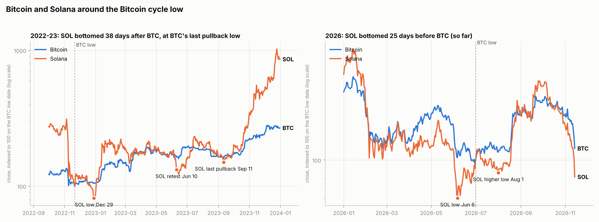

# 비트코인 저점 뒤 상승 시작 시점, 그리고 솔라나 저점과의 간격 (2026-11-15)

재현: `python research/sol_btc_ignition_study.py` → `research/output/sol_btc_ignition_study.txt`, 차트 `research/charts/sol_btc_around_low.png`
자료: Bitstamp·Coin Metrics 일봉(2010 ~), Binance 일봉·30분봉(BTC 2017-08 ~, SOL 2020-08 ~), 알트 16종 일별 종가, 솔라나 펀딩비. 수집 `scripts/fetch_sol_study.py` → `data/crypto/sol_study/`.
조사 노트: `research_notes/솔라나 저점과 상승 시작 연구/` (웹 수치는 검색 결과 요약 기준이며 원문 대조는 못 했다).

(차트: 비트코인 저점일의 종가를 100으로 둔 지수, 로그 눈금. 파랑 = 비트코인, 주황 = 솔라나. 글꼴 문제로 차트 글자는 영문.)

---

## 0. 결론

1. **비트코인은 저점 뒤 세 단계를 거쳐 올랐다.** 저점 → 한두 달 뒤 "마지막 눌림 저점" → 큰 양봉으로 200일선을 되찾는 "점화". 저점에서 점화까지 47 ~ 108일이 세 번(2019, 2020, 2023), 약 9개월이 한 번(2015)이었다.
2. **점화에는 매번 바깥의 계기가 있었다.** 2019년 연준의 금리 동결, 2020년 양적완화, 2023년 물가 둔화와 은행 지원책. 지금은 12월 9일 금리 인상 확률이 88 ~ 92%로 반대 방향이다.
3. **솔라나 저점은 비트코인 저점과 "같은 시각"이 기본이다.** 급락일 17번 가운데 13번은 30분봉 기준 2시간 이내였고, 솔라나 주요 저점 23곳 중 16곳이 비트코인의 국지 저점과 사흘 안에 겹쳤다.
4. **그러나 사이클 최저점 사이에는 고정된 간격이 없다.** 2022년에는 솔라나가 38일 늦었고, 2026년에는 지금까지 25일 빨랐다. 알트 16종으로 넓혀도 같다. 알트의 저점은 "비트코인의 여러 저점일 가운데 하나"에 찍히는데, 어느 날이 그 알트의 최저가 되는지는 그 알트의 사정이 정했다.
5. **솔라나는 진짜 저점에서 기다려 주지 않았다.** 저점 뒤 +50%까지 5 ~ 6일(2020, 2022), 길어도 76일(2026-06)이었다. 200일선 회복 같은 확인 신호는 저점보다 23 ~ 228% 오른 뒤에야 나왔고(2020년은 그 이상), 그 신호를 따라 산 경우의 성적은 나빴다.
6. **솔라나의 "지속 상승"은 저점이 아니라 비트코인의 두 번째 돌파에서 시작됐다.** 2023년 1월 비트코인 첫 점화 뒤 180일 동안 솔라나는 +21%였지만, 10월 두 번째 돌파 뒤 180일 동안은 +373%였다. 그 사이 다섯 달 동안 솔라나는 비트코인보다 약했다.
7. **지금 솔라나는 $70 안팎으로 올해 저점($60.13, 6월 6일)보다 17% 위다.** 11월 14일에 -10.1%(평소의 3.5배, 거래량 2.6배, RSI 15)로 급락했다. 비트코인이 투매로 저점을 만들면 솔라나 저점은 같은 시각에 나올 가능성이 높고, 그때 솔라나는 비트코인 낙폭의 1.3 ~ 2.5배를 빠졌다.

표본은 솔라나 사이클 2번, 비트코인 사이클 5번이다. 아래 수치는 관찰이며 증명이 아니다.

---

## 1. 비트코인: 저점에서 본상승까지

### 1-1. 사이클별 시간표 (저점일 기준 경과 일수, 괄호는 그날 종가의 저점 대비 수익)

| 사이클 | 저점 | 마지막 눌림 저점 | 200일선 회복 | 점화 양봉 (200일선 위, 평소의 3.5배 이상) | 사상 최고가 경신 |
|---|---|---|---|---|---|
| 2011 | 11-21 | 89일 (+88%) | 135일 | 207일 (2012-06-15) | 456일 |
| 2015 | 01-14 | 222일 (+38%) | 166일 → 실패, 10월에 재회복 | 292일 (2015-11-02, +11%) | 771일 |
| 2018 | 12-15 | 54일 (+8%) | 108일 | 108일 (2019-04-02, +18%) | 716일 |
| 2020 | 03-13 | 33일 (+72%) | 47일 | 136일 (2020-07-27, +11%) | 262일 |
| 2022 | 11-21 | 40일 (+7%) | 53일 | 60일 (2023-01-20, +8%) | 476일 |
| 2026-07 (후보) | 07-01 | 33일 (+8%) → 11월에 이탈 | 49일 → 85일 버티고 실패 | 49일 (2026-08-19, +7%) | - |

- "마지막 눌림 저점"은 그 뒤 1년 동안 종가가 한 번도 그 아래로 내려가지 않은 날이다. 조용한 저점 유형(2018, 2022)에서는 저점 40 ~ 54일 뒤, 저점보다 7 ~ 8% 위에서 나왔다.
- 다른 정의(200일선 위 첫 종가 가운데 -20% 전에 +50%에 닿은 날)로 잡아도 점화일은 2015-10-10(269일), 2019-04-02(108일), 2020-04-29(47일), 2023-01-13(53일)이다. 2023년에는 10월 16일(329일)의 두 번째 돌파가 결정적이었다.
- 점화 직전에는 변동성이 극도로 눌려 있었다(직전 60일 볼린저 폭 최저 0.03 ~ 0.06).

### 1-2. 가짜 출발

- 2015년 6 ~ 7월: 200일선 회복이 50일 버틴 뒤 -38%.
- 2019년 10월 ~ 2020년 3월: 회복 실패 네 번.
- 2026년: 회복 신호가 네 번 실패했다. 7월 저점 뒤에는 2022년과 같은 순서(33일 뒤 눌림, 49일 뒤 200일선 회복 양봉)가 그대로 나왔지만, 9월 21일 고점($87,374)에서 -29% 빠지며 반등분의 86%를 반납했다. 이 깊이는 2020·2023년의 눌림(-15 ~ -23%)보다 깊고 2015년 8월(-38%)에 가깝다.
- "200일선이 20일 동안 오르는 중"이라는 조건을 더하면 가짜가 줄지만 진입이 2 ~ 6주 늦어지고, 2015년 8월과 2026년 9월에는 그래도 실패했다.

### 1-3. 점화의 계기와 지금의 차이

| 점화 | 계기 (보도 요약) |
|---|---|
| 2015-10 ~ 11 | 중국 자본 유출 수요. 연준은 인상 직전이었다(예외) |
| 2019-04-02 | 한 매수자의 약 1억 달러 주문. 연준은 1월 30일 동결 선언 |
| 2020-04-29 | 연준의 무제한 양적완화 |
| 2023-01-13 | 물가 둔화, 숏 청산 4.95억 달러 |
| 2023-10-16 ~ 23 | 블랙록 ETF 등재 소식, 숏 청산 |

지금은 12월 9일 인상 확률 88 ~ 92%, 달러지수 연중 최고(103), ETF 유출, 스테이블코인 공급 감소다. 유동성 분석가 Howell은 세계 유동성 저점을 2027년 중 ~ 하반기로 본다.

### 1-4. 달력으로 본 시기

- 과거 저점은 다음 반감기 373 ~ 542일 전에 나왔다(최근 세 번은 513 ~ 542일). 널리 쓰이는 "517 ~ 547일 전" 규칙을 2028년 3 ~ 4월 반감기에 대입하면 저점 창은 약 2026-09-20 ~ 11-30으로 **지금**이다.
- 과거 점화는 반감기 187 ~ 463일 전에 나왔다. 대입하면 **2027년 1월 ~ 10월**이다.
- 저점이 11 ~ 12월에 새로 나온다면, 조용한 유형의 선례로는 마지막 눌림이 2027년 1 ~ 2월, 점화가 1 ~ 3월이다. 2015년처럼 계기가 늦으면 2027년 8 ~ 9월까지 밀린다.

---

## 2. 비트코인 저점과 알트·솔라나 저점의 간격

### 2-1. 알트 16종의 사이클 최저 종가일 (비트코인 최저 종가일 대비)

| 사이클 | 같은 주(±7일) | 30일 넘게 늦음 | 30일 넘게 빠름 | 특징 |
|---|---|---|---|---|
| 2015 (5종) | 60% | 40% | 0% | LTC·DASH·XMR은 같은 날. XRP는 321일 뒤 |
| 2018 (12종) | 42% | 42% | 8% | ETH·ADA·BCH·XMR은 같은 날. DOGE는 53일 뒤(비트코인의 마지막 눌림 저점일). XRP·XLM은 1년 뒤 |
| 2020-03 (13종) | 100% | 0% | 0% | 전부 같은 주 |
| 2022 (16종) | 6% | 44% | 44% | 둘로 갈림. ETH·BNB·XRP·DOGE 등 7종은 6월 투매 때, SOL·XLM은 50일 뒤, 나머지는 2023년 |
| 2026 (16종, 진행 중) | 31% | 31% | 12% | ETH·SOL은 24일 먼저(6월 6일). DOGE·XRP·DOT 등 5종은 11월 14일에 신저가 |

- 시차의 중앙값은 매번 0일 근처지만 흩어짐이 크다. **"알트는 비트코인보다 며칠 늦다"는 규칙은 없다.**
- 늦게 바닥난 알트는 비트코인 저점일 이후 중앙값 -16 ~ -50%를 더 빠졌다.
- 달러 저점과 별개로, 비트코인 대비 가격비는 비트코인 저점 뒤에도 몇 달씩 더 내렸다(2018년 ETH -37%, 2022년 SOL -40%).

### 2-2. 솔라나의 주요 저점 23곳 (2020-08 ~)

- 가장 가까운 비트코인 주요 저점과 같은 날 10곳, ±3일 11곳.
- 비트코인의 국지 저점(±15일 최저)과 사흘 안에 겹친 것은 16곳.
- 겹치지 않은 7곳은 솔라나만의 사건이거나 비트코인이 며칠 차이로 저점을 만든 경우다(2022-06-14, 2023-06-10 등).

### 2-3. 30분봉: 같은 급락에서 누가 먼저 저점을 찍었나

| 비트코인 저점 (UTC) | 비트코인 72시간 낙폭 | 솔라나 저점 시차 | 솔라나 72시간 낙폭 | 2시간 뒤 반등 (BTC / SOL) |
|---|---|---|---|---|
| 2021-05-19 13:00 | -39% | 30분 먼저 | -55% | +23% / +65% |
| 2022-06-18 20:30 | -23% | 30분 먼저 | -25% | +9% / +16% |
| 2022-11-09 23:00 | -26% | 1.5시간 먼저 | -64% | +4% / +14% |
| 2022-11-21 21:30 (조용한 저점) | -8% | 14.5시간 뒤 | -19% | +2% / +8% |
| 2024-08-05 06:00 | -25% | 같은 봉 | -34% | +8% / +11% |
| 2025-04-07 07:00 | -12% | 30분 먼저 | -23% | +2% / +6% |
| 2026-02-06 00:00 | -24% | 같은 봉 | -36% | +8% / +15% |
| 2026-06-05 19:00 | -13% | 10시간 뒤 | -21% | +4% / +4% |
| 2026-07-01 01:00 (조용한 저점) | -5% | 12시간 먼저 | -6% | +2% / +2% |
| 2026-11-14 22:30 | -15% | 30분 먼저 | -19% | +1% / +2% |

- 17번 중 13번이 ±2시간 이내, 5번은 같은 30분봉이었다.
- 솔라나는 비트코인 낙폭의 1.3 ~ 2.5배를 빠졌고, 반등도 1.5 ~ 3배였다.
- 비트코인이 조용히 저점을 만든 날(2022-11-21, 2026-07-01)에는 시각이 반나절씩 어긋났다.

### 2-4. 비트코인 주요 저점 뒤 120일 동안 솔라나 (22번)

- 그날이 솔라나의 최저였던 것은 8번. 나머지 14번은 뒤에 더 낮은 값이 나왔다(1주 안 1번, 8 ~ 45일 4번, 46일 이상 9번).
- 추가 하락의 중앙값은 -10%, 나쁜 쪽 4분의 1은 -41% 이하였다.
- 솔라나가 비트코인을 앞선 정도(초과수익)의 중앙값은 2주 +2%, 4주 -4%, 8주 0%, 12주 +1%로 뚜렷한 우위가 없었다.

### 2-5. 사이클 저점 두 번

| | 비트코인 저점 | 솔라나 저점 | 간격 | 솔라나의 추가 하락 |
|---|---|---|---|---|
| 2022 | 11-21 $15,476 | 12-29 $8.00 | 38일 뒤 | 비트코인 저점일 대비 -29% |
| 2026 (지금까지) | 07-01 $57,735 | 06-06 $60.13 | 25일 먼저 | 없음. 7월 1일에는 저점보다 20% 위 |

2022년의 솔라나 저점일(12-29)은 비트코인의 "마지막 눌림 저점"(12-30 ~ 31)과 같은 시기였다. 2018 ~ 19년에도 도지코인의 저점(2019-02-06)이 비트코인의 마지막 눌림 저점(02-07)과 겹쳤다. 2026년에도 솔라나의 8월 1일 저점(높은 저점)이 비트코인의 8월 3일 눌림과 겹쳤다. **늦게 바닥나는 알트는 비트코인 저점 한두 달 뒤의 눌림에서 바닥을 냈다**는 것이 가장 가까운 규칙이지만 사례는 세 번이다.

---

## 3. 솔라나 자체의 저점과 상승 시작

### 3-1. 2022년 12월 저점의 모습

| 날짜 | 저가 / 종가 | 수익 | 거래량 | RSI | 같은 날 비트코인 |
|---|---|---|---|---|---|
| 12-28 | $9.39 / $9.76 | -12.0% | 2.9배 | 24 | -1.0% |
| 12-29 | **$8.00** / $9.64 | -1.2% | 4.8배 | 23 | +0.5% |
| 12-30 | $9.00 / $9.90 | +2.7% | 5.0배 | 27 | -0.2% |
| 01-02 | $9.81 / $11.28 | +12.9% | 3.1배 | 44 | +0.3% |
| 01-03 | $11.00 / $13.37 | +18.5% | 5.9배 | 59 | 0.0% |

- 비트코인은 조용했고 솔라나만 이틀 동안 투매가 나왔다. 저점일은 긴 아래꼬리로 끝났고(저가 $8.00, 종가 $9.64) 거래량이 평소의 5배였다.
- 7일 펀딩비 합이 -74bp로 숏이 몰려 있었다(11월 22일에는 -271bp).
- 솔라나 ÷ 비트코인 비율도 같은 날 저점이었다.
- 나흘 뒤 이틀 연속 +13%, +18.5% 양봉이 3 ~ 6배 거래량으로 나왔다. 저점에서 22일 만에 $25가 됐다.

### 3-2. 저점 뒤 속도

| 솔라나 저점 (이후 안 깨진 것) | +50% | +100% | 200일선 회복 |
|---|---|---|---|
| 2020-12-23 $1.03 | 6일 | 11일 | 65일 (저점 +1,220%) |
| 2022-12-29 $8.00 | 5일 | 11일 | 53일 (저점 +228%) |
| 2023-06-10 $12.80 | 22일 | 33일 | 27일 (+68%) |
| 2023-09-11 $17.33 | 39일 | 49일 | 19일 (+23%) |
| 2026-06-06 $60.13 (진행 중) | 76일 | 111일 | 74일 (+42%) |

확인을 기다리면 이미 크게 오른 뒤였다.

### 3-3. 확인 신호를 따라 샀을 때 (검증)

| 규칙 | 사례 | 결과 |
|---|---|---|
| 솔라나 ÷ 비트코인 비율이 200일선 위로 (60일 이상 아래에 있다가) | 5 | 2021-02 +148%(90일), 2022-11-05 -33%(FTX 직전), 2023-07 -15%, 2025-07 -8%, 2026-06 +62%. 일관성 없음 |
| 솔라나가 200일선 회복 + 비트코인도 200일선 위 | 5 | 2021-02만 성공. 2023-02 -25%, 2025-05 -5%, 2025-07은 +27% 뒤 -15%, 2026-08은 +32% 뒤 실패 |
| 비트코인 저점일 직전 30일의 비율 변화로 "솔라나가 더 빠질지" 판단 | 21 | 상관 0.18. 비율이 급락했든 올랐든 추가 하락 확률은 50% 안팎. 구분력 없음 |
| 비트코인의 첫 점화일에 알트 매수 | 2019, 2023-01 | 90일 뒤 비트코인을 이긴 알트 8%, 0% |
| 비트코인의 결정적 돌파일에 알트 매수 | 2015-11, 2023-10 | 90일 뒤 비트코인을 이긴 알트 80%, 56%. 솔라나 +186% (2023-10) |

### 3-4. 두 종류의 상승

- **반사 반등**: 진짜 저점 직후 1 ~ 2주에 +50 ~ +100%. 2023년 1월의 반등은 숏 청산과 에어드롭 재료였고 추세의 시작이 아니었다.
- **지속 상승**: 2023년에는 저점 8.5개월 뒤에 시작됐다. $8 → $25(22일) → $12.8로 후퇴(6월) → $30(298일) → $100(359일) → $200(444일). 솔라나 ÷ 비트코인 비율의 진짜 저점은 달러 저점 6개월 뒤인 2023-06-28이었다.
- 지속 상승이 시작된 두 번(2021년 초, 2023년 가을) 모두 비트코인이 이미 200일선 위에서 150일 신고가를 내고 있었다.

---

## 4. 솔라나의 2026년 사정 (웹 조사, 검색 요약 기준)

| 항목 | 내용 |
|---|---|
| 현물 ETF | 누적 유입 정점 $16.05억(9/26) → 약 $14.6 ~ 14.7억. 10월 마지막 주 -$7,150만으로 주간 최대 유출. 매수자 평균 단가는 약 $100 ~ 105로 추정(조사원 추정치)되어 약 30% 손실 구간 |
| 재무 기업 | Forward Industries 약 870만 SOL 보유, 순자산 대비 0.98배. SkyAI는 10월에 전량 매도. Upexi는 매도 가능성 언급 |
| FTX 파산 재단 | 한 달 약 20만 SOL씩 풀림. 남은 물량 300만 SOL 미만 |
| 바이낸스 해킹 (10/29) | 약 97만 SOL 탈취, 동결되지 않음. 잠재 매물 |
| 네트워크 | 상반기 수익 전년 대비 -87%(밈코인 거래 감소). 스테이블코인 약 $167억 |
| 업그레이드 | 인플레이션 감속 안건 8/28 통과 보도. Alpenglow 10/21 가동 |
| 파생 (11/14) | 펀딩비 연율 -14.9%, 미결제약정 -11%, 계정의 77%는 아직 롱 |
| 분석가 목표 | 단기 $65 ~ 70, 머리어깨형 $50 ~ 57, 약 $40, 최저 $30 |
| 베타 | 주간 베타 1.16(2021 ~ 22) → 1.51(2025 ~ 26), 비트코인 하락 주에는 1.75 |

2022년의 FTX처럼 솔라나만의 강제 매도자가 있으면 저점이 비트코인보다 늦어졌다. 지금 그 후보는 해킹 물량, 재무 기업, ETF 손실 구간이다.

---

## 5. 지금의 상태와 경우별로 볼 것

| 항목 | 값 (11/14 종가, 11/15는 진행 중) |
|---|---|
| 솔라나 | $70.28 (11/14 저가 $68.60). 11/15 장중 $67.6 ~ 72 |
| 11/14 봉 | -10.1%, 평소의 3.5배, 거래량 2.6배, RSI 15 |
| 올해 저점 대비 | +17% (6월 6일 $60.13) |
| 사상 최고가 대비 / 200일선 대비 | -76% / -21% |
| 솔라나 ÷ 비트코인 | 1.096 (×10⁻³). 올해 최저 1.022(6월 6일)보다 7% 위. 20일 변화 -13% |
| 솔라나의 5σ 음봉 기준 | 하루 -14.6% |
| 비트코인 | 약 $64,600. 7월 저점 +11 ~ 12%. 5σ 기준 종가 약 $57,000 |

**경우 1 — 비트코인이 투매로 저점을 만든다 (5σ 음봉, 시간당 거래량 20배 이상)**
- 솔라나 저점은 같은 시각(±2시간)에 나올 가능성이 높다(13/17).
- 솔라나는 비트코인 72시간 낙폭의 1.3 ~ 2.5배를 빠졌다. 산술로만 보면, 비트코인이 지금에서 $54,000(-16%)까지 가면 솔라나는 -21 ~ -28%로 $50 ~ 55가 된다. 분석가들의 $50 ~ 57과 겹치고, 6월 저점 $60.13은 깨진다.
- 그 저점이 솔라나의 최종 저점일지는 솔라나만의 매도자가 남았는지에 달렸다. 2020년과 2018년에는 그날이 끝이었고, 2022년에는 50일 뒤 31% 더 낮은 저점이 나왔다.

**경우 2 — 비트코인이 조용히 저점을 만든다**
- 솔라나는 이미 바닥을 냈을 수도(2026-07), 한두 달 뒤 비트코인의 마지막 눌림에서 낼 수도(2022) 있다.
- 솔라나 자체의 서명을 본다: 비트코인이 잠잠한데 솔라나만 이틀쯤 급락, 거래량 3 ~ 5배, 긴 아래꼬리, 7일 펀딩 합 -70bp 이하, 비율 신저가. 그 뒤 일주일 안에 3 ~ 6배 거래량의 +13 ~ +18% 양봉.

**경우 3 — 7월이 비트코인의 저점이었고 긴 바닥이 이어진다 (2015년형)**
- 솔라나의 저점은 6월 6일 $60.13이다. 이 값과 비율 1.022가 판정선이다.
- 2015년에는 저점 7개월 뒤 +30% 위에서 마지막 눌림이 나왔고 본상승은 9개월 뒤였다.

**어느 경우든 "지속 상승"의 시기**
- 비트코인이 200일선(지금 약 $72,900)을 큰 양봉으로 되찾고 150일 신고가를 내는 때다. 달력으로는 2027년 1 ~ 10월 사이, 계기로는 연준의 인상 중단이 선례와 맞는다.
- 알트가 비트코인을 뚜렷이 앞선 것은 비트코인의 두 번째 돌파 이후였다.

---

## 6. SOLT(솔라나 2배 ETF)로 들고 갈 때

| 구간 | 솔라나 | SOLT | 솔라나 수익의 2배와의 차이 |
|---|---|---|---|
| 2026-06-05 → 09-21 (상승) | +87% | +206% | +32%p |
| 2026-06-05 → 11-13 (올랐다 내림) | +23% | +33% | -13%p |
| 2026-02-06 → 11-13 (횡보·하락) | -11% | -40% | -18%p |
| 2025-04-07 → 2026-11-13 | -27% | -81% | -27%p |

- 한 방향으로 갈 때는 2배보다 더 벌었고, 오르내릴 때는 크게 깎였다. 올해 솔라나가 -41%일 때 SOLT는 -77%였다(조사원 계산).
- 솔라나는 저점 뒤 반사 반등 다음에 몇 달씩 후퇴한 적이 있다(2023년 1 ~ 6월 -50%). 그 구간을 2배 상품으로 지나가면 손실이 커진다. 저점 매수와 장기 보유를 한 상품으로 하려는 계획에는 이 점이 걸린다.

---

## 7. 한계

- 솔라나의 사이클 저점은 두 번(2022, 2026 진행 중)뿐이다. 2020년 12월은 상장 직후의 저점이다.
- 2022년의 38일 지연은 FTX라는 솔라나 고유 사건 때문이었다. 일반화하기 어렵다.
- 기준값(±2시간, 평소의 3.5배 등)은 자료를 본 뒤에 골랐다.
- 4절의 2026년 사정과 1-3절의 계기는 검색 결과 요약에서 나왔다. ETF 평균 단가는 조사원의 추정이다.
- 11월 15일 봉은 진행 중이다.
- 주인님 컴퓨터는 이번에 연결되지 않아, 화면에서 읽어야 하는 자료(트레이딩뷰 지표, X 발언, 솔라나 ETF 일별 흐름표 등)는 반영하지 못했다.

## 8. 출처

웹 출처는 조사 노트 두 편에 항목별로 적혀 있다: `research_notes/솔라나 저점과 상승 시작 연구/btc_ignition_after_bottom.md`, `sol_vs_btc_bottom_timing.md`.
