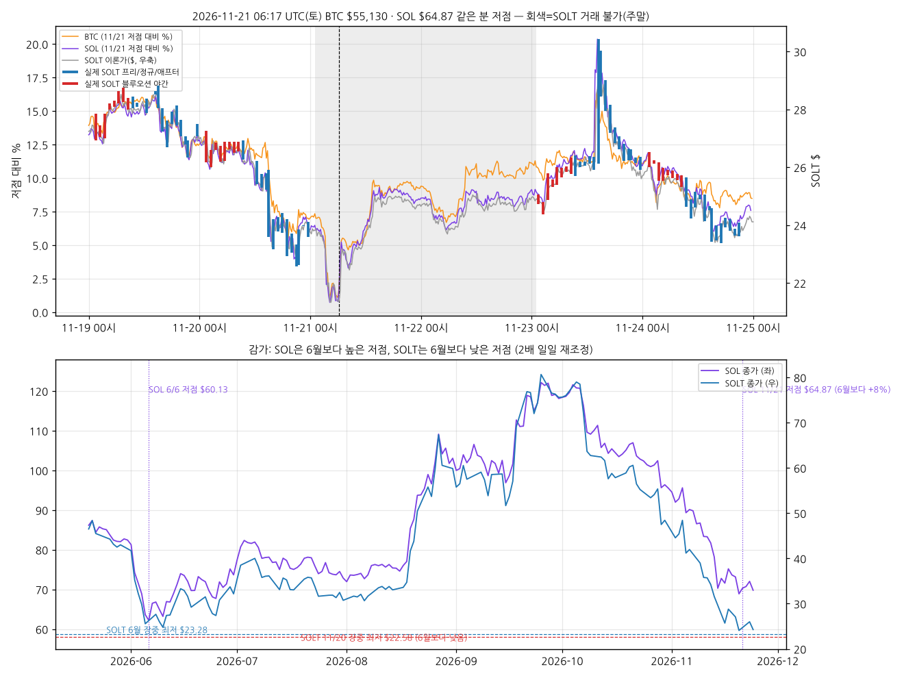

# "BTC 저점 = SOLT 저점이 절대 아니다"는 주장 검증

**작성 2026-11-24 · 자료: 바이낸스 BTC·SOL 1분봉 ~11/24 23:45 UTC, SOLT 실제 시간봉(프리/정규/애프터 + 블루오션 야간) ~11/24, 가상 SOLT 2020~2026**

> 연구 결과이며 투자 권유가 아닙니다. 2배 레버리지 상품은 원금 대부분을 잃을 수 있습니다.

---

## 0. 결론

### 0-1. 다른 AI의 주장: "일반론으로는 맞고, '절대'는 틀립니다"

| 질문 | 답 | 근거 |
|---|---|---|
| BTC 저점마다 SOLT도 그 순간 최저인가? | **대부분 아니다** | BTC 저점 50건 중 SOLT의 (전 30일 ~ 후 90일) 최저가 BTC 저점 당일에 온 경우는 **20%**(약세장 18%). BTC 저점에 사면 90일 안에 SOLT가 더 싸게 거래된 경우가 **70%**(약세장 88%) |
| BTC 저점이 **진짜 바닥(90일간 안 깨짐)**이었다면? | **대체로 같았다** | 20건 중 **65%는 SOLT가 그 뒤 더 낮아지지 않음**. 추가 하락 중앙 **−0.1%**, 하위 25%도 −4.7% |
| BTC 저점이 **가짜 바닥**이었다면? | **완전히 달랐다** | 28건 중 93%에서 SOLT가 더 낮아짐. 추가 하락 중앙 **−74%** |

**정리**
- 다른 AI의 말은 "모든 BTC 저점"에 대해서는 맞습니다. BTC 저점 대부분이 결국 깨지는 가짜 바닥이고, 그때 SOLT는 2배로 더 무너지기 때문입니다.
- 그러나 **"진짜 BTC 바닥에서 산다"는 주인님 계획의 전제**에서는, SOLT 바닥도 대개 같은 자리였습니다.
- 그래서 **"절대"는 과장**입니다. 다만 진짜 바닥이어도 SOLT 바닥이 어긋나는 원인 세 가지가 실제로 있습니다(0-2).

### 0-2. 진짜 바닥이어도 SOLT 바닥이 어긋나는 세 가지 원인

| 원인 | 크기 | 대표 사례 |
|---|---|---|
| **① SOL 고유 사정** | 드물지만 치명적 | 2022-11-21 BTC 사이클 바닥 → SOL은 38일 뒤 −30%(FTX 여파). SOLT는 **−58%** 더 빠짐 |
| **② 2배 일일 재조정 감가** | 작지만 꾸준함 | SOL이 2~4주 뒤 같은 가격으로 돌아오면 SOLT는 중앙 **−6%**(25건). 6월→11월 실사례는 아래 |
| **③ 주말·시간외** | 크고 잦음 | BTC 저점 10건이 주말이었고, 첫 거래 시점 SOLT는 저점 순간 이론가보다 중앙 **+23%** 위(2021-05 청산급 이상치 1건 제외. SOLT 상장 후 SOL 저점 기준으로는 +10%) |

**② 감가의 실사례 (지금 진행 중)**
- SOL: 6/6 저점 $60.13 → 11/21 저점 **$64.87** (8% **높은** 저점)
- SOLT: 6월 장중 최저 $23.28 → 11/20 장중 최저 **$22.58** (3% **낮은** 저점, SOLT 상장 후 최저)

### 0-3. 이번 11/21 사례: 세 원인 중 ③이 그대로 나타났습니다

| 시점 | 내용 |
|---|---|
| **11/21(토) 06:17 UTC** | BTC **$55,130**, SOL **$64.87** — 같은 분 저점 (BTC는 7월 저점 $57.7k 이탈) |
| 그 순간 SOLT 이론가 | **$20.97** (11/20 종가 $22.76, 그 시각 SOL $67.52 기준) |
| 그때 SOLT | **거래 불가**(주말) |
| 첫 거래 가능 시점 | 일요일 20:00 ET(월 10:00 KST) 블루오션 시가 **$25.01** — 이론 저점보다 **+19%** |
| 그 뒤 | 월요일 SOL이 $76까지 튀며 SOLT $30.43 → 화요일 장중 $23.37 → 현재 **$24.27** (SOL $69.79, BTC $59,806) |

### 0-4. 계획을 바꿔야 하나: "버리지 말고, 보완하라"

BTC 저점 48건에서 다섯 가지 계획을 비교했습니다(§3).

| 계획 | 진짜 바닥 (20건): 1.5배 도달 / 걸린 날 | 가짜 바닥 (28건): 1년 뒤 가치 | 최대손실 하위 25% (전체 48건) |
|---|---|---|---|
| **P0 원안: BTC 저점에 SOLT 100%** | **100% / 3.5일** | 0.36배 | −85% |
| P1 SOLT 절반 + SOL 추세 확인 후 절반 | 95% / 13일 | 0.40배 | −85% |
| P2 SOL 현물 → 확인 후 SOLT 전환 | 95% / 20일 | 0.37배 | −85% |
| P3 SOLT 3분할 (0·14·28일) | 100% / 29일 | 0.32배 | −84% |
| **P4 SOLT 절반 + SOL 현물 절반** | 95% / 8일 | **1.01배** | **−63%** |

- **"확인 후 매수"나 "분할 매수"로 바꾸는 것은 데이터상 손해**였습니다. 진짜 바닥의 수익은 줄이고, 가짜 바닥 방어 효과는 거의 없었습니다.
- **유일하게 의미 있는 보완은 "SOLT + SOL 현물 혼합"(P4)**이었습니다. 진짜 바닥에서의 성과는 거의 그대로이고, 가짜 바닥·SOL 고유 악재·감가의 피해는 크게 줄었습니다.

---

## 1. 측정 방법

**대상:** 2020-09 ~ 2026-11 BTC 스윙 저점 50건
- 시간봉 기준 15% 이상 하락 후 15% 이상 반등한 저점
- 별도 추가: 2022-11-21, 2022-12-30, 2026-11-15, 2026-11-21

**측정 항목 (저점마다)**
- **매수가:** BTC 저점 분의 SOLT 이론가. 저점이 주말이면 일요일 20:00 ET 재개장 가격
- **그 뒤 90일 SOLT 최저:** 거래 가능 시간만, 가상 SOLT 시간봉 기준
- **원인 분류:** SOLT 최저 시점의 SOL이 매수 시점 SOL보다 낮으면 "SOL 신저가". 높은데도 SOLT가 낮으면 다음 둘 중 하나
  - **하루 급락 2배 증폭:** 그 재조정 구간 SOL 하락폭이 30% 이상인 경우
  - **감가:** 그 밖의 경우
- **BTC 저점 유지 여부:** 그 뒤 90일 동안 BTC가 그 저점을 깨지 않았는지

**가상 SOLT 정확도:** 실제 SOLT 대비 경로 오차 5.9%, 상장 후 전체 0.122배 대 0.121배(`scripts/synth_solt.py`).

---

## 2. 결과

### 2-1. 전체 (`scripts/k_btc_vs_solt.py`, `output/k_btc_vs_solt.txt`)

| | 전체 (50) | 약세장 (17) | 투매형 (34) | 조용한형 (16) |
|---|---|---|---|---|
| SOLT 최저(전 30~후 90일)가 BTC 저점 **당일** | **20%** | 18% | 18% | 25% |
| 이전 / 이후 | 36% / 44% | 18% / 65% | 35% / 47% | 38% / 38% |
| 매수 뒤 90일 안에 SOLT가 더 싸게 거래 | **70%** | 88% | 76% | 56% |
| 추가 하락 중앙: SOLT / SOL | −36% / −3% | −58% / −30% | −36% / −5% | −28% / −2% |

### 2-2. BTC 저점이 지켜졌나 (`scripts/k2_refine.py`)

| | 지켜짐 (20) | 깨짐 (28) |
|---|---|---|
| SOLT가 더 낮아지지 않음 | **65%** | 7% |
| SOL 신저가 때문 | 20% | 71% |
| 감가 때문 (SOL은 더 높음) | 15% | 7% |
| 하루 급락 2배 증폭 | 0% | 14% |
| SOLT 추가 하락 중앙 (하위 25%) | **−0.1% (−4.7%)** | **−74% (−91%)** |

**지켜진 바닥에서 SOLT가 더 빠진 7건**

| BTC 저점 | 원인 | SOLT 추가 하락 |
|---|---|---|
| 2020-11-26 | SOL 고유 급락 | −68% |
| 2022-11-21 | FTX 여파, SOL 38일 뒤 바닥 | −58% |
| 2022-06-18 | 토요일 저점 → 일요일 밤 +56% 위에서 매수 → 되밀림 | −39% |
| 2022-01-24 | SOL 신저가 | −9% |
| 2021-01-04 | 감가 | −7% |
| 2023-06-15 | SOL 신저가 | −4% |
| 2026-07-01 | 감가 (SOL은 6월 저점 위) | −4% |

### 2-3. 감가의 크기

- SOL이 BTC 저점 당시 가격(±2%)으로 **10일 이후 처음 돌아왔을 때** SOLT는 중앙 **−5.9%**였습니다(25건, 경과 중앙 17일).
- 이론적으로는 SOL 변동성 연 70~90%에서 횡보 1개월당 약 4~7%가 깎입니다.
- 의미: **SOL이 "같은 가격의 쌍바닥"을 만들면, SOLT는 두 번째 바닥이 더 낮습니다.** 6월 → 11월 실사례(0-2)가 바로 이 경우입니다.

### 2-4. SOL 상대강도 다이버전스 (참고, 표본 작음; `scripts/k3_divergence.py`)

| 경우 | 건수 | SOLT 추가 하락 중앙 |
|---|---|---|
| BTC가 120일 신저가인데 SOL은 이전 저점보다 3% 이상 위 | 4 | −18% |
| SOL도 같이 신저가 | 9 | −39% |

이번 11/21은 6월 저점 기준으로는 SOL이 버텼습니다(+8%). 하지만 최근 120일 저점(11/15 $67.41) 기준으로는 SOL도 신저가(−4%)라 판단이 애매합니다.

### 2-5. 2022년: 유일한 "SOL 사이클 바닥"의 교훈

- BTC 사이클 바닥은 2022-11-21이었습니다. SOL은 12/29에 30% 더 낮게 바닥을 찍었고, SOLT형 상품은 **58%** 더 빠졌습니다.
- 원인은 SOL 고유 악재(FTX가 SOL 생태계의 최대 후원자였음)였고, 바닥 무렵 SOL은 BTC보다 뚜렷하게 약했습니다.
- **다른 AI의 주장이 가장 크게 들어맞은 사례**입니다. 같은 일이 반복되려면 SOL에 비슷한 고유 악재가 있어야 합니다.

---

## 3. 계획 대안 비교 (`scripts/l_plans.py`, `output/l_plans.txt`)

### 3-1. 대안 정의

- **공통:** BTC 저점의 "체결 가능 시점"(주말이면 일요일 20:00 ET)에 매수하고, 투입 원금 대비 1.5배·2배 도달 여부와 손실을 봅니다. 미투입분은 현금입니다.
- **추세 확인:** SOL이 25거래일 평균 위에서 2일 연속 마감하는 것
- **대안 구성**

| 대안 | 구성 |
|---|---|
| P0 | SOLT 100% |
| P1 | SOLT 50% + 추세 확인 시 SOLT 50% |
| P2 | SOL 현물 100% → 추세 확인 시 전부 SOLT로 전환 |
| P3 | SOLT를 0·14·28일에 1/3씩 |
| P4 | SOLT 50% + SOL 현물 50% |

### 3-2. 결과

| 계획 | 지켜진 바닥 (20): 1.5배 / 2배 / 1.5배까지 | 최대손실 하위 25% | 깨진 바닥 (28): 1.5배 / 1년 뒤 | 최대손실 하위 25% | 약세장 (15): 1.5배 / 2배 / 1년 뒤 |
|---|---|---|---|---|---|
| **P0** | **100% / 95% / 3.5일** | −61% | 86% / 0.36배 | −90% | 80% / 53% / 0.10배 |
| P1 | 95% / 90% / 13일 | −72% | 79% / 0.40배 | −86% | 60% / 47% / 0.14배 |
| P2 | 95% / 90% / 20일 | −75% | 79% / 0.37배 | −89% | 60% / 47% / 0.13배 |
| P3 | 100% / 90% / 29일 | −74% | 75% / 0.32배 | −88% | 60% / 47% / 0.08배 |
| **P4** | 95% / 95% / 8일 | **−39%** | 82% / **1.01배** | **−73%** | 67% / 53% / **0.51배** |
| 참고: SOL 현물 100% | 95% / 80% / 29일 | −23% | 79% / 1.38배 | −56% | 53% / 20% / 0.73배 |

**읽는 법**
- **목표가에 반드시 파는 주인님 방식이라면 1.5배·2배 도달률이 핵심**입니다. P0가 가장 높고 가장 빠릅니다(가짜 바닥 포함 전체 1.5배 92%, 2배 83%).
- **위험은 목표에 못 닿은 나머지 사례**입니다. 2배 상품을 그대로 들고 있으면 1년 뒤 0.1~0.4배가 됩니다. P4는 이를 0.5~1.0배로 막았습니다.
- **추세 확인(P1·P2)과 시간 분할(P3)은 늦게 사는 만큼 반등 초입을 놓쳤습니다.** 가짜 바닥에서는 확인 신호도 가짜로 켜져 방어가 되지 않았습니다.

---

## 4. 실행 계획 보완안

| 원안 | 보완 | 근거 |
|---|---|---|
| BTC 바닥에서 SOLT 매수 | **유지.** BTC 바닥 판정이 맞으면 SOLT 바닥도 대개 같은 자리(65%, 중앙 −0.1%) | §2-2 |
| SOLT 100% | **SOLT + SOL 현물 혼합**(예: 절반씩). 가짜 바닥·SOL 고유 악재·감가 피해를 줄임 | §3 |
| 분 단위 정밀 매수 | 평일이면 그대로. **주말 저점이면** 일요일 밤 재개장가가 이론가보다 크게 높을 때(예: +10% 이상) 추격하지 않습니다. 대신 SOL 목표가에 해당하는 SOLT 지정가를 걸어 둡니다 | §0-3, 이전 보고서 §3-5 |
| 고정 배수 매도 | **유지.** 바닥 미확정 단계의 SOLT 몫은 1.3~1.5배에서 빨리 익절합니다(감가·추가 하락 위험이 시간에 비례) | §2-3, 이전 보고서 §4-5 |
| (없음) | **SOL 고유 위험 점검:** BTC 바닥 무렵 SOL만 유독 약하면(SOL/BTC 신저가, 생태계 악재) SOLT 몫을 줄이고 SOL 자체 투매를 기다립니다(2022 교훈) | §2-5 |
| (없음) | **같은 가격의 쌍바닥은 SOLT로는 더 낮습니다.** 두 번째 바닥에서는 SOLT 지정가를 이론가 기준으로 다시 계산합니다 | §2-3 |

### 지금(11/24) 이 틀로 본 상황

- **BTC:** 7월 저점을 깨고 **$55,130(11/21, 토)**을 찍었습니다. BTC 바닥 연구의 하단 구간($50~55.5k) 위쪽 끝입니다. **바닥인지는 아직 모릅니다.** 이 저점이 깨지지 않는지가 핵심 변수입니다.
- **SOL:** 같은 분에 $64.87로 저점을 찍었습니다. 6월 저점보다 8% 높아, SOL 고유 약세 신호는 2022년보다 약합니다.
- **SOLT:** 저점 순간 이론가는 $20.97이었지만 주말이라 살 수 없었습니다. 현재 $24.27로 그보다 16% 위, 금요일 실제 최저 $22.58보다 7% 위입니다.
- **원안대로라면** 이번 저점이 바닥일 경우 지금 가격대가 "체결 가능한 바닥 근처"입니다. **바닥이 아니라면** 과거 깨진 바닥의 SOLT 추가 하락은 중앙 −74%였습니다. 그래서 혼합(P4)과 지정가 사다리가 이 불확실성에 대한 데이터상 최선입니다.

---

## 5. 한계

1. "지켜진 바닥" 20건 중 약세장은 6건뿐이고, SOL이 겪은 진짜 사이클 바닥은 2022년 하나입니다.
2. 90일 유지 여부로 "진짜 바닥"을 나눈 것은 사후 분류입니다. 실시간에는 BTC 바닥 연구의 판정에 의존해야 합니다.
3. 가상 SOLT는 SOL 현물로 만들었습니다. 실제 SOLT는 CME 선물 기반이고, 시간외·야간 호가가 급락을 바로 따라가지 못하는 경우가 있습니다(이전 보고서 §3-4).
4. 다른 AI의 구체적인 논거는 보지 못했습니다. 원문을 주시면 항목별로 대조하겠습니다.

## 6. 재현

```
cd research/solt_bottom_precision
python3 scripts/update_1m.py SOLUSDT BTCUSDT ETHUSDT    # 1분봉 최신화
python3 scripts/fetch_yahoo_intraday.py; python3 scripts/tv_fetch.py
python3 scripts/synth_solt.py
python3 scripts/k_btc_vs_solt.py     # §2-1
python3 scripts/k2_refine.py         # §2-2, §2-3
python3 scripts/k3_divergence.py     # §2-4
python3 scripts/l_plans.py           # §3
python3 scripts/n_chart_now.py       # 차트
```


