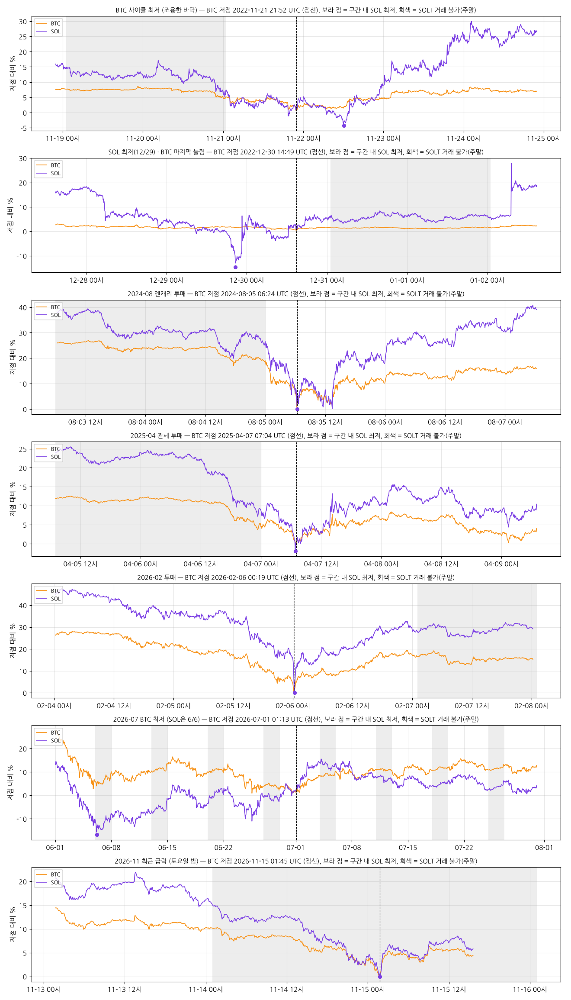
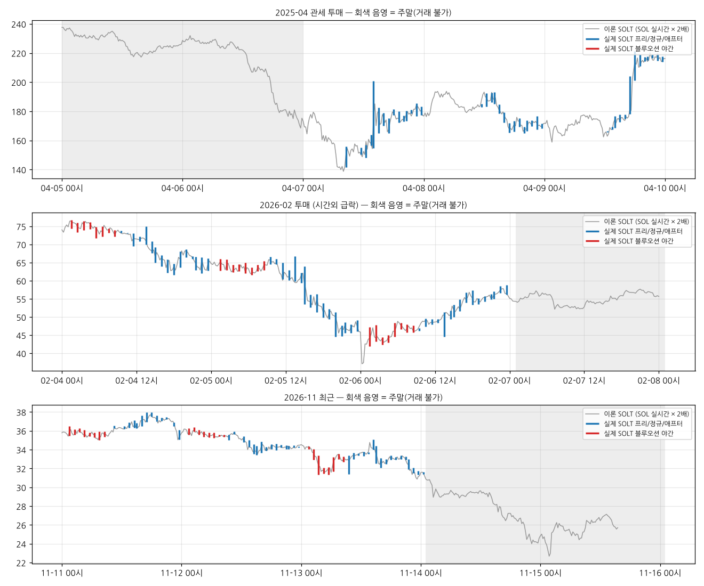

# SOLT 저점 정밀 매수 검증: BTC 저점 → SOL 저점 → SOLT 매수

**작성 2026-11-15 · 분 단위·실거래 시간 기준 검증 · 유튜브 '매매법아카이브' 매매법 검증 포함**

- **목적:** 주인님 전략은 "BTC 바닥 연구로 시기를 잡고 → 그 순간의 SOL 바닥에 → SOLT를 정밀하게 사서 → 정해 둔 배수에 판다"입니다. 이 고리의 각 연결이 실제 데이터에서 성립하는지 확인합니다.
- **데이터 원천:** 이번에는 거래소 원시 1분봉과 트레이딩뷰 데이터를 직접 받아 썼습니다. 트레이딩뷰는 차트 서버 데이터를 받고 헤드리스 크롬으로 화면도 캡처했습니다.

> 연구 결과이며 투자 권유가 아닙니다. 2배 레버리지 상품은 원금 대부분을 잃을 수 있습니다.

---

## 0. 결론

### ① BTC 저점 → SOL 저점: "같은 급락"이면 분 단위로 일치하지만, "그 국면의 바닥"인지는 반반입니다

| 항목 | 결과 |
|---|---|
| 분석 대상 | 2020~2026 BTC 스윙 저점 48개 (1분봉) |
| SOL 저점이 BTC 저점 **±30분 안** | **58%** (투매형 64%) |
| ±2시간 안 / ±24시간 안 | 69% / 88% |
| 시차 중앙값 | **SOL이 6분 먼저** |
| BTC 저점 순간의 SOL 가격 | 그 주변 최저보다 중앙 **+0.6%** |
| **이후 90일 안에 SOL이 더 낮은 저점** | **50%** (추가 하락 중앙 −33%) |

- 사이클 바닥은 유형에 따라 달랐습니다.
  - **조용한 사이클 바닥(2022-11-21):** SOL은 38일 뒤에 43% 더 낮은 곳($8.00, 12/29)에서 자체 투매로 바닥을 찍었습니다.
  - **SOL이 먼저 바닥을 찍은 경우(2026-07-01 BTC 최저):** SOL 최저는 25일 앞선 6/6이었습니다.
- **이전 세션의 "BTC 저점 = SOL 저점" 주장:** "같은 급락의 바닥 순간"이라는 뜻이라면 맞습니다. "BTC 사이클 바닥일 = SOL 사이클 바닥일"이라는 뜻이라면 조건부입니다. 이전 세션 보고서 본문도 같은 단서를 달고 있습니다.

### ② SOL 저점 → SOLT 매수: 평일에는 거의 이론가에 살 수 있고, 주말에는 불가능합니다

- **SOLT는 평일 24시간 거래됩니다.** 정규장·프리·애프터에 더해 **블루오션 야간(트레이딩뷰 `BOATS:SOLT`, 상장 직후부터)**이 있습니다. 공백은 **금요일 20:00 ET ~ 일요일 20:00 ET**(한국 시간 토요일 10:00 ~ 월요일 10:00)뿐입니다.
- **이론가 추종:** SOLT 실제가는 어느 시간대에서나 이론가(직전 정규장 종가 × (1 + 2 × SOL 등락률))를 잘 따라갔습니다. 시간봉 기준 괴리 중앙값은 0% 근처, 80% 범위는 ±0.5~1.1%입니다.
- **SOL 저점의 약 80%가 SOLT 거래 시간**이었습니다. 이때 그 시간봉 안의 SOLT 최저가는 이론 저점 대비 중앙 **+0.5%**였습니다.
- **나머지 약 20%는 주말**이었습니다. 이때 첫 거래 가능 시점(일요일 밤)의 SOLT는 이미 **+10%** 위였습니다.
- **투매형 BTC 저점의 88%가 SOLT 거래 시간**이었습니다. 주로 **프리마켓·블루오션 야간(한국 시간 낮~밤)**이었고, 요일은 **월요일**이 가장 많았습니다.
- **예외:** 시간외에 몇 분만에 지나간 순간 꼬리는 SOLT로 잡을 수 없었습니다. 2026-02-05 19:19 ET에 이론가는 $32.8까지 내려갔지만 실제 SOLT는 $42가 최저였습니다.
- **지정가 체결:** SOL이 직전 종가 대비 −6%에 닿을 때, 그 가격에 해당하는 SOLT 지정가는 같은 시간 안에 **정규장 92%, 야간 93%, 프리 80%** 체결됐습니다.

### ③ 정밀 매수가 결과를 가릅니다. 그러나 실시간으로 정밀하게 사는 방법은 데이터상 없었습니다

| 매수 방식 | 결과 |
|---|---|
| **사후에 안 정확한 저점 분**에 매수 | 1년 안 1.5배 98%, 2배 90%, 3배 75% 달성. 1.5배까지 중앙 3일 |
| 실시간 **투매 감지 즉시** 매수 (약세장) | 1.5배 40%, 2배 10%. 그 전에 중앙 −72% |
| 실시간 **반등 확인 + 저점 손절** | 약세장에서 목표 1.3~1.5배면 손익분기(0.99~1.12배), 2배면 손실(0.77~0.87배). 진짜 바닥 근처에서는 손절이 반복돼 **오히려 최악**(0.49~0.81배) |
| 유튜브 매매법 5종 | 매수가가 SOL 바닥보다 **+31~41%** 위. 거래당 0.96~1.06배, 약세장에서 모두 손실 |

### ④ 진짜 바닥 시기만 맞히면, 정밀하지 않아도 대부분을 먹습니다

진짜 바닥 창(바닥일 ±30일 안에 들어왔다고 가정)에서 2배 목표 기준으로 비교했습니다.

| 매수 방식 | BTC·ETH·SOL (7건) | 알트 (23건) |
|---|---|---|
| BTC 바닥 그 분 (정밀) | 기하평균 **2.32배** (100% 달성) | 2.07배 |
| **시간 분산 4회** (D−30·−10·+10·+30일) | **1.88배** (최악 1.56배) | 1.21배 |

- 다만 **가짜 바닥이면** 시간 분산이든 손절 없는 보유든 0.2~0.4배로 무너졌습니다(BTC·ETH·SOL).
- **결국 승부는 "거시 바닥 판정"에서 납니다.** 주인님이 진행 중인 BTC 바닥 연구가 이 전략의 핵심 변수입니다.

### ⑤ 고정 배수 매도: 약세장에서는 낮게, 바닥 확정 뒤에는 높게

정밀 매수 기준(체결 가능 시점)입니다.

| 국면 | 1.3배 | 1.5배 | 2배 | 3배 | 5배 |
|---|---|---|---|---|---|
| **약세장** — 기하평균 (손실 비율) | **1.30 (0%)** | 0.81 (13%) | 0.47 (33%) | 0.30 (53%) | 0.09 (73%) |
| **강세장·조정** — 기하평균 | 1.30 | 1.50 | 1.89 | 2.40 | **2.51** |

### ⑥ 첫 보고서 정정

SOLT 환산 기준 SOL 가격은 미국 정규장 마감(16:00 ET) 시각의 값이어야 합니다. 첫 보고서는 이를 잘못 잡아, 바닥 시나리오별 SOLT 추정치가 약 5% 높게 나왔습니다. 중심 시나리오는 $14 → **약 $13.3**입니다. 첫 보고서에 정정 문구를 넣었습니다.

### ⑦ 현재 (2026-11-15 15:36 UTC)

- **지금 상태:** SOL $71.33 → SOLT 이론가 **$25.82**입니다(금요일 종가 $32.98, 그때 SOL $80.01 기준).
- **이번 주말 급락:** 저점은 **토요일 밤**(BTC $62,006 / SOL $67.41, 같은 분)이었고, SOLT로는 살 수 없는 시간이었습니다. 그 순간 이론가는 $22.59였습니다.

---

## 1. 자료와 방법

| 자료 | 범위 | 출처 |
|---|---|---|
| BTC·ETH 1분봉 | 2017-08 ~ 2026-11-15 (각 485만 행) | 바이낸스 공개 데이터 (data.binance.vision + API) |
| SOL 1분봉 | 2020-08 ~ 2026-11-15 (329만 행) | 같음 |
| 알트 12종 1분봉 | 2018-10 ~ 2023-12 (BNB·LTC·ADA·XRP·TRX·XLM·ETC·LINK·DOGE·AVAX·DOT·MATIC) | 같음 |
| SOLT 시간봉 (프리·정규·애프터) | 2025-03-20 ~ 2026-11-13 (6,773개) | 야후 |
| **SOLT 야간 시간봉** | 2025-03-21 ~ 2026-11-13 (3,095개) + 5분봉 | **트레이딩뷰 `BOATS:SOLT`** (차트 데이터 서버) |
| SOLT 5분·1분봉 | 최근 60일·7일 | 야후, 트레이딩뷰 `NASDAQ:SOLT` 시간외 포함 |
| 교차 확인 | SOL-USD 1분봉 | 코인베이스 |

**가상 SOLT 검증:** SOL 1분봉으로 미국 정규장 마감(16:00 ET)마다 2배를 재조정하고 연 20% 비용을 뺐습니다.

| 구간 | 실제 SOLT | 가상 SOLT |
|---|---|---|
| 상장 후 전체 | 0.121배 | 0.122배 |
| 2025-04 → 09 상승기 | 4.07배 | 4.26배 |
| 2026-06 → 10 | 2.56배 | 2.44배 |

경로 오차는 5.9%였습니다(`scripts/synth_solt.py`).

**트레이딩뷰 직접 분석**
- 헤드리스 크롬으로 트레이딩뷰 차트를 열어 핵심 바닥 날짜로 이동해 캡처했습니다(`charts/tv_*.png`).
- 비로그인 상태에서는 봉 5,000개까지만 볼 수 있어, 2022년은 일봉으로 캡처했습니다.

---

## 2. 고리 ① — BTC 저점에서 SOL 저점까지 (분 단위)

### 2-1. BTC 스윙 저점 48개 (`scripts/a_bottom_sync.py`)

시간봉 기준 15% 이상 하락 후 15% 이상 반등한 저점을 1분봉으로 정밀화했습니다.

| | 전체 (48) | 투매형 (33) | 조용한형 (15) |
|---|---|---|---|
| SOL 저점 ±30분 안 | 58% | 64% | 47% |
| ±2시간 / ±24시간 | 69% / 88% | 76% / 91% | 53% / 80% |
| 시차 중앙 (음수 = SOL 먼저) | −6분 | −1분 | −7분 |
| BTC 저점 순간 SOL의 최저 대비 위치 | +0.6% | +0.7% | +0.6% |
| SOL 낙폭 배율 (로그) | 1.59 | 1.61 | 1.49 |
| 24시간 반등 SOL / BTC | +20% / +11% | +25% / +15% | +12% / +7% |
| **90일 안 SOL 신저가** | **50%** (−33%) | 52% | 47% |

투매형은 BTC 저점 직전 24시간 −8% 이상 하락이거나 저점 시간 거래량이 7일 중앙값의 4배 이상인 경우입니다.

### 2-2. 핵심 바닥 13곳 (`output/a2_key_bottoms.txt`)

| 바닥 | BTC 저점 (UTC) | SOLT 시간대 | SOL 시차 | 국면 최저 SOL | 국면 최저까지 | BTC 저점 순간 SOL은 국면 최저보다 |
|---|---|---|---|---|---|---|
| 2022-06-18 투매 (가짜 바닥) | 06-18 20:34 | **주말** | −22분 | $25.86 (06-14) | −4.8일 | +6% |
| 2022-11-09 FTX | 11-09 23:07 | 애프터 | −97분 | $8.00 (12-29) | +49.9일 | +69% |
| **2022-11-21 BTC 사이클 최저** | 11-21 21:52 | 애프터 | −138분 | **$8.00 (12-29)** | **+37.9일** | **+43%** |
| 2022-12-30 BTC 마지막 눌림 | 12-30 14:49 | 정규 | −297분 | $8.00 (12-29) | −0.8일 | +17% |
| 2024-08-05 엔캐리 투매 | 08-05 06:24 | 야간 | **0분** | 같은 분 | 0일 | 0% |
| 2025-04-07 관세 투매 | 04-07 07:04 | 야간 | −10분 | 같은 시각 | 0일 | +2% |
| 2026-02-06 투매 | 02-06 00:19 | 애프터 | **0분** | 같은 분 | 0일 | 0% |
| 2026-07-01 BTC 최저 (현재까지) | 07-01 01:13 | 야간 | 0분 | $60.13 (06-06, **주말**) | −24.8일 | +20% |
| 2026-11-15 최근 급락 | 11-15 01:45 | **주말** | 0분 | 같은 분 | 0일 | 0% |

**세 가지 유형**

| 유형 | 사례 | 특징 |
|---|---|---|
| **투매형 동시 바닥** | 2024-08, 2025-04, 2026-02 | BTC와 SOL이 같은 분에 바닥. 그 국면의 최저점 |
| **조용한 BTC 바닥** | 2022-11-21 | SOL은 몇 주 뒤 **자체 투매**로 더 낮게 바닥(12/28~29, 이틀간 거래량 5배) |
| **SOL 선행** | 2026-06-06 → BTC 2026-07-01 | SOL이 먼저 바닥, BTC는 몇 주 뒤 조용히 더 낮게 |



트레이딩뷰 캡처 (화면 하단 시간축은 UTC):
- `charts/tv_SOL_30m_2026-02-06.png`, `charts/tv_BTC_30m_2026-02-06.png`: 같은 시각 긴 아래꼬리
- `charts/tv_BTC_1D_2022-11-21.png`, `charts/tv_SOL_1D_2022-12-29.png`: 2022년 BTC와 SOL의 바닥 시차
- `charts/tv_SOL_1h_2026-06-06.png`: 주말 SOL 저점

### 2-3. 이전 세션 주장 검증

이전 세션 보고서(`research/sol_bottom_and_ignition_2026-11-15.md`, 브랜치 `ccr-d4b3886b-gvci67`)의 내용과 이번 분석을 대조했습니다.

| 이전 세션 주장 | 이번 분석 |
|---|---|
| 30분봉 급락 17번 중 13번이 2시간 이내 | **재현됨.** 투매형 76%가 2시간 이내 |
| "사이클 최저점 사이에는 고정 간격이 없다" (2022: 38일 늦음, 2026: 25일 빠름) | **재현됨** |
| BTC 주요 저점 22번 중 그날이 SOL 최저였던 것은 8번 | 비슷함. 90일 안 SOL 신저가 50% |
| "저점 당일 매수가 1위" | **사후 기준으로는 같은 결론.** 다만 각 자산의 진짜 저점을 사후에 골라 계산한 값입니다. 가짜 바닥과 매수 시점 오차를 넣으면 달라집니다(§4) |

---

## 3. 고리 ② — SOL 저점에서 SOLT 매수까지 (실거래 시간)

### 3-1. SOLT 거래 시간

| 세션 | 미국 동부 (ET) | 한국 시간 (겨울) | 자료 |
|---|---|---|---|
| 블루오션 야간 (`BOATS:SOLT`) | 일~목 20:00 – 04:00 | 월~금 10:00 – 18:00 | 트레이딩뷰 |
| 프리마켓 | 04:00 – 09:30 | 18:00 – 23:30 | 야후 |
| 정규장 | 09:30 – 16:00 | 23:30 – 06:00 | 야후 |
| 애프터마켓 | 16:00 – 20:00 | 06:00 – 10:00 | 야후 |
| **거래 불가** | 금 20:00 – 일 20:00 | **토 10:00 – 월 10:00** | |

- 블루오션 야간 SOLT는 **매시간 거래가 있었고**(거래 없는 봉 0%), 최근 60일 일평균 거래대금은 약 **$137만**입니다.
- 야간 마지막 봉과 프리마켓 첫 봉의 가격 괴리는 중앙 0%, 90% 범위 ±1.8%였습니다.
- **토스증권 데이마켓(한국 시간 낮)에서 SOLT를 거래할 수 있는지는 확인하지 못했습니다.** 앱에서 꼭 확인하십시오.

### 3-2. SOLT 실제가 / 이론가 − 1 (시간봉 종가, `scripts/b_solt_exec.py`)

| 세션 | 중앙 | 10% 분위 | 90% 분위 |
|---|---|---|---|
| 정규 | −0.07% | −0.59% | +0.32% |
| 프리 | −0.06% | −1.10% | +0.93% |
| 애프터 | +0.05% | −0.53% | +0.75% |
| 블루오션 야간 | +0.01% | −0.45% | +0.49% |

### 3-3. SOL 저점 순간에 SOLT를 얼마에 살 수 있었나 (SOLT 상장 후, SOL 10% 스윙 저점 42개)

| SOL 저점 시각 | 건수 | 첫 거래 가능 봉 저가 (이론 저점 대비) | 그 봉 시가 | 24시간 안 최저 |
|---|---|---|---|---|
| 거래 시간 중 | 31 | **+0.5%** | +4.2% | +0.4% |
| 주말 | 11 | **+9.8%** | +10.4% | +6.0% |

2020년 이후 전체 SOL 스윙 저점(15% 기준 220개)의 시간대 분포는 다음과 같습니다.

| 야간 | 프리 | 정규 | 애프터 | **주말** |
|---|---|---|---|---|
| 24% | 23% | 21% | 13% | **19%** |

### 3-4. 이론가에 살 수 없었던 두 사례

| 날짜 | 무슨 일이 있었나 |
|---|---|
| **2025-10-10** | 바이낸스에만 있던 순간 꼬리였습니다. 코인베이스 SOL 저점 $176.85, 바이낸스 $168.79 |
| **2026-02-05 19:19 ET** (애프터) | 코인베이스·바이낸스 저점이 같았습니다($67.48 / $67.50). 그런데 SOLT 이론가 $32.8에 실제 최저 $42였습니다(+28%). 몇 분짜리 시간외 꼬리를 SOLT 호가가 따라가지 않았습니다 |



### 3-5. 지정가 사다리 체결률 (`scripts/g_limit_fill.py`)

SOL이 직전 정규장 종가 대비 −x%에 처음 닿은 시간봉에서, 그 SOL 가격에 해당하는 SOLT 이론가 지정가가 같은 봉 안에 체결됐는지 봤습니다.

| SOL 하락폭 | 정규 | 블루오션 야간 | 프리 | 애프터 |
|---|---|---|---|---|
| −6% | **92%** (37) | **93%** (30) | 80% (10) | 1/1 |
| −10% | 4/4 | 3/6 | 2/2 | 1/2 |
| −15% | 1/1 | **0/2** | 1/1 | **0/1** |

깊고 빠른 시간외 급락에서는 지정가가 체결되지 않을 수 있습니다. 다만 표본이 작습니다.

### 3-6. 투매형 BTC 저점의 시간대 (`output/j_capitulation_sessions.txt`)

- **투매형 33개:** 프리 11, 블루오션 야간 9, 정규 5, 애프터 4, 주말 4 → **88%가 SOLT 거래 가능 시간**
- 요일은 월요일 8개로 가장 많았습니다. 주말에 흘러내리다가 **월요일 아시아 개장 시간에 투매가 끝나는 패턴**이 반복됐습니다. 블루오션 야간이 바로 이 시간대를 덮습니다.

---

## 4. 고리 ③ — "정밀 저점 매수 + 고정 배수 매도"의 실제 성과

### 4-1. 사후에 안 정확한 저점에 샀다면 (BTC 저점 이벤트 48~50개, 가상 SOLT, `scripts/c_target_exits.py`)

| 매수 시점 | 1.5배 (1년 안) | 2배 | 3배 | 5배 | 1.5배까지 중앙 | 2배 전 최대 낙폭 (중앙) |
|---|---|---|---|---|---|---|
| BTC 저점 그 분 | 98% | 90% | 75% | 56% | 3.0일 | −5% |
| 체결 가능 시점 (주말이면 일요일 밤) | 96% | 88% | 76% | 57% | 3.5일 | −8% |
| 확인 매수: SOL +5% 반등 뒤 | 90% | 82% | 68% | 54% | 4.3일 | **−28%** |
| 확인 매수: SOL +10% 반등 뒤 | 91% | 81% | 66% | 53% | 5.8일 | **−41%** |

- ⚠️ 이 이벤트들은 "그 뒤 BTC가 15% 이상 반등한 저점"을 **사후에 고른 것**이라 결과가 낙관적입니다. 실시간에는 이런 저점인지 알 수 없습니다.
- 매수 후 1년 안의 최저점은 중앙 **−93%**였습니다. **목표가에 도달하면 반드시 파는 것**이 전제입니다.

### 4-2. 실시간 투매 감지 즉시 매수 (사후 정보 없음, `scripts/c2_realtime.py`)

약세장 구간(2021-11~2023-01, 2025-10~)의 결과입니다.

| 신호 | 건수 | 매수가 (72시간 최저 대비) | 1.5배 | 2배 | 1.5배 전 낙폭 |
|---|---|---|---|---|---|
| BTC 24시간 −8% & 거래량 5배 | 10 | +23% | 40% | 10% | **−72%** |
| SOL 24시간 −15% & RSI(1h) < 20 | 5 | +16% | 80% | 20% | −54% |

### 4-3. 반등 확인 + 저점 손절 (`scripts/c3_confirm.py`)

규칙: 투매 감지 뒤 누적 최저 L을 추적하고, L × 1.05에 역지정가 매수를 겁니다. 손절은 L × 0.98, 재시도는 최대 3회입니다.

| 구간 | 1.3배 목표 | 1.5배 목표 | 2배 목표 |
|---|---|---|---|
| 전체 (32건, 강세장 조정 포함) | 기하 1.12 (최악 0.58) | 1.19 (0.58) | 1.22 (0.33) |
| 약세장 (10건) | 0.99 (0.71) | **1.04** (0.82) | 0.77 (0.33) |
| 약세장, SOL 과매도 신호 (5건) | 1.00 | 1.12 | 0.87 |

### 4-4. 거시 타이밍이 맞았다고 가정할 때 (바닥일 −30일 ~ +60일, `scripts/d_macro_window.py`)

- **진짜 바닥:** 2018-12, 2020-03, 2022-11
- **가짜 바닥:** 2018-02, 2018-06, 2019-12, 2022-06, 2022-11 FTX

2배 목표, 기하평균(최악) 기준입니다.

| 매수 방식 | 진짜: BTC·ETH·SOL (7) | 진짜: 알트 8종 (23) | 가짜: BTC·ETH·SOL (12) | 가짜: 알트 (24) |
|---|---|---|---|---|
| ① BTC 바닥 그 분 (사후) | **2.32 (1.99)** | 2.07 (0.60) | 1.07 (0.03) | 1.42 (0.17) |
| ③ 반등 확인 + 손절 | 0.70 (0.35) | 0.49 (0.32) | 0.64 (0.37) | 0.82 (0.42) |
| ④ 반등 확인, 손절 없이 목표까지 | 1.22 (0.13) | 0.69 (0.03) | **0.21 (0.00)** | 0.81 (0.22) |
| ⑤ 시간 분산 4회 | **1.88 (1.56)** | 1.21 (0.07) | 0.35 (0.00) | 1.11 (0.18) |

- 진짜 바닥이면 시간 분산만으로 정밀 매수 성과의 약 80%를 얻었습니다.
- 진짜 바닥 근처에서 촘촘한 손절은 **독**이었습니다.
- 가짜 바닥이면 손절 없는 보유가 **치명적**이었습니다.

### 4-5. 고정 배수의 기대값 (정밀 매수, 체결 가능 시점, `output/h_exit_ev.txt`)

목표에 못 닿으면 1년 뒤 가격으로 정리한다고 가정했습니다.

| 국면 | 1.3배 | 1.5배 | 2배 | 3배 | 5배 | 1/3씩 1.5·2·3배 |
|---|---|---|---|---|---|---|
| 약세장 (15) — 기하 / 손실 비율 | **1.30 / 0%** | 0.81 / 13% | 0.47 / 33% | 0.30 / 53% | 0.09 / 73% | 0.74 / 33% |
| 강세장·조정 (34) — 기하 / 손실 비율 | 1.30 / 0% | 1.50 / 0% | 1.89 / 3% | 2.40 / 9% | **2.51 / 21%** | 2.03 / 3% |

---

## 5. 유튜브 '매매법아카이브' 검증 (`youtube/`, `scripts/e_youtube_methods.py`)

### 5-1. 채널 개요

- 2026-10-21 ~ 11-14에 올라온 영상 19개 전부의 **수동 한국어 자막**을 확보했습니다(`youtube/transcripts/`). 매매법 21개를 `youtube/methods.md`에 정리했습니다.
- **지표 코드는 고정 댓글의 구글 폼(연락처 수집)을 거쳐야 받을 수 있어** 받지 않았습니다.
- 영상이 직접 통계를 제시한 것은 2개뿐입니다(피보나치: BTC 1시간봉 45건 중 28건, 클린 MACD: +2% 익절 82/105). 나머지는 잘 맞은 사례 위주입니다. SOL 사례는 없었습니다.

### 5-2. 바닥 포착형 5종 → SOL에 적용한 가상 SOLT 결과 (2020-09~2026-10, 순차 매매, 편도 0.2%)

| 매매법 | 신호 수 | 매수가 (앞뒤 30일 SOL 최저 대비, 중앙) | 영상 손절 + SOLT 1.5배: 승률 / 거래당 기하 | 2배: 승률 / 기하 | 약세장 거래당 기하 |
|---|---|---|---|---|---|
| ① RSI 쌍바닥 (1h) | 262 | +31% | 15% / 0.99 | 9% / 0.96 | 0.92~0.96 |
| ② CHoCH + 매물대 되돌림 (4h) | 62 | +37% | 21% / 0.99 | 11% / 0.96 | 0.92~0.94 |
| ③ 피보나치 황금구간 (1h) | 1,312 | +41% | 21% / 0.99 | 16% / 1.00 | 0.93~0.99 |
| ④ 하락추세선 돌파 (4h) | 377 | +37% | 24% / 0.97 | 17% / 0.96 | 0.90~0.98 |
| ⑤ HMA100 기울기 전환 (1D) | 24 | +40% | 55% / 1.00 | **48% / 1.06** (누적 3.4배) | 0.85~0.98 |

- **"정밀 저점 매수" 도구로는 모두 부적합합니다.** 확인을 기다리는 만큼 SOL 기준 30~40%, SOLT 기준 60~80%를 놓쳤습니다.
- 짧은 시간봉 기법은 2배 상품에서 손절이 목표보다 훨씬 자주 걸렸습니다.
- **HMA100 일봉만 약한 우위**가 있었습니다. 성격은 바닥 이후 추세 확인용입니다(앞선 보고서의 일봉 추세 규칙과 같은 계열).
- 채널 스스로 "안 된다"고 한 방법은 다음과 같습니다. RSI 30 이하 매수, 하락 후 첫 반등 매수, 볼린저 밴드 하단 터치 매수, 거래량 없는 돌파 등. 이번 결과(투매 즉시 매수와 반등 확인 매수 모두 약세장 손실)와 일치합니다.

---

## 6. 주인님 전략에 맞춘 실행안

| 단계 | 내용 | 근거 |
|---|---|---|
| ① 거시 게이트 | BTC 바닥 연구의 **바닥 구간·시기**에 들어왔을 때만 SOLT 매수를 준비합니다(현재 연구 기준 $53~58k, 11월 중순~1월) | 승부를 가르는 변수 (§4-4) |
| ② 유형 판별 | **투매형**(BTC 24시간 −8% 이상 + 거래량 폭증 + 긴 아래꼬리)이면 SOL도 같은 분에 바닥일 가능성이 높습니다(64%가 ±30분). **조용한 바닥**이면 SOL의 **자체 투매**(이틀 연속 급락 + 거래량 5배)를 따로 기다립니다 | §2 |
| ③ 지정가 사다리 | 미국 정규장 마감마다 SOL 목표가에 해당하는 SOLT 지정가를 **다시 계산해** 걸어 둡니다. 공식: **SOLT 지정가 = SOLT 종가 × (1 + 2 × (SOL 목표가 ÷ 16:00 ET SOL 가격 − 1))**. 평일 체결 신뢰도 약 90% | §3-5 |
| ④ 분할 | 한 번의 정밀 매수에 몰지 말고 **가격 2~3단 + 시간 2~4회**로 나눕니다. 진짜 바닥이면 정밀 매수의 약 80%를 얻고, 가짜 바닥 손실은 줄어듭니다 | §4-4 ⑤ |
| ⑤ 주말 | 주말 급락은 살 수 없습니다. **일요일 20:00 ET(월 10:00 KST) 재개장** 때 이론가와 비교해 판단합니다 | §3-3 |
| ⑥ 시간외 꼬리 | 시간외에 이론가보다 크게 비싸면(+10% 이상) 추격 매수하지 말고, 다음 세션에서 이론가 근처를 기다립니다 | §3-4 |
| ⑦ 매도 배수 | 바닥 미확정 단계에서는 **1.3~1.5배에서 절반 이상**을 팝니다. 바닥 확정 신호(예: 일봉 추세 회복) 뒤 나머지는 **2~3배 이상** | §4-5 |
| ⑧ 위험 관리 | 진짜 바닥 근처의 **촘촘한 손절은 피하고, 비중으로** 관리합니다. 1회 −60%를 견딜 수 있는 금액만 넣습니다 | §4-3, §4-4 |

### 현재 SOL 목표가별 SOLT 지정가

- 기준: SOLT 11/13 정규장 종가 $32.98, 그 시각 SOL $80.01
- **다음 미국 정규장 마감 전까지만 유효합니다.** 그 뒤에는 새 종가로 다시 계산해야 합니다.

| SOL | 70 | 67.5 | 65 | 62.5 | 60 | 57.5 | 55 | 52.5 | 50 |
|---|---|---|---|---|---|---|---|---|---|
| SOLT | 24.73 | 22.67 | 20.61 | 18.54 | 16.48 | 14.42 | 12.36 | 10.30 | 8.24 |

- 여러 날에 걸쳐 같은 SOL 가격까지 내려오면, 2배 일일 재조정 때문에 SOLT는 위 표보다 대체로 **높게** 형성됩니다(완만한 하락일수록).
- 첫 보고서 시나리오표는 기간 손실을 반영한 값입니다(정정 후 중심 약 $13.3).

---

## 7. 한계

1. **SOL이 겪은 사이클 바닥은 2022년 한 번이고, FTX 사태가 겹쳤습니다.** 이를 보완하려고 BTC·ETH(2018·2020·2022)와 알트 8종을 함께 썼습니다.
2. **사후 정보 편향:** 사후 정밀 매수 표(§4-1, §4-5)는 반등이 확인된 저점만 골랐으므로 낙관적입니다. 실시간 결과(§4-2~4-4)를 함께 보십시오.
3. **체결 가정:** 시간봉 단위 체결 가정입니다. 실제 호가 스프레드, 시간외 유동성, 손절 미끄러짐은 더 나쁠 수 있습니다. SOLT 순자산은 약 1억 달러대입니다.
4. **유튜브 매매법:** 영상 설명대로 코드화했습니다. 영상이 말하지 않은 값(D 거리, 매물대 정의 등)은 표준 해석을 썼습니다. 원래 지표 코드는 보지 못했습니다.
5. **바이낸스 단독 꼬리:** 2025-10-10처럼 바이낸스에만 있던 꼬리는 미국 상품 가격과 다를 수 있습니다.

## 8. 재현

```
cd research/solt_bottom_precision
python3 scripts/fetch_binance_1m.py          # 1분봉 (data/*.parquet, 약 1.6GB — git 제외)
python3 scripts/fetch_alts_windows.py
python3 scripts/fetch_yahoo_intraday.py      # SOLT 프리/정규/애프터
python3 scripts/tv_fetch.py                  # 트레이딩뷰 BOATS:SOLT 등
python3 scripts/synth_solt.py                # 가상 SOLT (미국 16:00 재조정)
python3 scripts/a_bottom_sync.py 0.15        # §2-1
python3 scripts/a2_key_bottoms.py            # §2-2
python3 scripts/b_solt_exec.py               # §3
python3 scripts/g_limit_fill.py              # §3-5
python3 scripts/c_target_exits.py            # §4-1
python3 scripts/c2_realtime.py               # §4-2
python3 scripts/c3_confirm.py                # §4-3
python3 scripts/d_macro_window.py BTC,ETH,SOL; python3 scripts/d_macro_window.py BNB,LTC,ADA,XRP,TRX,XLM,ETC,LINK   # §4-4
python3 scripts/e_youtube_methods.py SOL     # §5
python3 scripts/f_charts.py                  # 차트
node scripts/tv_goto.js BINANCE:SOLUSDT 30 2026-02-06 00:00 charts/x.png   # 트레이딩뷰 캡처
```
