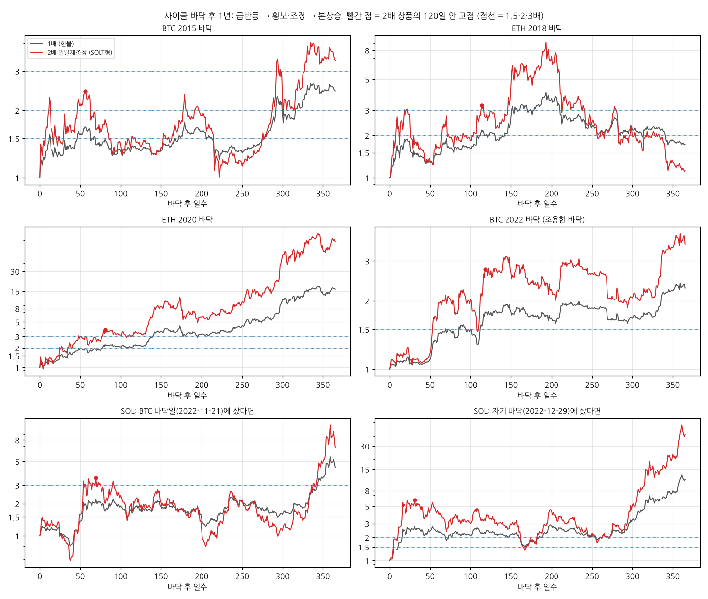

# 사이클 바닥 뒤에는 횡보인가, 급반등인가 — 그리고 SOLT는 언제 녹는가

**작성 2026-11-25 · 자료: BTC 일봉(2011~, Bitstamp·CoinMetrics), ETH·알트 일봉(CoinMetrics), SOL·SOLT(바이낸스·야후·트레이딩뷰)**

> 연구 결과이며 투자 권유가 아닙니다.

**확인할 주장:** 다른 AI는 "사이클 바닥을 찍고 횡보하는 동안 SOLT가 녹는다"고 했습니다.

---

## 0. 결론

### 0-1. 순서는 "급반등 → 횡보·조정 → 본상승"이었습니다

- **바닥 직후 급반등:** BTC 사이클 바닥 5번 중 4번은 **1주 안에 +20~30%** 반등했습니다. 알트는 자기 바닥 기준으로 사이클별 중앙 **1주 +10~39%, 1달 +54~95%**였고, **SOL 2022는 1주 +41%, 1달 +167%**였습니다.
- **그다음 횡보·조정:** 첫 반등 고점을 다시 넘기까지 **수주~수개월** 걸렸습니다. 알트 중앙 41~132일, 그 사이 되밀림 −16~−61%였습니다.
- **예외(2022 BTC 조용한 바닥):** 바닥 직후 BTC는 **약 7주 동안 횡보**(1주 +5%, 1달 +13%)한 뒤 1월에 급등했습니다. 같은 기간 SOL은 오히려 **20% 더 빠졌습니다**(SOL 고유 악재).

→ **다른 AI가 말한 "횡보에 녹는 구간"은 실제로 있습니다. 다만 대부분 바닥 직후가 아니라 첫 급반등이 끝난 뒤에 왔습니다.**

### 0-2. 바닥에서 2배 상품을 샀다면: 목표 배수는 대개 녹기 전에 닿았습니다

BTC 사이클 바닥 5번, BTC·ETH·SOL·알트 47건, BTC 바닥일 매수 기준입니다.

| 목표 | 1년 안 도달 | **30일 안** | 90일 안 | 걸린 날 (중앙) | 도달 전 최대 하락 (중앙 / 하위 25%) |
|---|---|---|---|---|---|
| **1.5배** | 98% | **79%** | 94% | **7일** | 0% / −9% |
| **2배** | 89% | 49% | 77% | 27일 | 0% / −20% |
| 3배 | 77% | 15% | 40% | 83일 | −6% / −44% |

- **120일 안 2배 상품의 고점:** 중앙 **2.82배**, 약 78일째였습니다.
- **그 고점 이후에도 1년까지 계속 들고 있으면:** 고점 대비 중앙 **−73%**(하위 25% −83%)까지 녹았습니다. 1년 시점에는 고점의 절반(−49%)이었습니다.

→ **주인님의 "정해 둔 배수에서 매도" 방식은 바로 이 구조에 맞습니다.** 1.5~2배 목표는 대개 급반등 구간에 닿았고, 녹는 것은 팔지 않고 계속 들고 있을 때의 일이었습니다.

### 0-3. 이번 사이클(2026)은 반등이 약하고 횡보가 길었습니다

| SOL 저점 | 첫 거래 가능 SOLT 매수가 | 7일 / 30일 안 SOLT 최고 | 1.5배 도달 | 2배 도달 | 그 전 최저 |
|---|---|---|---|---|---|
| 2026-02-05 (목 애프터) | $42.80 (블루오션) | 1.37배 / 1.42배 | 38일 | 미도달 | −4% |
| 2026-06-06 (토) | $28.25 (일요일 밤) | 1.03배 / 1.43배 | **74일** | **79일** | **−15%** |
| 2026-11-21 (토) | $25.01 (일요일 밤) | (진행 중) | — | — | — |

- 2026-06은 다른 AI 논리대로 흘렀습니다. 두 달 가까이 횡보하며 SOLT가 먼저 −15% 녹았고, 8월 급등 때 목표에 닿았습니다.
- 다만 2026-02와 2026-06은 사이클 바닥이 아니었습니다(이후 BTC가 더 낮아짐). 진짜 사이클 바닥은 과거처럼 반등이 더 클 수 있습니다.

### 0-4. "녹는 속도"는 변동성의 제곱에 비례합니다

- 2배 일일 재조정 상품의 감가는 대략 **(연 변동성)² × 기간**입니다.
- **조용한 횡보는 별로 녹지 않습니다.** BTC 연 40%면 한 달 약 1.3%로, 2022 BTC 7주 횡보 때 2배 상품은 거의 녹지 않았습니다.
- **크게 출렁이는 횡보는 많이 녹습니다.** SOL 연 80~100%면 한 달 5~8%입니다.
- **횡보 중 큰 되밀림은 2배로 증폭됩니다.** SOL 2023 횡보기에 SOL은 −45% 되밀렸고, 2배 상품은 자기 고점 대비 약 **−75%**가 됐습니다.

---

## 1. 바닥 직후의 모양 (`scripts/o_after_bottom.py`, `output/o_after_bottom.txt`)

### 1-1. BTC 바닥일 기준 — BTC·ETH·SOL

| 사이클 | 자산 | 7일 안 최대 | 30일 안 | 90일 안 | +50%까지 | 첫 반등 고점 (일째, 상승률) | 고점 재돌파까지 (되밀림) | 바닥 아래로 다시? |
|---|---|---|---|---|---|---|---|---|
| 2011 | BTC | +20% | +42% | +186% | 31일 | 58일, +186% | 179일 (−41%) | −10% |
| 2015 | BTC | +30% | +56% | +69% | 12일 | 56일, +69% | 123일 (−26%) | 없음 |
| 2018 | BTC | +28% | +28% | +29% | 108일 | 70일, +29% | 37일 (−10%) | 없음 |
| 2018 | ETH | +39% | +88% | +90% | 8일 | 70일, +90% | 38일 (−21%) | 없음 |
| 2020 | BTC | +25% | +49% | +106% | 42일 | 81일, +106% | 56일 (−12%) | 없음 |
| 2020 | ETH | +24% | +57% | +126% | 25일 | 81일, +126% | 51일 (−11%) | 없음 |
| **2022** | **BTC** | **+5%** | **+13%** | +56% | 69일 | 89일, +56% | (곧장 추세) | 없음 |
| 2022 | **SOL** | +23% | +23% | +121% | 53일 | 69일, +121% | **166일 (−45%)** | **−20%** |
| 2022 | ETH | +9% | +19% | +53% | 74일 | 88일, +53% | (곧장 추세) | 없음 |

### 1-2. 알트 중앙값 (사이클별)

| 사이클 | 기준 | 7일 | 30일 | 90일 | 첫 반등 고점까지 | 횡보·조정 기간 (되밀림) | 2배 상품: 기초자산이 첫 반등 고점을 되찾은 날, 자기 고점 대비 |
|---|---|---|---|---|---|---|---|
| 2015 | BTC 바닥일 | +25% | +47% | +95% | 11일 | 132일 (−61%) | **−83%** |
| 2018 | BTC 바닥일 | +39% | +55% | +86% | 11일 | 97일 (−30%) | −8% |
| 2020 | BTC 바닥일 | +27% | +56% | +91% | 81일 | 41일 (−16%) | 0% |
| 2022 | BTC 바닥일 | +12% | +19% | +44% | 78일 | 57일 (−23%) | −3% |
| 2015 | 자기 바닥 | +38% | +95% | +346% | 32일 | 132일 (−61%) | −83% |
| 2018 | 자기 바닥 | +39% | +64% | +90% | 39일 | 71일 (−30%) | −8% |
| 2020 | 자기 바닥 | +28% | +57% | +100% | 79일 | 41일 (−16%) | 0% |
| 2022 | 자기 바닥 | +10% | +54% | +69% | 53일 | 57일 (−26%) | −3% |
| **SOL 2022** | 자기 바닥 (12/29) | **+41%** | **+167%** | +174% | 31일 | **166일 (−45%)** | **−29%** |

**마지막 열 읽는 법:** 기초자산이 첫 반등 고점을 다시 넘는 날(본상승 시작)에 2배 상품은 자기 첫 반등 고점보다 몇 % 아래였는지입니다.
- 같은 가격으로 돌아왔는데 2배 상품이 낮다면, 그만큼이 **횡보·조정 동안 녹은 양**입니다.
- 짧고 얕은 조정(2018·2020)에서는 거의 녹지 않았습니다. 길고 깊은 조정(2015 알트, SOL 2023)에서는 크게 녹았습니다.



---

## 2. 2배 상품의 목표 배수 도달 (`scripts/o2_targets.py`, `output/o2_targets.txt`)

### 2-1. 자산 47건 전체

| 매수 기준 | 목표 | 1년 안 | 30일 안 | 90일 안 | 걸린 날 (중앙) | 도달 전 최대 하락 (중앙 / 하위 25%) |
|---|---|---|---|---|---|---|
| BTC 바닥일 | 1.5배 | 98% | 79% | 94% | 7일 | 0% / −9% |
| | 2배 | 89% | 49% | 77% | 27일 | 0% / −20% |
| | 3배 | 77% | 15% | 40% | 83일 | −6% / −44% |
| 자기 바닥 (사후) | 1.5배 | 100% | 91% | 98% | 7일 | 0% / 0% |
| | 2배 | 98% | 68% | 91% | 20일 | 0% / 0% |
| | 3배 | 89% | 26% | 55% | 58일 | 0% / −6% |

### 2-2. BTC·ETH·SOL 개별 (BTC 바닥일 매수)

| 사이클·자산 | 1.5배까지 (그 전 최대 하락) | 2배까지 | 3배까지 | 120일 안 고점 (일째) | 고점 뒤 1년까지 최대 녹음 |
|---|---|---|---|---|---|
| 2011 BTC | 12일 (−20%) | 31일 | 44일 | 6.16배 (53) | −74% |
| 2015 BTC | 7일 (0%) | 12일 | 293일 | 2.45배 (56) | −59% |
| 2018 BTC | 5일 (0%) | 109일 | 145일 | 2.32배 (116) | −10% |
| 2018 ETH | 5일 (0%) | 8일 | 18일 | 3.26배 (114) | −66% |
| 2020 BTC | 11일 (−1%) | 42일 | 56일 | 3.47배 (56) | −27% |
| 2020 ETH | 23일 (−6%) | 25일 | 48일 | 3.81배 (81) | −24% |
| 2022 BTC | 53일 (0%) | 65일 | 140일 | 2.77배 (118) | −33% |
| **2022 SOL** | **49일 (−42%)** | 54일 | 54일 | 3.53배 (69) | **−78%** |
| 2022 ETH | 52일 (0%) | 60일 | 146일 | 2.26배 (118) | −41% |

- **2022 SOL(BTC 바닥일 매수)이 다른 AI 시나리오에 가장 가까웠습니다.** SOL이 12/29까지 먼저 −20% 빠져 2배 상품이 −42%까지 내려갔다가, 1월 급등으로 49일째 1.5배, 54일째 3배에 닿았습니다. 그 뒤 계속 보유했다면 고점 대비 −78%였습니다.

---

## 3. 이번 사이클 실제 SOLT (`output/o3_2026_actual.txt`)

0-3 표와 같습니다. 2026년의 SOL 저점들은 과거 사이클 바닥보다 반등이 약했습니다(30일 안 SOL 최대 +39~40%). 특히 6월 저점 뒤에는 두 달 횡보가 먼저 왔습니다.

---

## 4. 주인님 계획에 대한 의미

| 질문 | 데이터 답 |
|---|---|
| 바닥 직후 횡보 때문에 SOLT를 사면 안 되나? | 아닙니다. 대부분 **첫 급반등이 먼저** 왔고, 1.5배는 중앙 7일, 30일 안 79%에 닿았습니다 |
| 그럼 녹는 문제는 없나? | 있습니다. **목표에서 안 팔고 계속 들고 가면** 1년 안에 고점 대비 중앙 −73%까지 녹았습니다 |
| 목표 배수는? | **1.5배는 급반등 구간에서 거의 확실**(30일 79%, 90일 94%). **2배는 반반**(30일 49%, 90일 77%). **3배는 본상승까지 기다려야** 해서(90일 40%) 횡보·녹음을 견뎌야 했습니다 |
| 조용한 바닥(2022형)이면? | BTC는 7주 횡보. SOL은 오히려 더 빠졌고, 2배 상품은 −42%를 먼저 겪은 뒤 목표에 닿았습니다. 이 경우를 대비해 **SOL 현물 혼합**(이전 보고서 P4)이 유효합니다 |

**운영 제안**
1. 바닥 매수 후 **1.5배 구간에서 상당 부분(절반 이상) 익절**합니다. 급반등이 끝나면 횡보·조정이 오는 경우가 많기 때문입니다.
2. 나머지는 2배 목표로 두되, **약 90일 안에 닿지 않으면 다시 판단**합니다. 계속 들고 있으면 녹는 구간에 들어갈 가능성이 커집니다.
3. 3배 이상을 노린다면 SOLT를 계속 들고 버티지 말고, **횡보가 끝난 뒤 추세가 확인되면 다시 매수**합니다(이전 보고서의 25거래일 이동평균 규칙).

---

## 5. 한계

- 사이클 바닥은 5번뿐이고(2011·2015·2018·2020·2022), SOL은 2022 한 번입니다.
- 2020-03은 급락형 바닥으로 다른 사이클과 성격이 다릅니다.
- 2배 상품은 일봉 일일 재조정 가상 상품입니다(비용 연 20%). 실제 SOLT는 미국 장 종가 기준이며, 주말에는 거래되지 않습니다.
- "첫 반등 고점"은 바닥 후 90일 안 최고 종가로 기계적으로 정했습니다. 추세가 계속된 2020·2022 BTC는 횡보 기간이 짧게 잡힙니다.

## 6. 재현

```
cd research/solt_bottom_precision
python3 scripts/o_after_bottom.py   # §1
python3 scripts/o2_targets.py       # §2
python3 scripts/o4_chart.py         # 차트
```
