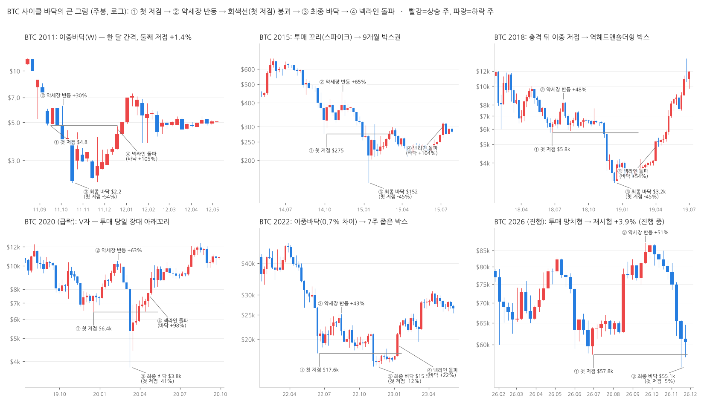
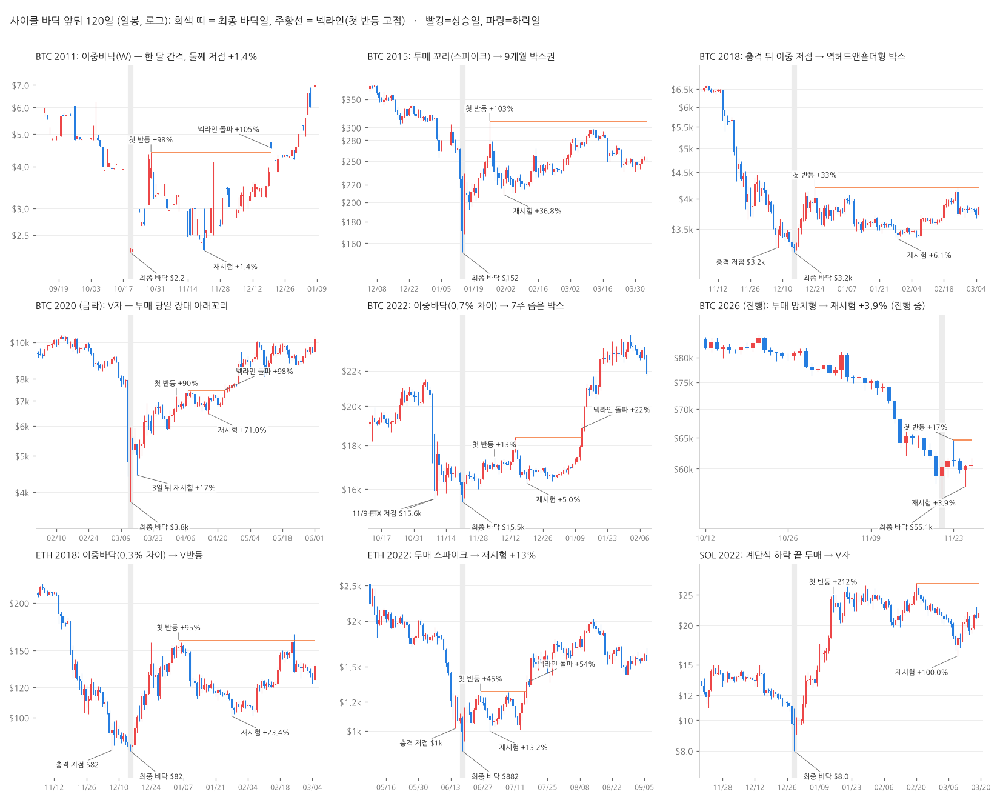
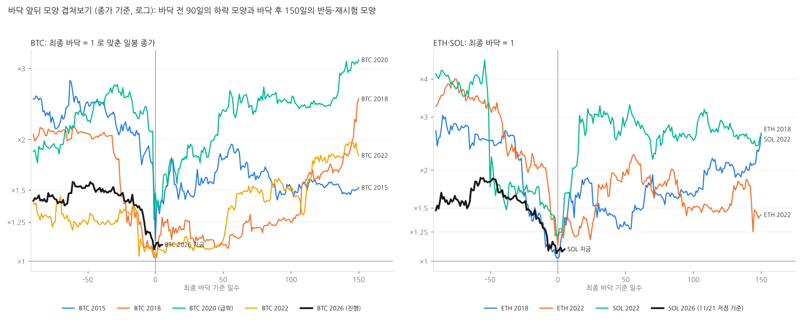
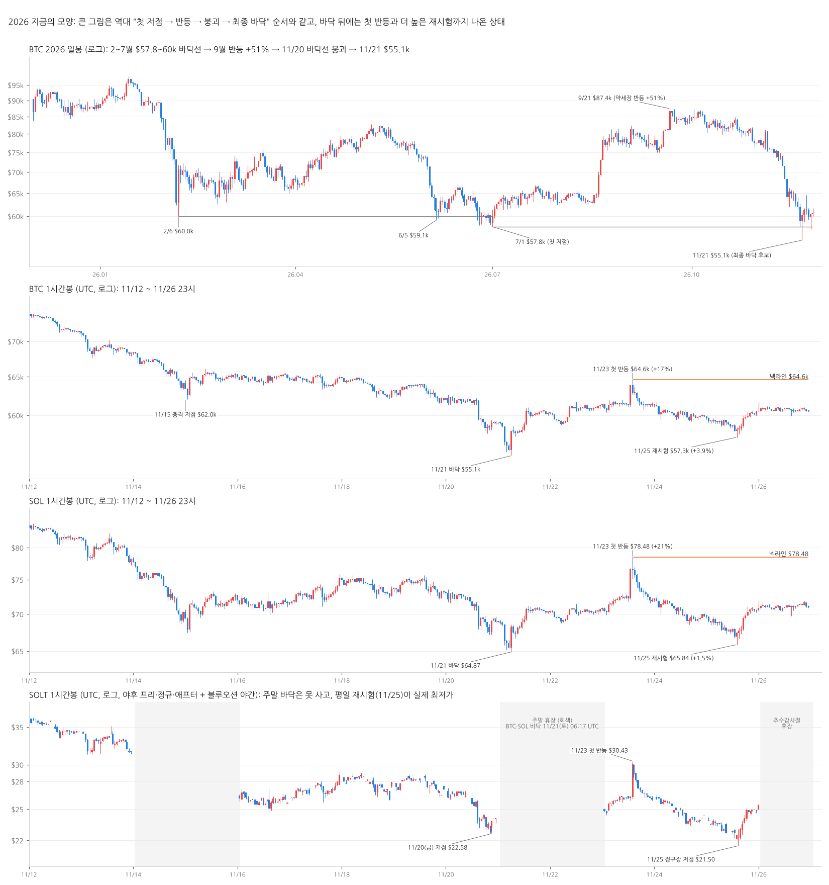

# 역대 사이클 바닥의 차트 모양 (BTC·ETH·SOL)과 2026 지금의 모양

**작성 2026-11-26 (시세 11/26 23:31 UTC)**

**자료**
- BTC 일봉: 2011·2015는 비트스탬프, 2017-08 이후는 바이낸스 1분봉으로 만든 UTC 일봉
- ETH·SOL: 바이낸스 1분봉
- SOLT: 야후 프리·정규·애프터 + 트레이딩뷰 블루오션 야간

**분석 대상 (최종 바닥 9개):** BTC 2011·2015·2018·2020(급락)·2022·2026(진행), ETH 2018·2022, SOL 2022

> 연구 결과이며 투자 권유가 아닙니다. 바닥 표본이 적어서, "모양"은 관찰이지 법칙이 아닙니다.

---

## 0. 결론

### 0-1. 큰 그림: 5번 모두 같은 4단계로 바닥이 만들어졌습니다

**① 첫 주요 저점 → ② 약세장 반등 → ③ 첫 저점이 깨지며 최종 바닥 → ④ 첫 반등 고점(넥라인) 돌파**

| 사례 | ① 첫 저점 | ② 약세장 반등 | 반등 고점 → 최종 바닥 | 첫 저점 붕괴 → 바닥 | ③ 최종 바닥 (첫 저점 대비) |
|---|---|---|---|---|---|
| BTC 2011 | 2011-09-16 $4.80 | +30% | −65% (15일) | 13일 | 10-20 $2.22 (**−54%**) |
| BTC 2015 | 2014-10-05 $275 | +65% | −66% (62일) | 10일 | 01-14 $152 (**−45%**) |
| BTC 2018 | 06-24 $5,750 | +48% | −63% (143일) | 31일 | 12-15 $3,156 (**−45%**) |
| BTC 2020 (급락) | 2019-12-18 $6,435 | +63% | −64% (29일) | 1일 | 03-13 $3,782 (**−41%**) |
| BTC 2022 | 06-18 $17,622 | +43% | −39% (98일) | 13일 | 11-21 $15,476 (**−12%**) |
| **BTC 2026 (진행)** | **07-01 $57,800** | **+51%** | **−37% (61일)** | **1일** | **11-21 $55,130 (−4.6%)** |
| ETH 2018 | 09-12 $167 | +53% | −68% | 26일 | 12-15 $81.8 (−51%) |
| ETH 2022 | 01-24 $2,159 | +66% | −75% | 38일 | 06-18 $882 (−59%) |
| SOL 2022 | 11-14 $12.07 | +25% | −47% | 38일 | 12-29 $8.00 (−34%) |

- 최종 바닥은 늘 **"몇 달 지켜지던 첫 저점이 깨진 직후"**에 왔습니다. 붕괴부터 바닥까지 1~38일 걸렸습니다.
- 첫 저점 아래로 빠진 폭은 사이클마다 줄었습니다: −54% → −45% → −45% → −12% → (2026) −4.6%.
  - 실현가격 대비 비율이 사이클마다 높아진 것과 같은 흐름입니다(직전 보고서).

### 0-2. 최종 바닥 자체의 모양은 두 가지였습니다

| 형태 | 사례 | 두 저점 (간격·차이) | 바닥일 거래량 (30일 중앙 대비) | 일봉 RSI | 바닥 뒤 재시험 |
|---|---|---|---|---|---|
| **이중바닥 (W)** | BTC 2011 | 10/20 $2.22 · 11/21 $2.25 (32일, +1.4%) | 0.8배 | — (자료 부족) | +1.4% |
| | BTC 2018 | 12/8 $3,222 · 12/15 $3,156 (7일, −2.0%) | **0.6배** | 23.5 → **25.4** (높아짐) | +6.1% |
| | BTC 2022 | 11/9 $15,588 · 11/21 $15,476 (12일, −0.7%) | **1.2배** | 24.5 → **31.5** (높아짐) | +5.0% |
| | ETH 2018 | 12/7 $82.07 · 12/15 $81.79 (8일, −0.3%) | **0.5배** | 21.6 → **23.4** (높아짐) | +23% |
| **투매 스파이크 (V)** | BTC 2015 | 1/4 $255에서 열흘 만에 −40% | **13배** | 26.1 → **19.4** (신저점) | +37% (2/1) |
| | BTC 2020 | 하루 −50% 급락 | **6.8배** | **15.0** (신저점) | 3일 뒤 +17%, 그 뒤 직행 |
| | ETH 2022 | 6/15 → 6/18 −13% | 2.9배 (5일 안 최대 5.3배) | 19.9 → 19.5 | +13% |
| | SOL 2022 | 11/22 → 12/29 −27% (연말 투매) | **4.8배** | 27.1 → **23.4** (신저점) | 없음 (V자, +212%) |

**이중바닥형** (BTC 바닥 5번 중 3번: 2011·2018·2022)
- 두 저점의 차이가 **±2% 안**이었습니다. 간격은 7~32일이었습니다.
- 최종 저점일 **거래량은 평소 수준(0.5~1.2배)**이었습니다. 2018·2022·ETH 2018은 두 번째 저점에서 **RSI가 오히려 높았습니다**(상승 다이버전스).
- BTC는 바닥 뒤 재시험도 바닥에 바짝 붙었습니다(+1.4~6.1%). ETH 2018은 +23%였습니다.

**스파이크형** (2015·2020, ETH 2022, SOL 2022)
- 마지막 며칠에 −13~−50%가 쏟아졌고, 거래량은 3~13배였습니다.
- **RSI는 신저점**을 찍었습니다(다이버전스 없음).
- 재시험은 바닥보다 13~37% 위에서 멈추거나, 아예 없었습니다(V자).

### 0-3. 바닥 뒤의 모양: 첫 반등 → 재시험 → 넥라인 돌파

| 사례 | 첫 반등 (21일 안) | 재시험 (첫 반등 뒤 120일 안 최저) | 넥라인 돌파 (재시험 뒤 일봉 종가 기준) | 돌파 뒤 90일 |
|---|---|---|---|---|
| BTC 2011 | +98% (9일) | **+1.4%** (11/21) | 61일 뒤, 바닥 +105% | 최고 +62% / 최저 −17% |
| BTC 2015 | +103% (12일) | +37% (2/1) | 179일 뒤, 바닥 +104% | +2% / **−36% (가짜 돌파, 진짜는 10월)** |
| BTC 2018 | +33% (9일) | **+6.1%** (1/29) | 108일 뒤, 바닥 +54% | +188% / −15% |
| BTC 2020 | +90% (20일) | (3일 뒤 +17%) | 41일 뒤, 바닥 +98% | +39% / −6% |
| BTC 2022 | +13% (14일) | **+5.0%** (12/19) | 52일 뒤, 바닥 +22% | +62% / −5% |
| ETH 2018 | +95% (21일) | +23% (1/28) | 108일 뒤, 바닥 +100% | +125% / −14% |
| ETH 2022 | +45% (8일) | +13% (6/30) | 28일 뒤, 바닥 +54% | +50% / −12% |
| SOL 2022 | +212% (17일) | +100% (3/10) | 198일 뒤 | — |
| **BTC 2026** | **+17% (2일, 11/23 $64,603)** | **+3.9% (4일, 11/25 $57,300)** | **아직 (넥라인 $64,603)** | — |

- **넥라인 돌파를 확인하고 사면 늦었습니다.** BTC는 이미 바닥 대비 +22~+105% 오른 뒤였고, 확인까지 41~179일 걸렸습니다.
- 대신 2018·2020·2022처럼 확인 뒤 90일 안 최대 하락은 −5~−15%로 작았습니다. 2015년만 가짜 돌파였습니다.

### 0-4. 2026 지금의 모양

**① 큰 그림은 역대와 같은 순서입니다**
- 2/6 $60.0k, 6/5 $59.1k, 7/1 $57.8k로 5개월간 바닥선이 지켜졌습니다.
- 9/21까지 +51% 반등한 뒤 11/20에 바닥선이 깨졌고, 11/21 $55,130을 찍었습니다.
- 다른 점이 둘 있습니다.
  - **첫 저점 아래로 −4.6%만** 빠졌습니다. 역대 가장 얕습니다.
  - **하루 만에 바닥선 위로 종가를 회복**했습니다. 역대는 10~139일 걸렸습니다.
- 바닥 전 90일 경로는 **2022년과 가장 비슷**합니다(로그 경로 평균 차이 15%p, 다른 사이클은 28~47%p). 반등 고점에서 바닥까지 −37%(2022 −39%), 90일 −29%(2022 −28%)였습니다.

**② 11/21 바닥 캔들은 스파이크형 특징이 강합니다**
- 아래꼬리 65%, 종가 위치 87%로, 9개 사례 중 **가장 강한 망치형**입니다.
- 거래량 3배, 일봉 RSI 17.4(2020의 15.0 다음으로 낮음)로 첫 저점(7/1) 대비 다이버전스가 없습니다.
- 주봉도 아래꼬리 58%의 망치형입니다(2015 50%, 2022 60%와 비슷).
- 다만 주봉 RSI는 35로, 역대 바닥(28~33)만큼 과매도는 아닙니다.

**③ 바닥 뒤 모양은 이중바닥형에 가깝습니다**
- 첫 반등 +17%(2일) 뒤 재시험이 **+3.9%**(4일)였습니다. SOL은 +1.5%였습니다.
- 스파이크형의 재시험(+13~37%)보다 **이중바닥형의 재시험(+1.4~6.1%)**에 가깝습니다.
- 즉 지금은 **"스파이크 바닥 + 바짝 붙은 재시험 = W 진행형"**입니다.

**④ SOLT는 BTC·SOL 바닥(11/21 토 06:17 UTC)을 주말이라 살 수 없었습니다**
- 실제 최저가는 **평일 재시험 때인 11/25 09:45 ET $21.50**이었습니다. 11/20(금) 저점 $22.58보다 낮습니다.
- SOL은 더 높은 저점(+1.5%)을 만들었는데도 SOLT는 더 낮은 저점이 나왔습니다. 2배 레버리지와 그 사이의 감가 때문입니다.
- 11/25 종가 기준 이론가로 계산한 SOL $65.84 때 SOLT는 $21.46이었습니다. 실제 저점 $21.50과 거의 같습니다.

### 0-5. 2026: 차트 모양으로 본 다음 갈림길

| 상황 | BTC | SOL | SOLT (이론) | 역대 근거 |
|---|---|---|---|---|
| **W 확인** — 일봉 종가가 넥라인 위 | **$64,603** 위 (+6.8%) | $78.48 위 | ≈ $30.3 | 2011·2018·2022: 확인 뒤 90일 최고 +62~+188%, 최저 −5~−17% |
| 재시험 저점 | $57,300 | $65.84 | ≈ $21.5 | 이중바닥형 재시험 +1.4~6.1% 안 |
| 11/21 바닥 | $55,130 | $64.87 | ≈ $20.8 | — |
| **무효** — 11/21 이탈 뒤 "충격 저점형" 최종 저점 | **$47.6k~54.7k** (−21~−10%) | $50~61 | **≈ $12~18** | 2022: 충격 12일 뒤 −0.7%, 2018: 20일 뒤 −13.6% |

- SOLT 이론가는 11/25 종가($24.82, 그 시각 SOL $70.62) 기준입니다.
  - 위 세 줄은 하루 안의 움직임으로 계산했습니다.
  - 마지막 줄은 약 3주에 걸쳐 내려간다고 보고 감가를 넣었습니다(SOL 변동성 53%, 비용 연 10%, SOL 연동 배율 1.45배, 범위 1.0~1.8배).
- "무효" 범위의 아래쪽($47.6k)은 직전 실현가격 보고서의 보수적 중심(비율 0.82~0.84 → BTC 약 $44k)과 상단(0.90 → $48k) 사이에 걸칩니다.

**SOLT 매수에 쓰는 차트 모양 규칙 (기존 전략에 더할 것)**
1. **이중바닥이 BTC 바닥의 다수(3/5)였습니다.** 두 번째 저점(재시험)은 거래량이 줄고 RSI가 높아지는 "조용한" 저점입니다.
   - SOLT는 주말 바닥을 못 사기 때문에, **평일에 오는 재시험이 실제로 더 싼 매수 기회**가 되는 경우가 많습니다. 2026-11-25가 그 예입니다.
2. **넥라인 돌파를 확인하고 사면 늦습니다.**
   - 이번이라면 BTC +17%, SOL +21%가 오른 뒤입니다. SOLT로는 재시험 저점 $21.5 대비 약 +41%($30.3)입니다.
   - 확인 매수는 "추가 매수"용으로만 쓰는 것이 맞습니다.
3. **11/21 $55,130이 일봉 종가로 깨지면, 남은 자금은 "충격 뒤 조용한 최종 저점"을 기다립니다.**
   - 역대로는 1~3주 안에, 거래량이 줄고 RSI가 높아지는 저점이었습니다.
   - 2018년처럼 깊으면 BTC $47.6k, SOLT 약 $12까지 열어 둡니다.

---

## 1. 그림

### 1-1. 큰 그림 (주봉)


### 1-2. 바닥 앞뒤 120일 (일봉)


### 1-3. 최종 바닥 기준 겹쳐보기


- 검은 선이 2026입니다. 바닥 전 90일은 노란 선(2022)과 가장 가깝게 움직였습니다.
- 2015·2018·2020은 바닥 직전 한 달 안에 ×2 이상에서 무너졌습니다.

### 1-4. 2026 지금 (BTC 일봉, BTC·SOL·SOLT 1시간봉)


---

## 2. 정의 (`scripts/u_chart_shape.py`, `u2_after_pivots.py`)

| 용어 | 정의 |
|---|---|
| 첫 저점 | 최종 바닥 45~300일 전의 최저가 (2011은 자료 시작 2011-08 이후) |
| 약세장 반등 | 첫 저점과 최종 바닥 사이의 최고가 |
| 붕괴일 | 첫 저점 아래로 처음 내려간 날 |
| 충격 저점 | 최종 바닥 전 60일 안 1시간봉 스윙 저점(BTC 8%·ETH 12%·SOL 15% 반전) 중 마지막 3개의 최저 |
| 첫 반등 | 바닥 후 21일 안 최고가 |
| 재시험 | 첫 반등 뒤 120일 안 최저가 |
| 넥라인 | 바닥~재시험 사이 최고가 |
| 돌파 | 재시험 뒤 일봉 종가가 넥라인 위인 첫날 |
| RSI | 14일, 와일더 방식 |
| 거래량 배수 | 그날 거래량 ÷ 직전 30일 중앙값 |
| 아래꼬리 | (시가·종가 중 낮은 값 − 저가) ÷ (고가 − 저가) |

- 모양 이름(이중바닥·스파이크·V)은 위 수치와 그림을 보고 붙인 판단입니다.
- 이중바닥 기준: 두 저점 차이 ±2% 안, 간격 7~32일입니다.

## 3. 세부 수치

### 3-1. 바닥 캔들·RSI (`output/u_chart_shape.txt` C표)

| 사례 | 일봉 아래꼬리 | 종가 위치 | 바닥일 거래량 | 주봉 아래꼬리 | 일봉 RSI (첫 저점 → 바닥) | 주봉 RSI (첫 저점 → 바닥) |
|---|---|---|---|---|---|---|
| BTC 2015 | 0.24 | 0.24 | 13.0배 | 0.50 | 23.1 → 19.4 | 30.3 → 27.5 |
| BTC 2018 | 0.46 | 0.46 | 0.6배 | 0.16 | 31.0 → 25.4 | 41.7 → 28.7 |
| BTC 2020 | 0.47 | 0.83 | 6.8배 | 0.36 | 28.8 → 15.0 | 44.7 → 33.3 |
| BTC 2022 | 0.36 | 0.36 | 1.2배 | 0.60 | **20.3 → 31.5** | **26.1 → 31.9** |
| **BTC 2026** | **0.65** | **0.87** | **3.0배** | **0.58** | 30.3 → 17.4 | 38.2 → 35.4 |
| ETH 2018 | 0.61 | 0.61 | 0.5배 | 0.21 | 20.9 → 23.4 | 35.6 → 28.5 |
| ETH 2022 | 0.53 | 0.53 | 2.9배 | 0.43 | 21.8 → 19.5 | 39.0 → 26.3 |
| SOL 2022 | 0.57 | 0.57 | 4.8배 | 0.57 | 27.5 → 23.4 | 29.4 → 29.1 |

- **BTC에서 첫 저점 대비 RSI 다이버전스는 2022년(일·주 모두)뿐**이었습니다(ETH 2018은 일봉만). 2022년은 첫 저점 대비 −12%만 빠진 가장 얕은 붕괴였습니다.
- 2026은 일봉 RSI가 첫 저점보다 훨씬 낮습니다(30.3 → 17.4). 지금까지는 "약한 붕괴 + 강한 단기 과매도"입니다.

### 3-2. 바닥권 체류

바닥 ×1.25 이하에 머문 기간(최종 바닥 기준 일수)입니다.

| 사례 | 처음 들어간 날 | 마지막 날 | 모양 |
|---|---|---|---|
| BTC 2015 | 0 | +1 | 스파이크: 바닥권에 이틀만 |
| BTC 2018 | −21 | +102 | 넉 달 바닥권 (원형·역헤드앤숄더형 박스) |
| BTC 2020 | −1 | +3 | V자 |
| BTC 2022 | **−156** | +53 | 반년 바닥권 (6월 첫 저점부터) |
| BTC 2026 | **−172** | (+5, 진행) | 6월부터 바닥권 (2022와 같은 긴 바닥권) |

## 4. 정정

직전 실현가격 보고서의 "이번 사이클 중간 저점 6/30 장중 $58,201 → 실현가격 대비 1.10"은 UTC 일봉 기준으로 **7/1 $57,800 → 1.09**가 맞습니다. 결론은 바뀌지 않습니다. 그 보고서에도 반영했습니다.

## 5. 한계

- 표본이 BTC 바닥 5번(2020 급락 포함), ETH 2번, SOL 1번뿐입니다.
- 2011년은 비트스탬프 거래가 매우 얇아 빈 날과 튀는 가격이 있습니다.
  - 그림에서는 시가·종가의 1.5배를 넘는 고가를 잘랐습니다. 2011 RSI는 자료가 짧아 뺐습니다.
  - 당시 주력이던 마운트곡스 기준 바닥은 11/18 $2.01입니다.
- 2026은 진행 중입니다. 11/21이 최종 바닥인지는 아직 모릅니다. 위 표의 2026 값은 11/26 23:31 UTC까지입니다.
- SOLT 이론가는 11/25 종가와 그 시각 SOL 기준의 근사입니다.
  - 11/26은 추수감사절 휴장, 11/27은 단축 거래입니다.
  - 지정가는 매일 미국 장 마감 뒤 다시 계산해야 합니다.

## 6. 재현

```
cd research/solt_bottom_precision
python3 scripts/update_1m.py BTCUSDT ETHUSDT SOLUSDT   # 최신 1분봉
python3 scripts/u_chart_shape.py        # 큰 그림·바닥 뒤·캔들 표 (output/u_chart_shape.txt)
python3 scripts/u2_after_pivots.py      # 충격 저점·1시간봉 스윙 (output/u2_after_pivots.txt)
python3 scripts/u4_similarity_levels.py # 2026 유사도·시나리오 가격 (output/u4_similarity_levels.txt)
python3 scripts/u3_charts.py            # 그림 4장 (charts/u1~u4)
```
