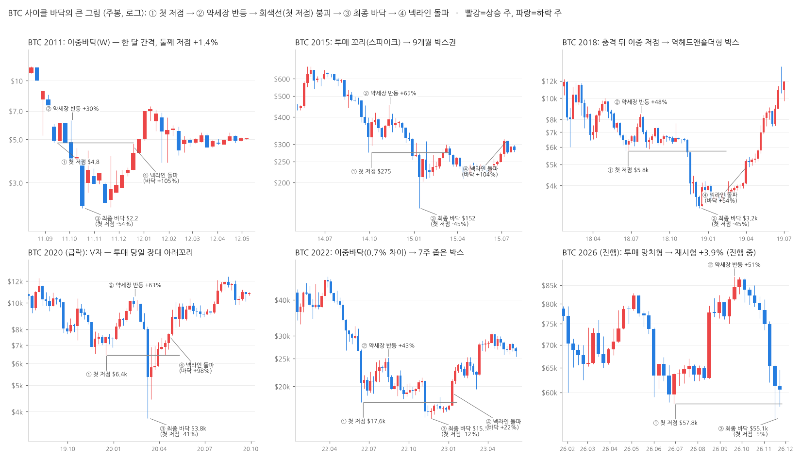
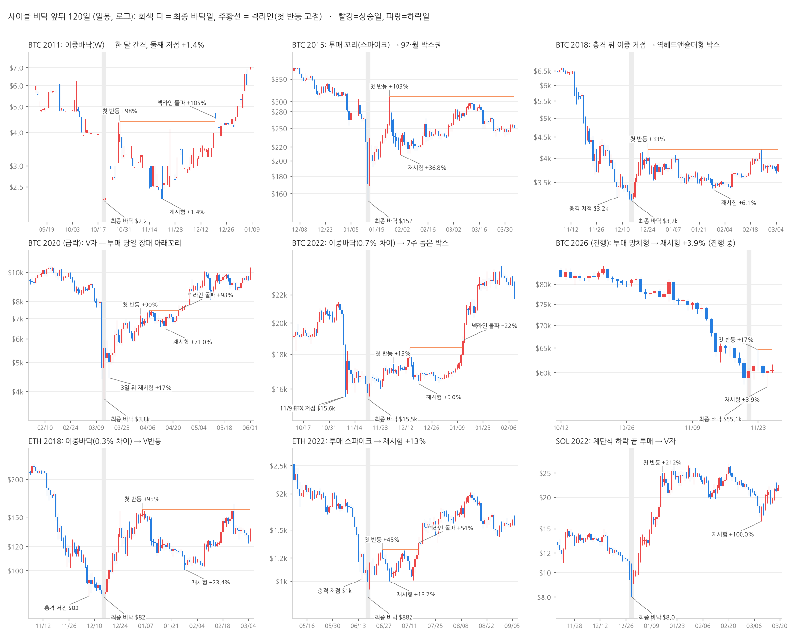
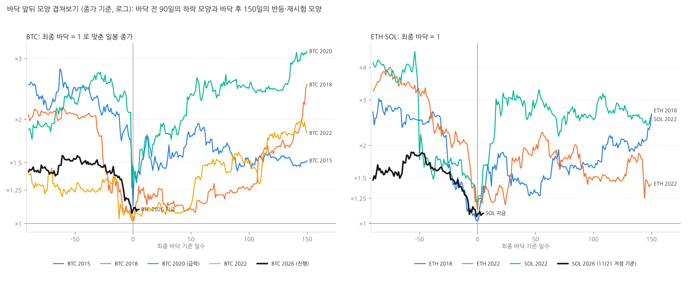
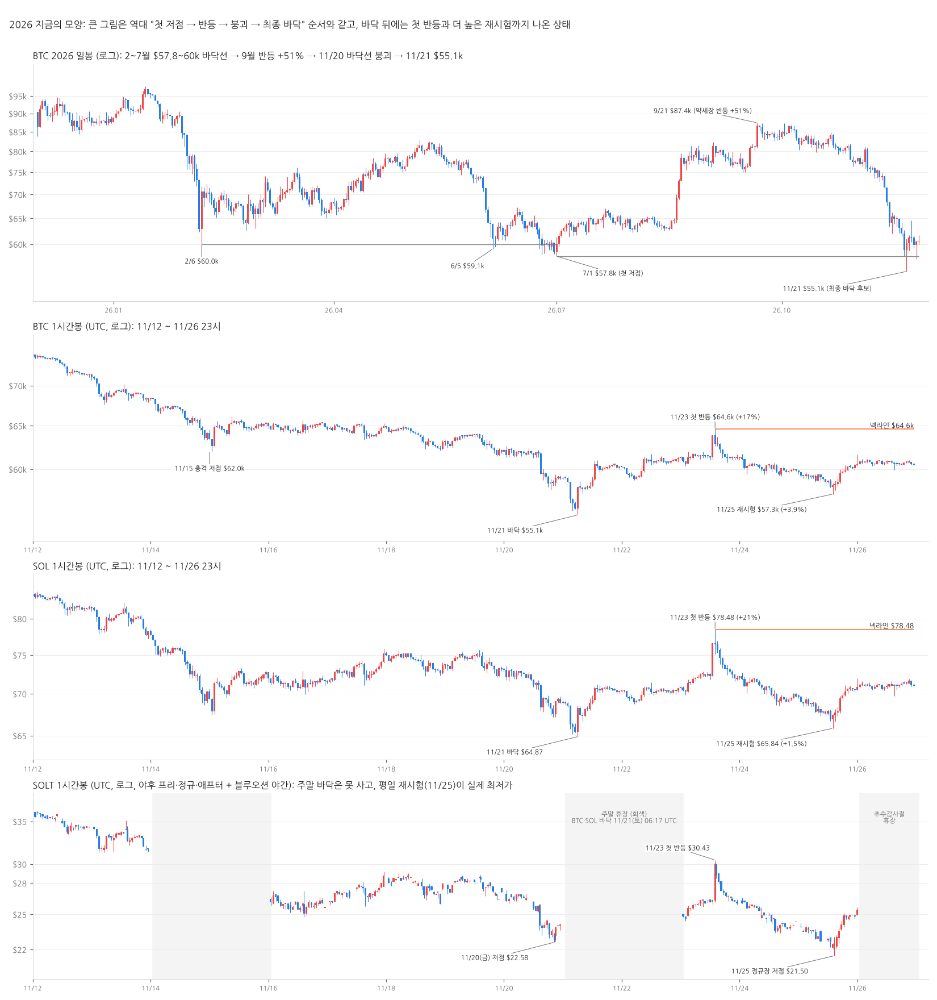
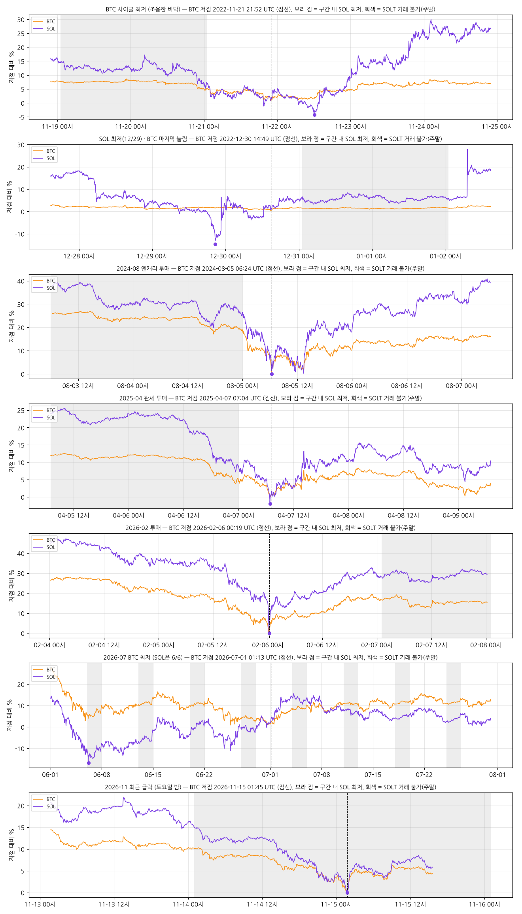
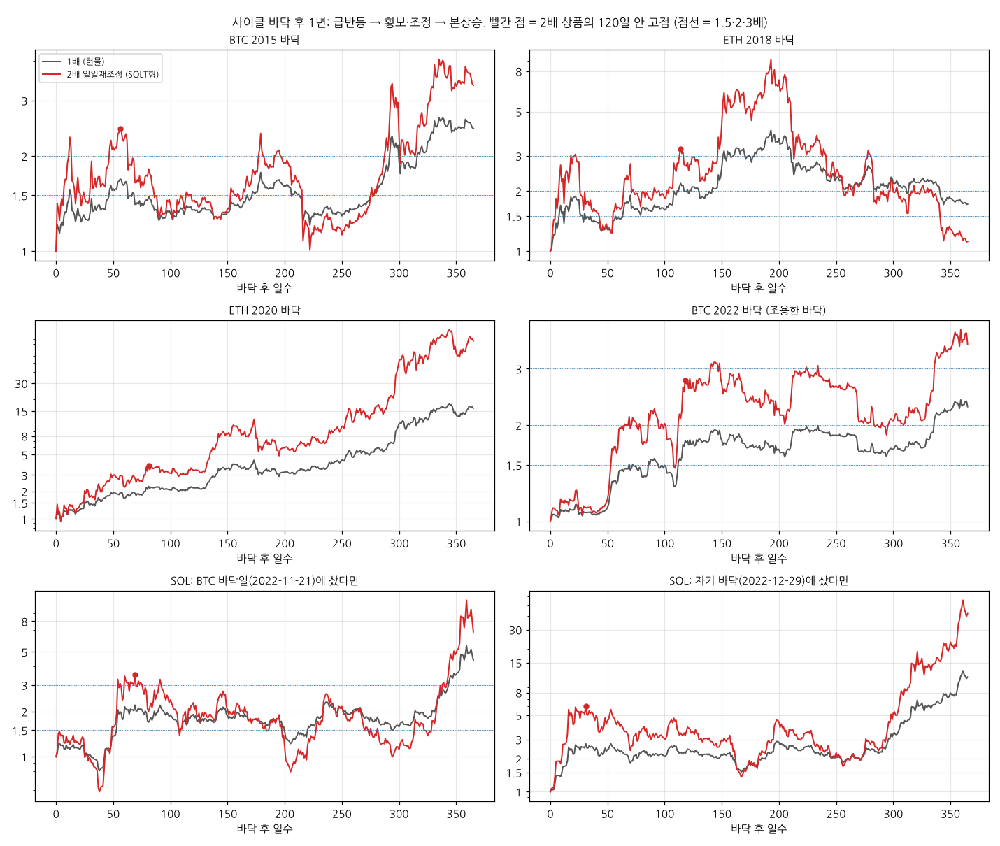

# SOLT 저점 매수 연구 종합 — 방법과 결과 (거시 · 미시 · 차트 모양)

**작성 2026-11-27 (시세 11/27 01:39 UTC: BTC $60,702 · ETH $1,700 · SOL $71.38 · SOLT 이론가 약 $25.4)**

이 문서는 2026-11-15부터 이 세션에서 한 연구를 한 곳에 묶은 것입니다. 각 결론이 어떤 자료와 방법에서 나왔는지, 지금 어디에 있는지, 그래서 무엇을 할지를 차례로 적습니다. 세부는 끝의 "보고서 지도"에 있는 개별 보고서를 보십시오.

> 연구 결과이며 투자 권유가 아닙니다. 2배 레버리지 상품은 원금 대부분을 잃을 수 있습니다. 비트코인 사이클 바닥은 몇 번뿐이라, 아래의 %와 "공통점"은 과거 횟수이지 법칙이 아닙니다.

---

## 0. 한 장 요약

### 0-1. 지금 위치

```
 $64.6k ─ ─ ─ ─ ─ ─ ●(11/23 첫 반등 +17%) ─ ─ ─  ← 넥라인: 일봉 종가로 뚫으면 W 성공
                   / \
                  /   \        ●(지금 $60.7k)
                 /     \      /
 $57.3k         /       ●(11/25 재시험 +3.9%)
 $55.1k ─ ─ ●(11/21 바닥 후보, 토요일) ─ ─ ─ ─  ← 깨지면 한 번 더 하락
 $53.1k ─ ─ ─ ─ ─ ─ ─ ─ ─ ─ ─ ─ ─ ─ ─ ─ ─ ─ ─  ← BTC 실현가격 (역대 사이클 바닥은 모두 이 아래)
 $48.4k ─ ─ ─ ─ ─ ─ ─ ─ ─ ─ ─ ─ ─ ─ ─ ─ ─ ─ ─  ← 장기 보유자 실현가격
```

### 0-2. 세 관점이 말하는 것

| 관점 | 무엇을 봤나 | 지금 결과 | 방향 |
|---|---|---|---|
| **거시** | 실현가격·MVRV, 사이클 구조, 시간·심리 | MVRV 1.14 (실현가격 위). 역대 바닥은 0.49~0.76. 실현가격 위 약세장 저점 17번 중 사이클 바닥 0번 | **한 번 더 아래** |
| | | 고점 후 410일, 반감기까지 511일, 공포 지수 10 → 역대 바닥과 같은 시기 | 바닥 근처 |
| **미시** | 분·시간 단위 BTC·SOL·SOLT 저점, 거래 시간, 감가 | 11/21 바닥은 주말이라 SOLT 매수 불가. SOLT 실제 최저는 평일 재시험 11/25 $21.50 | 평일 재시험이 실제 매수 기회 |
| **차트 모양** | 주봉·일봉·1시간봉 모양, 같은 모양의 과거 결과 | 큰 그림은 역대와 같은 4단계. 바닥 캔들은 역대 가장 강한 망치형. 그러나 "급반등 뒤 바닥 바로 위 재시험"은 과거 14번 중 13번 저점이 다시 깨짐 | **한 번 더 아래** (대략 80~90%) |

### 0-3. 결론과 행동

| 갈래 | 대략 가능성 | 가격 | SOLT 행동 |
|---|---|---|---|
| **A. $55,130이 깨지고 마지막 저점** | **높음 (80~90%)** | 깨진 뒤 중앙 −6% (BTC $51.8k), 넓게 $45.8~54.6k | **분할 지정가:** BTC $51.8k(SOLT 약 $16) · $48.5k(약 $13) · $45.8k(약 $11) |
| B. $64,603 일봉 종가 돌파 (W 성공) | 낮음 (10~20%) | — | 돌파 때 일부만 추격 (SOLT 약 $30) |

- 지금(SOLT 약 $25)은 큰 비중을 넣기에 불리한 자리입니다.
- **A가 나쁜 소식만은 아닙니다.** 역대 최종 바닥 무렵에는 "한 번 더 깨짐"이 마지막 투매였습니다(2015-01, 2018-11~12, 2022-06, 2022-11).

---

## 1. 연구의 흐름과 자료

### 1-1. 질문의 흐름

| 순서 | 주인님 질문 | 보고서 |
|---|---|---|
| 1 | BTC 저점에서 SOLT는 얼마인가 (독립 재추정) | `solt_at_btc_bottom_independent/SOLT_BTC저점_독립예측_2026-11-15.md` |
| 2~4 | 언제 사고 팔아야 하나, 상승기 수익, 수백 배를 먹는 법 | `solt_strategy_after_btc_bottom/` 두 보고서 |
| 5 | BTC→SOL→SOLT 저점을 분 단위로 정밀 검증, 유튜브 매매법 | `SOLT_저점정밀매수_검증_2026-11-15.md` |
| 6 | "BTC 저점 = SOLT 저점이 절대 아니다"라는 반론 | `BTC저점_vs_SOLT저점_반론검증_2026-11-24.md` |
| 7~8 | 바닥 뒤 횡보에 SOLT가 녹나, 언제 사야 가장 효과적인가 | `사이클바닥후_반등vs횡보_2026-11-25.md`, `BTC저점후_SOLT최적매수시점_2026-11-26.md` |
| 9 | 역대 바닥의 요일·시간과 공통점 | `역대사이클바닥_요일시간_공통점_2026-11-26.md` |
| 10~11 | 실현가격과 그 비율의 현재 적용 | `실현가격_정의와_..._2026-11-26.md`, `사이클바닥_실현가격비율_현재적용_2026-11-26.md` |
| 12~13 | 차트 모양, 지금 위치의 확률 | `역대사이클바닥_차트모양_2026-11-26.md`, `지금위치와_확률_쉬운설명_2026-11-27.md` |

### 1-2. 자료

| 자료 | 범위 | 용도 |
|---|---|---|
| 바이낸스 BTC·ETH·SOL **1분봉** (data.binance.vision + REST) | 2017-08(SOL 2020-08) ~ 2026-11-27 | 분 단위 저점, 일·주봉 생성 |
| 비트스탬프 BTC 시간봉·일봉 | 2011-08 ~ 2026-11-15 | 2011·2015 사이클 |
| 야후 SOLT 1·5·15·60분봉 (프리·정규·애프터) | 2025-03 ~ 2026-11-25 | 실제 SOLT 체결 가능가 |
| 트레이딩뷰 `BOATS:SOLT` (블루오션 야간), `NASDAQ:SOLT` 연장 | 2025 ~ 2026-11-25 | 야간 거래, 차트 캡처 |
| CoinMetrics 커뮤니티 API (BTC·ETH MVRV·가격) | 2010 ~ 2026-11-24 | 실현가격 = 가격 ÷ MVRV |
| BGeometrics (단기·장기 보유자 실현가격) | ~ 2026-11-19 | STH·LTH 실현가격 |
| 공포·탐욕 지수, 바이낸스 펀딩비, 알트 16종 일봉 | 2018 ~ / 2020 ~ / 2013 ~ | 심리·파생, 알트 비교 |
| 유튜브 '매매법아카이브' 영상 목록·자막 | — | 매매법 검증 (자막은 저작권상 저장소에서 제외) |

### 1-3. 공통 도구와 공식

| 도구 | 내용 |
|---|---|
| **SOLT 이론가** | SOLT = 직전 정규장 종가 × (1 + 2 × (SOL ÷ 16:00 ET 시각 SOL − 1)) |
| **가상 SOLT (2020~)** | SOL 일간 수익 × 2, 미국 16:00 ET 재조정, 비용 연 20%. 실제 SOLT와 비교해 로그 오차 5.9% (실제 0.121 vs 가상 0.122) |
| **며칠에 걸친 경로의 SOLT** | 지금 이론가 × (S ÷ 지금 SOL)² × exp(−(σ² + 비용) × 일수 ÷ 365). 감가는 대략 (연 변동성)² × 기간에 비례 |
| **SOLT 거래 시간** (미국 동부) | 정규 09:30~16:00, 프리 04:00~09:30, 애프터 16:00~20:00, 블루오션 야간 20:00~04:00. **주말 금 20:00 ~ 일 20:00은 거래 불가** (한국 토 10:00 ~ 월 10:00) |
| **스윙 저점·고점** | 지그재그: 직전 극값에서 일정 비율(BTC 8~15%, ETH 12~15%, SOL 15~20%) 되돌리면 확정 |
| **실현가격, MVRV** | 실현가격 = 실현 시가총액 ÷ 유통량, MVRV = 가격 ÷ 실현가격 |
| **RSI** | 14일, 와일더 방식 (일봉·주봉) |
| **거래량 배수** | 그날(그 시간) 거래량 ÷ 직전 30일 중앙값 |

---

## 2. 거시 — 사이클과 온체인

### 2-1. 실현가격이란

- **시장 전체의 평균 매입 단가(온체인 원가)**입니다. 모든 코인을 마지막으로 이동한 날의 가격으로 평가해 평균 낸 값입니다.
- MVRV < 1은 평균 보유자가 손실인 구간입니다. **역대 BTC 사이클 바닥은 모두 여기서 나왔습니다.**

| 자산 | 실현가격 | 지금 MVRV | 판정 |
|---|---|---|---|
| **BTC** | **$53,099** (11/24) | **1.14** | 실현가격보다 14% 위 |
| BTC 단기 보유자 | $73,615 | 0.82 | 최근 매수자는 평균 손실 |
| BTC 장기 보유자 | **$48,427** | 1.25 | |
| ETH | $2,002 | 0.85 | 이미 실현가격 아래 |
| SOL (대리 추정) | $95~140 | 약 0.5~0.75 | 이미 크게 아래 |

- SOL은 무료 공개 실현가격이 없습니다. 글래스노드 보도값($134, 2025-03-11)에 거래량 가중 평균가를 맞춰 범위로 추정했습니다(`r_proxy.py`).

### 2-2. 역대 바닥의 실현가격 대비 비율과 추세

| 사이클 | 장중 기준 | 종가 기준 |
|---|---|---|
| 2011 | 0.40 | 0.42 |
| 2015 | 0.49 | 0.56 |
| 2018 | 0.68 | 0.69 |
| 2020 (급락) | 0.67 | 0.88 |
| 2022 | 0.76 | 0.75 |
| **2026 (11/21 저점)** | **1.04** | — |

**비율이 높아진 속도:** 0.40 → 0.49(+0.085) → 0.68(+0.195) → 0.76(+0.079). 고르지 않습니다. 그래서 추세 모형에 따라 다음 바닥이 달라집니다.

| 추세 모형 | 다음 바닥 비율 | BTC | SOL | SOLT (3주 경로) |
|---|---|---|---|---|
| 직선 (사이클 순번·연도) | 0.90~0.92 | $47.9~48.8k | $50~52 | $12.4~13.0 |
| 평균 증가폭 반복 | 0.88 | $46.9k | $48.8 | $11.6 |
| **직전 증가폭(+0.079) 반복** | **0.84** | **$44.7k** | $45.5 | **$10.1** |
| **빠진 폭이 일정 배수로 축소** | **0.82~0.84** | **$43.7~44.3k** | $44~45 | **$9.4~9.9** |
| 2022 비율 그대로 | 0.76 | $40.5k | $39.4 | $7.6 |
| 2018 비율 그대로 | 0.68 | $36.3k | $33.7 | $5.5 |

- 직선 모형은 다음다음 바닥을 1.03으로 봅니다. 실현가격 위에서 바닥이 끝난다는 뜻이라 무리가 있습니다.
- "빠진 폭이 일정 배수로 줄어든다"는 모형은 1.0에 다가가기만 하고 넘지 않아 구조상 자연스럽습니다. 그래서 **보수적 중심 0.82~0.84(BTC 약 $44k), 상단 0.90(약 $48k)**으로 봤습니다.

**왜 높아졌나:** 사이클마다 진폭 자체가 줄었습니다.

| 항목 | 2011 | 2013/15 | 2017/18 | 2021/22 | 2024~26 |
|---|---|---|---|---|---|
| 고점 MVRV | 7.74 | 5.88 | 4.72 | 3.96 | **2.78** |
| 고점 → 바닥 낙폭 | −93% | −85% | −84% | −77% | **−56%** (지금까지) |

### 2-3. 실현가격 위의 저점은 사이클 바닥이 된 적이 없습니다 (`v_w_odds.py`)

약세장 주요 저점 24번(고점 대비 −45% 이하, 그 뒤 +20% 반등)을 실현가격 기준으로 나눴습니다.

| 저점 위치 | 횟수 | 그중 사이클 바닥 |
|---|---|---|
| 실현가격 **위** (MVRV ≥ 1) | 17번 | **0번** |
| 실현가격 **아래** (MVRV < 1) | 7번 | **4번** (2015·2018·2020·2022 전부) |

- 2026-02-06과 07-01 저점(둘 다 1.09)도 "위"에 있었고, 결국 깨졌습니다. **11/21 저점 $55,130은 1.04**입니다.

### 2-4. 사이클 바닥의 다른 공통점 (`q_bottom_calendar.py`)

| 항목 | 2015 | 2018 | 2020 | 2022 | **2026 (11/21)** |
|---|---|---|---|---|---|
| 고점 후 일수 | 410 | 363 | 260 | 376 | **410** ✓ |
| 고점 대비 낙폭 | −87% | −84% | −73% | −78% | **−56%** ✗ |
| 실현가격 대비 (장중 저점) | −51% | −32% | −33% | −24% | **+4%** ✗ |
| 공포·탐욕 지수 | — | 11 | 10 | 21 | **10** ✓ |
| 200주 이동평균 대비 | −20% | +2% | +2% | −34% | −11% ✓ |
| 다음 반감기까지 | 542일 | 513일 | (59일, 예외) | 515일 | **511일** ✓ |
| 바닥 후 7일 반등 | +53% | +31% | +82% | +9% | +17% |

- **시기·심리는 바닥과 맞고, 가격 깊이(낙폭·실현가격)는 아직 맞지 않습니다.**

### 2-5. 바닥 뒤의 경로: 급반등 → 횡보 → 본상승 (`o_after_bottom.py`)

- BTC 사이클 바닥 5번 중 4번은 **1주 안에 +20~30%** 반등했습니다. 예외인 2022년은 7주 횡보 뒤 급등했습니다.
- 그 뒤 첫 반등 고점을 다시 넘기까지 수주~수개월 걸렸습니다.
- **바닥에서 2배 상품을 샀을 때** (BTC·ETH·SOL·알트 47건, BTC 바닥일 매수):

| 목표 | 1년 안 도달 | 30일 안 | 걸린 날 (중앙) | 도달 전 최대 하락 (중앙 / 하위 25%) |
|---|---|---|---|---|
| 1.5배 | 98% | 79% | 7일 | 0% / −9% |
| 2배 | 89% | 49% | 27일 | 0% / −20% |
| 3배 | 77% | 15% | 83일 | −6% / −44% |

- 120일 안 고점은 중앙 2.82배였습니다. **그 뒤 계속 들고 있으면 고점 대비 중앙 −73%까지 녹았습니다.** 정해 둔 배수에서 파는 방식이 이 구조에 맞습니다.
- 녹는 속도는 변동성의 제곱에 비례합니다. 조용한 횡보(BTC 연 40%)는 한 달 약 1.3%, SOL 연 80~100%의 출렁이는 횡보는 한 달 5~8%입니다.

### 2-6. 사이클 전체 수익 (전략 보고서 요약)

| 방식 (SOL 2022~25, 2배) | 결과 |
|---|---|
| SOL 자체 바닥에 사서 고점에 판다 (사후 최대치) | 122배 |
| BTC 바닥일에 사서 고점에 판다 | 73배 |
| BTC 바닥일에 사서 지금까지 보유 | 1.6배 (고점에서 98% 반납) |
| **실시간 최선: 하이브리드 규칙** (MA25 진입 + 3배 뒤 단계 익절) | **18.6배** |
| 바닥 60일·30일 전에 매수 | 최대치 3.4·4.7배 (마지막 투매에 −95%) |
| **바닥 뒤 첫 MA25 신호에 매수** | 최대치 68배 (바닥일 73배와 거의 같음) |

- **바닥 전에 2배를 사는 것이 최악**이었습니다. 바닥을 정확히 맞히지 못하면 "바닥 뒤 첫 추세 전환"에 타는 것이 거의 같은 결과였습니다.
- 매도는 3배·10배·30배에 1/4씩 미리 걸고, 나머지 1/4은 SOL이 200일선 아래로 2일 연속 마감할 때 팝니다.

---

## 3. 미시 — 분·시간 단위와 거래 시간

### 3-1. BTC 저점 → SOL 저점 (2020~2026 BTC 스윙 저점 48개, 1분봉)

| 항목 | 결과 |
|---|---|
| SOL 저점이 BTC 저점 ±30분 안 | **58%** (투매형 64%) |
| ±2시간 / ±24시간 안 | 69% / 88% |
| 시차 중앙값 | **SOL이 6분 먼저** |
| BTC 저점 순간 SOL 가격 | 주변 최저보다 중앙 +0.6% |
| 그 뒤 90일 안 SOL이 더 낮은 저점 | **50%** (추가 하락 중앙 −33%) |

- **"같은 급락의 바닥 순간"으로는 거의 일치**합니다.
- **"그 국면의 바닥"으로는 반반**입니다. 2022-11-21 BTC 사이클 바닥 때 SOL은 38일 뒤 43% 더 낮은 $8.00(12/29)에서 바닥을 찍었습니다.

### 3-2. "BTC 저점 = SOLT 저점"인가 (BTC 저점 50건)

| 질문 | 답 |
|---|---|
| BTC 저점마다 SOLT도 그 순간 최저인가 | 대부분 아니다. 당일이 최저였던 경우는 20%(약세장 18%) |
| BTC 저점이 **진짜 바닥**(90일간 안 깨짐)이면 | **대체로 같았다.** 20건 중 65%는 SOLT가 그 뒤 더 낮아지지 않음. 추가 하락 중앙 −0.1% |
| BTC 저점이 **가짜 바닥**이면 | 완전히 달랐다. 28건 중 93%에서 SOLT가 더 낮아짐. 추가 하락 중앙 −74% |

**진짜 바닥이어도 어긋나는 세 원인**
1. **SOL 고유 사정:** 2022 FTX. SOLT형은 −58% 더 빠졌습니다.
2. **2배 일일 재조정 감가:** SOL이 2~4주 뒤 같은 가격이면 SOLT는 중앙 −6%입니다.
   - 실사례: SOL은 6월 $60.13 → 11월 $64.87로 **더 높은** 저점이었는데, SOLT는 $23.28 → $22.58로 **더 낮은** 저점이었습니다.
3. **주말·시간외:** 주말 바닥이면 첫 거래 시점 SOLT가 이론 저점보다 중앙 +23% 위였습니다(SOLT 상장 후 기준 +10%).

### 3-3. SOLT 실제 체결 (야후·트레이딩뷰)

- **평일 24시간 거래됩니다.** 실제가는 어느 시간대에서도 이론가를 잘 따랐습니다(시간봉 괴리 중앙 0% 근처, 80% 범위 ±0.5~1.1%).
- SOL 저점의 약 80%가 SOLT 거래 시간이었고, 그 시간봉 안 SOLT 최저는 이론 저점 대비 중앙 +0.5%였습니다.
- 지정가 체결률(SOL이 직전 종가 대비 −6%에 닿을 때): 정규장 92%, 야간 93%, 프리 80%.
- **예외:** 시간외 몇 분짜리 꼬리는 못 잡습니다(2026-02-05: 이론가 $32.8, 실제 최저 $42).

### 3-4. 요일과 시간 (`q_bottom_calendar.py`)

| 사이클 | 장중 최저 (UTC) | 요일 | SOLT 시간대 (있었다면) |
|---|---|---|---|
| 2011 | 10-20 (비트스탬프) / 11-18 (마운트곡스) | 목 / 금 | 프리마켓 |
| 2015 | 01-14 07:00 | 수 | 블루오션 야간 |
| 2018 | 12-15 15:51 | **토** | **거래 불가** |
| 2020 | 03-13 02:16 | 금 | 블루오션 야간 |
| 2022 | 11-21 21:52 | 월 | 애프터마켓 |
| **2026 (후보)** | **11-21 06:17** | **토** | **거래 불가** |

- 사이클 바닥 5번 중 주말은 1번(2018)이었습니다. **미국 정규장 시간에 찍힌 사이클 바닥은 0번**이었습니다.
- 약세장 주요 저점 28건에서 요일 효과는 없었습니다(주말 21% vs 무작위 28.6%, p=0.53). 다만 **투매형 저점은 주말에 드물었습니다**(12%, p=0.03).

### 3-5. 언제 사야 가장 효과적인가 (공격형)

| 상황 | 최선의 매수 | 근거 |
|---|---|---|
| **평일 바닥** | 그 순간 즉시 | 바로 사면 1.5배 도달 95%, 중앙 2일. −10% 지정가 체결률은 30%뿐 |
| **주말 바닥** | 일요일 밤 재개장가를 따라 사지 말고 **−10% 지정가 + 저점 순간 이론가 지정가**로 나눔 | 재개장가는 이론 저점보다 중앙 +28%. −10% 지정가는 90%가 중앙 2.4일 안에 체결 |
| **SOL 고유 지연** (2022형) | 일부를 남겨 SOL 자체 투매(이틀 연속 급락 + 거래량 폭증)에서 매수 | 2022: SOLT형은 BTC 바닥보다 −42% 더 낮았음 |
| **2차 기회** | 첫 반등(+30% 이상) 뒤 고점 대비 −30% 되밀림 | 체결 53%, 체결되면 1년 최대 6.24배 |

**다섯 가지 계획 비교** (BTC 저점 48건)

| 계획 | 진짜 바닥: 1.5배 도달 / 걸린 날 | 가짜 바닥: 1년 뒤 | 최대손실 하위 25% |
|---|---|---|---|
| P0: BTC 저점에 SOLT 100% | 100% / 3.5일 | 0.36배 | −85% |
| P3: SOLT 3분할 (0·14·28일) | 100% / 29일 | 0.32배 | −84% |
| **P4: SOLT 절반 + SOL 현물 절반** | 95% / 8일 | **1.01배** | **−63%** |

- "확인 후 매수"나 "시간 분할"은 진짜 바닥의 수익만 줄였습니다. **의미 있는 보완은 SOL 현물을 섞는 것(P4)**이었습니다.

### 3-6. 실시간 신호의 한계

| 매수 방식 | 결과 |
|---|---|
| 사후에 안 정확한 저점 분에 매수 | 1년 안 1.5배 98%, 2배 90% |
| 실시간 투매 감지 즉시 매수 (약세장) | 1.5배 40%. 그 전에 중앙 −72% |
| 반등 확인 + 저점 손절 | 진짜 바닥 근처에서 손절이 반복돼 오히려 최악 (0.49~0.81배) |
| 유튜브 '매매법아카이브' 5종 | 매수가가 SOL 바닥보다 +31~41% 위, 약세장에서 모두 손실 |

- **결국 승부는 "거시 바닥 판정"에서 납니다.** 진짜 바닥 창(±30일)에만 들어가면, 시간 분산 4회 매수도 기하평균 1.88배(최악 1.56배)였습니다.

---

## 4. 차트 모양

### 4-1. 큰 그림: 모두 같은 4단계 (`u_chart_shape.py`)

**① 첫 주요 저점 → ② 약세장 반등 → ③ 첫 저점 붕괴 뒤 최종 바닥 → ④ 넥라인 돌파**

| 사례 | ① 첫 저점 | ② 반등 | 반등 고점 → 바닥 | 붕괴 → 바닥 | ③ 최종 바닥 (첫 저점 대비) |
|---|---|---|---|---|---|
| BTC 2011 | $4.80 | +30% | −65% | 13일 | $2.22 (−54%) |
| BTC 2015 | $275 | +65% | −66% | 10일 | $152 (−45%) |
| BTC 2018 | $5,750 | +48% | −63% | 31일 | $3,156 (−45%) |
| BTC 2020 | $6,435 | +63% | −64% | 1일 | $3,782 (−41%) |
| BTC 2022 | $17,622 | +43% | −39% | 13일 | $15,476 (−12%) |
| **BTC 2026** | **$57,800 (7/1)** | **+51%** | **−37%** | **1일** | **$55,130 (−4.6%)** |

- 첫 저점 아래로 빠진 폭이 사이클마다 줄었습니다(−54 → −45 → −45 → −12 → −4.6%).
- 2026의 바닥 전 90일 경로는 **2022와 가장 비슷**했습니다(로그 경로 평균 차이 15%p, 다른 사이클 28~47%p).

### 4-2. 최종 바닥의 두 가지 모양

| 모양 | 사례 | 특징 |
|---|---|---|
| **이중바닥(W)** | BTC 2011·2018·2022, ETH 2018 | 두 저점 차이 ±2% 안(7~32일 간격). 최종 저점일 거래량 0.5~1.2배. 2018·2022·ETH 2018은 두 번째 저점에서 RSI가 더 높았음. BTC 재시험 +1.4~6.1% |
| **투매 스파이크(V)** | BTC 2015·2020, ETH 2022, SOL 2022 | 마지막 며칠 −13~−50%, 거래량 3~13배, RSI 신저점. 재시험 +13~37% 또는 없음 |

### 4-3. 바닥 뒤: 첫 반등 → 재시험 → 넥라인 돌파

| 사례 | 첫 반등 | 재시험 | 넥라인 돌파 (바닥 대비, 일수) |
|---|---|---|---|
| BTC 2011 | +98% | +1.4% | +105%, 61일 |
| BTC 2015 | +103% | +37% | +104%, 179일 (가짜 돌파) |
| BTC 2018 | +33% | +6.1% | +54%, 108일 |
| BTC 2020 | +90% | (3일 뒤 +17%) | +98%, 41일 |
| BTC 2022 | +13% | +5.0% | +22%, 52일 |
| **BTC 2026** | **+17% (2일)** | **+3.9% (4일)** | 아직 (넥라인 $64,603) |

- 넥라인 돌파를 확인하고 사면, 이미 바닥 대비 +22~105% 오른 뒤였습니다.

### 4-4. 2026 바닥 캔들

- 일봉 아래꼬리 65%, 종가 위치 87%로, 9개 사례 중 **가장 강한 망치형**입니다.
- 거래량 3배, 일봉 RSI 17.4(2020의 15.0 다음으로 낮음)입니다.
- 주봉도 아래꼬리 58%의 망치형입니다. 다만 주봉 RSI는 35로, 역대 바닥(28~33)만큼 과매도는 아닙니다.
- **첫 저점 대비 RSI 다이버전스는 없습니다**(30.3 → 17.4). BTC에서 다이버전스가 있었던 바닥은 2022년뿐입니다.

### 4-5. 같은 모양의 과거 결과 (`v_w_odds.py`)

**같은 모양의 정의 (2013~2026 BTC 일봉)**
- 약세장(고점 대비 −40% 이하)에서 60일 신저가를 찍었습니다.
- 5일 안에 +12% 이상 반등했습니다.
- 10일 안에 저점 +6% 안까지 재시험했고, 저점은 깨지지 않았습니다.

| 결과 | 횟수 |
|---|---|
| **저점이 먼저 깨짐** | **13번 / 14번** (보통 재시험 뒤 3일 안, 10번은 7일 안) |
| 넥라인을 먼저 돌파 | 1번 (2021-06) |

- 기준(반등 10~15%, 재시험 4~8%)을 바꿔도 64~100%가 깨졌습니다.
- 지금과 가장 비슷한 6번(반등 15% 이상, 재시험 4% 이하)은 **6번 모두** 깨졌습니다.
- 재시험 뒤 이틀을 버틴 8번 중에서도 7번이 그 뒤 깨졌습니다.

**깨진 뒤 30일 안 최저 (원래 저점 대비)**
- −1, −1, −3, −3, −4, −5, **−6 (중앙)**, −10, −12, −17, −27, −27, −40%
- −27~−40%의 세 번(2014-09, 2015-01, 2018-11)은 모두 2018년까지입니다.

### 4-6. 그림

| 그림 | 파일 |
|---|---|
| 큰 그림 (주봉) |  |
| 바닥 앞뒤 120일 (일봉) |  |
| 최종 바닥 기준 겹쳐보기 |  |
| 2026 지금 (BTC 일봉, BTC·SOL·SOLT 1시간봉) |  |
| BTC·SOL 바닥 동시성 |  |
| 바닥 뒤 1년, 1배 vs 2배 |  |

---

## 5. 2026 지금: 세 관점을 합치면

### 5-1. 근거 정리

| 근거 | 바닥이 이미 왔다 (B 쪽) | 한 번 더 아래 (A 쪽) |
|---|---|---|
| 거시 | 고점 후 410일, 반감기 511일 전, 공포 지수 10. 진폭이 줄어드는 추세 | MVRV 1.04~1.14. 실현가격 위 저점 17번 중 사이클 바닥 0번. 비율 추세 0.82~0.90 → $44~48k |
| 미시 | — | SOLT는 주말 바닥을 못 샀음. 실제 최저는 평일 재시험 $21.50 |
| 차트 | 큰 그림 4단계 완성. 가장 강한 망치형. 하루 만에 바닥선 위로 복귀(역대 10~139일) | 같은 모양 14번 중 13번 저점이 깨짐. RSI 다이버전스 없음. 주봉 RSI 35로 덜 과매도 |

### 5-2. 가격 지도 (11/25 SOLT 종가 $24.82, 그 시각 SOL $70.62 기준)

| BTC | SOL | SOLT (이론) | 의미 |
|---|---|---|---|
| $64,603 (일봉 종가 돌파) | $78.48 | 약 $30.3 | W 성공 (B) |
| $60,702 | $71.38 | 약 $25.4 | **지금** |
| $57,300 | $65.84 | 약 $21.5 | 11/25 재시험 (SOLT 실제 최저 $21.50) |
| $55,130 | $64.87 | 약 $20.8 | 11/21 바닥 후보 — 깨지면 A |
| $54,600 | $61 | 약 $18 | 깨진 뒤 −1% (2022-11형) |
| **$51,800** | **$57** | **약 $16** | 깨진 뒤 중앙 −6%, 실현가격 바로 아래 |
| $48,500 | $52 | 약 $13 | −12% (2022-06형), 장기 보유자 원가 근처 |
| $45,800 | $47 | 약 $11 | −17%, 실현가격 비율 0.86 |
| $44,000 | $44 | 약 $10 | 실현가격 비율 0.83 (보수적 중심) |
| $40,000 | $39 | 약 $7.5 | 2022 비율 0.76, 깨진 뒤 −27% |

- $54.6k 아래 SOLT는 약 3주에 걸쳐 내려간다고 보고 감가를 넣은 값입니다(SOL 변동성 53%, 비용 연 10%, SOL 연동 배율 1.45배).
- SOL 연동 배율을 1.0~1.8배로 바꾸면, $51.8k에서 SOLT는 약 $14~18입니다.

---

## 6. 행동 계획 (SOLT 공격적 저점 매수)

1. **지금(SOLT 약 $25.4)은 큰 비중을 넣지 않습니다.**
2. **$55,130이 깨질 때를 대비해 분할 지정가를 겁니다.**
   - BTC $51.8k(SOLT 약 $16), $48.5k(약 $13), $45.8k(약 $11)
   - 공식: **SOLT 지정가 = 직전 정규장 종가 × (1 + 2 × (SOL 목표가 ÷ 16:00 ET SOL − 1))**. 매일 미국 장 마감 뒤 다시 계산합니다.
3. **평일에 깨지면 그 순간이 기회입니다.** 평일 투매 저점은 SOLT로 거의 이론가에 살 수 있었습니다.
4. **주말에 깨지면** 일요일 밤 재개장가를 쫓지 않습니다. 재개장가 −10%와 저점 순간 이론가에 나눠 겁니다. 이번 11/25처럼 평일 재시험이 더 싸게 오는 경우가 많았습니다.
5. **깨진 뒤 최종 바닥 확인:** 충격 뒤 1~3주 안에 거래량이 줄고 RSI가 높아지며 살짝 더 낮은 저점(조용한 최종 저점)이 나오는지 봅니다.
6. **SOL만 늦게 빠지는 2022형**에 대비해 일부는 SOL 자체 투매용으로 남깁니다.
7. **B(넥라인 $64,603 돌파)가 나오면** 일부만 추격합니다(SOLT 약 $30).
8. **안전장치:** SOLT 절반 + SOL 현물 절반(P4)이 가짜 바닥 손실을 가장 크게 줄였습니다.
9. **매도:** 정해 둔 배수에서 팝니다. 약세장 반등에서는 1.3배 안팎, 바닥 확정 뒤에는 3·10·30배 단계 익절을 씁니다. 그냥 들고 있으면 고점 대비 중앙 −73%까지 녹았습니다.

---

## 7. 정정 이력

| 날짜 | 정정 |
|---|---|
| 11-15 | 첫 보고서의 SOLT 환산 기준 SOL을 UTC 종가($78.10)에서 **16:00 ET 값($80.01)**으로 바로잡았습니다. SOLT 추정치가 약 5% 낮아졌습니다(중심 $14 → $13.3) |
| 11-26 | 이번 사이클 중간 저점을 6/30 $58,201(1.10)에서 **7/1 $57,800(1.09)**으로 바로잡았습니다(UTC 일봉) |
| 11-27 | 차트 모양 보고서의 "W 진행형, 재시험 구간 지정가"를 고쳤습니다. 같은 모양 14번 중 13번 저점이 깨졌으므로, **붕괴 뒤 분할 지정가**로 바꿨습니다 |

## 8. 한계

- **표본이 작습니다.** BTC 사이클 바닥 5번(2020 급락 포함), ETH 2번, SOL 1번, 같은 모양 사례 14번입니다.
- **2011년 자료**는 비트스탬프 거래가 얇아 빈 날과 튀는 가격이 있습니다.
- **SOL 실현가격**은 대리 추정치입니다.
- **ETF 시대의 구조 변화**로 이번 사이클이 다를 수 있습니다. 진폭 축소, 가장 얕은 붕괴, 빠른 복귀는 B 쪽 근거입니다.
- **SOLT 이론가**는 정규장 종가와 그 시각 SOL 기준 근사입니다. 며칠에 걸친 경로는 변동성에 따라 달라지고, 하루 만의 급락은 더 크게 깎입니다.
- **2026은 진행 중**입니다. 11/26 추수감사절 휴장, 11/27 단축 거래입니다.

## 9. 보고서 지도와 재현

| 영역 | 보고서 | 주요 스크립트 |
|---|---|---|
| 첫 추정 | `../solt_at_btc_bottom_independent/SOLT_BTC저점_독립예측_2026-11-15.md` | 그 폴더의 `sim.py`, `legs.py`, `backtest_formula.py` |
| 전략 | `../solt_strategy_after_btc_bottom/SOLT_매매전략_BTC저점기준_2026-11-15.md`, `..._사이클전체_수익극대화_및_저점동시성검증_2026-11-15.md` | 그 폴더의 `engine.py`, `rules.py`, `hybrid.py`, `robust.py`, `verify_sync.py` |
| 미시 | `SOLT_저점정밀매수_검증_2026-11-15.md`, `BTC저점_vs_SOLT저점_반론검증_2026-11-24.md`, `BTC저점후_SOLT최적매수시점_2026-11-26.md` | `a_bottom_sync.py`, `b_solt_exec.py`, `g_limit_fill.py`, `k_btc_vs_solt.py`, `p_entry_timing.py`, `p2_retest_intraday.py` |
| 바닥 뒤 경로 | `사이클바닥후_반등vs횡보_2026-11-25.md` | `o_after_bottom.py`, `o2_targets.py` |
| 요일·공통점 | `역대사이클바닥_요일시간_공통점_2026-11-26.md` | `q_bottom_calendar.py` |
| 거시 | `실현가격_정의와_BTC_ETH_SOL_SOLT_시나리오_2026-11-26.md`, `사이클바닥_실현가격비율_현재적용_2026-11-26.md` | `r_fetch_realized.py`, `r_proxy.py`, `r_scenarios.py`, `s_ratio_apply.py`, `t_ratio_trend.py` |
| 차트 모양 | `역대사이클바닥_차트모양_2026-11-26.md`, `지금위치와_확률_쉬운설명_2026-11-27.md` | `u_chart_shape.py`, `u2_after_pivots.py`, `u3_charts.py`, `u4_similarity_levels.py`, `v_w_odds.py` |

```
cd research/solt_bottom_precision
python3 scripts/update_1m.py BTCUSDT ETHUSDT SOLUSDT   # 최신 1분봉
python3 scripts/r_fetch_realized.py                    # 실현가격 (CoinMetrics, BGeometrics)
python3 scripts/s_ratio_apply.py && python3 scripts/t_ratio_trend.py
python3 scripts/u_chart_shape.py && python3 scripts/u2_after_pivots.py && python3 scripts/u3_charts.py
python3 scripts/v_w_odds.py                            # 같은 모양의 과거 결과
```
