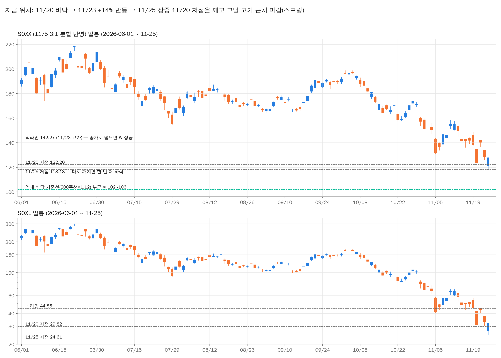
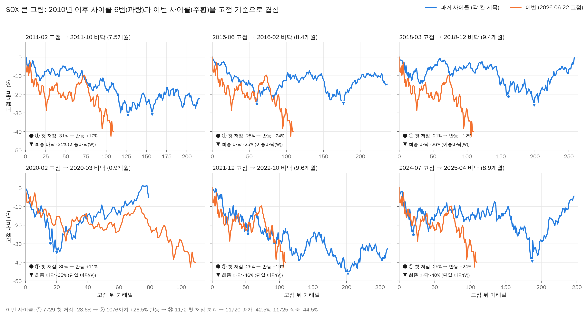
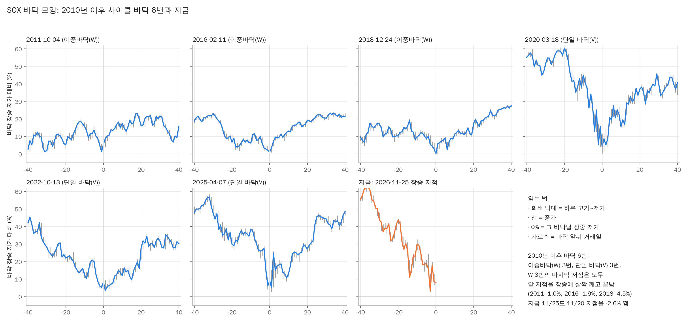
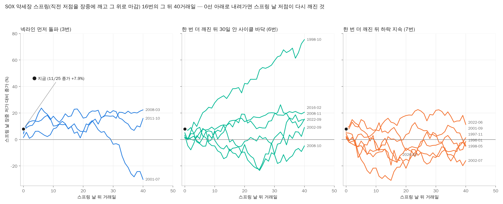

# SOXX(반도체) 차트 모양으로 본 지금 위치와 앞으로의 확률

**작성** 2026-11-27 11시 KST
**기준** 미국 11/25(수) 종가. 11/26은 추수감사절 휴장이고, 11/27 반일장은 한국시간 23:30 ~ 11/28 03:00입니다.

**자료**
- 확률 계산: SOX 지수 일봉(1994~). 2005년 이전 시가는 결함이 있어 고가·저가·종가만 썼습니다.
- 가격 환산: SOXX·SOXL 일봉. SOXX는 11/5 3:1 분할을 반영했습니다(저장소 원자료는 미조정).

**방법:** 비트코인 세션(11/26~27, SOLT)과 같은 순서로 봤습니다.
1. 역대 사이클 바닥의 큰 그림
2. 바닥 모양
3. "지금과 같은 모양"이 과거에 나온 뒤 결말 세기
4. 기준을 바꿔도 같은지 점검
5. 기준선 (비트코인의 실현가격 → SOX 200주선)
6. SOXX·SOXL 가격으로 환산

> 과거 자료로 센 횟수이며 투자 권유가 아닙니다.

---

## 0. 결론

1. **지금 위치는 "바닥을 한 번 뚫는 척하고 다시 올라온 자리(스프링)"입니다.**
   - 11/20 바닥 → 11/23 +14% 반등 → 11/25 장중에 11/20 저점을 −3.3% 깸(SOXX 118.18) → 그날 고가 근처 127.98로 마감
2. **비트코인과 같은 틀로 세면, SOXX는 비트코인보다 한 걸음 앞서 있습니다.**
   - "급반등 뒤 바닥 바로 위 재시험"은 과거 25번 중 21번(84%) 저점이 먼저 깨졌습니다.
   - 비트코인은 아직 그 깨짐을 기다리는 자리입니다. SOXX는 11/25에 실제로 깨졌습니다.
3. **이제 관건은 11/25 저점(SOXX 118.18 · SOX 8,129)입니다.** 과거 같은 스프링 16번의 결말은 이렇습니다.

| 결말 | 횟수 |
|---|---|
| 넥라인(11/23 고점)을 먼저 종가로 뚫음 | 3번 (19%) |
| 스프링 저점이 한 번 더 깨짐 | **13번 (81%)**, 대부분 1~5거래일 안 |
| (11/25처럼 고가 근처에서 마감한 7번만) | 넥라인 먼저 2번, 깨짐 5번 (71%) |

   **→ 앞으로 몇 주는 아래쪽이 더 유력합니다. 11/25 저점 재이탈 약 70%, 넥라인 돌파 약 30%로 봅니다.**
   비트코인 쪽(80~90%)보다는 덜 나쁩니다. 11/25 마감이 그만큼 강했기 때문입니다.

4. **다시 깨지는 것이 나쁜 소식만은 아닙니다.**
   - 깨진 13번 중 **6번은 30거래일 안에 사이클 최종 바닥**이 나왔습니다(1998-10, 2002-10, 2008-11, 2016-02, 2022-10).
   - 그 바닥은 스프링 저점보다 −2~−25% 아래였고, 중앙은 −11%였습니다.
5. **큰 그림의 기준선은 "최종 바닥은 아직 아래"라고 말합니다.**
   - 1998년 이후 사이클 바닥 11번은 모두 SOX가 **200주선의 1.12배 이하**일 때 나왔습니다(0.35~1.12배).
   - 11/25 저점은 **1.37배**입니다.
   - 200주선은 계속 올라옵니다. 2~4월에 1.12배가 되는 자리는 **SOX 7,000~7,300(SOXX 약 102~106, SOXL 약 11~14)**입니다.
   - 11/25 사이클 재검증 보고서의 중심(SOX 7,300~7,800)과 같은 쪽입니다.

---

## 1. 지금 위치: 4개의 선

| 선 | SOX | SOXX | SOXL | 뜻 |
|---|---|---|---|---|
| **넥라인** (11/23 장중 고가) | 9,728 | **142.27** | 44.85 | 종가로 넘으면 스프링(W) 성공 |
| 지금 (11/25 종가) | 8,775 | 127.98 | 32.02 | |
| 11/20 장중 저가 | 8,342 | 122.20 | 29.82 | 11/25에 깨짐 |
| **스프링 저점** (11/25 장중 저가) | 8,129 | **118.18** | 24.61 | 다시 깨지면 한 번 더 하락 |

- **종가 기준으로는 아직 안 깨졌습니다.** 가장 낮은 종가는 여전히 11/20(SOX 8,408.59, SOXX 123.40)입니다. 11/25 종가는 그보다 +4.4% 위입니다.
- 종가 기준으로 같은 틀(종가 신저가 → 5일 안 종가 +10%↑ → 10일 안 종가 +6% 안 재시험)을 세어도, 과거 14번 중 9번(64%)은 그 종가 저점이 먼저 깨졌습니다.
- **11/25 하루 모양:** 장중 저가에서 종가까지 +7.9%를 올렸고, 종가가 그날 범위의 99% 자리(사실상 고가)였습니다.

---

## 2. 큰 그림: 역대와 같은 순서이고, 지금은 ③단계입니다

비트코인 세션의 4단계(① 첫 저점 → ② 약세장 반등 → ③ 첫 저점 붕괴 뒤 최종 바닥 → ④ 넥라인 돌파)를 SOX 2010년 이후 사이클 6번에 대 봤습니다.

| 사이클 | ① 첫 저점 (고점 대비) | ② 반등 | ③ 첫 저점 붕괴 → 최종 바닥 | 최종 바닥 (첫 저점 대비, 종가) | 바닥 모양 | ④ 넥라인 돌파 때 바닥 대비 |
|---|---|---|---|---|---|---|
| 2011 | 2011-08-19 (−31%) | +17% | 종가로는 안 깨짐 (같은 값 재시험) | 0% | 이중바닥(W) | +24% (107일 뒤) |
| 2016 | 2015-08-25 (−25%) | +24% | 2016-02-11 당일 | −0.1% | 이중바닥(W) | +29% (152일 뒤) |
| 2018 | 2018-10-29 (−21%) | +12% | 12/19 붕괴 → 5일 뒤 | −6.2% | 이중바닥(W) | +52% (212일 뒤) |
| 2020 | 2020-03-12 (−30%) | +11% | 3/16 붕괴 → 2일 뒤 | −7.6% | 단일 바닥(V) | +24% (19일 뒤) |
| 2022 | 2022-03-14 (−25%) | +19% | 4/14 붕괴 → 183일 뒤 | −29.0% | 단일 바닥(V) | +36% (101일 뒤) |
| 2025 | 2024-08-07 (−25%) | +24% | 2025-03-10 붕괴 → 29일 뒤 | −19.5% | 단일 바닥(V) | +19% (17일 뒤) |
| **이번** | **2026-07-29 (−28.6%)** | **+26.5%** | **11/2 붕괴 → 지금 23일째** | **지금까지 −19.5%** (11/20 종가) | ? | |

- 순서는 역대와 같습니다. 7월 첫 저점 → 10월까지 반등 → 11/2 첫 저점 붕괴 → 11/20 신저가입니다.
- 첫 저점 아래로 더 빠진 폭은 역대 0~−29%였습니다. 이번은 이미 **−19.5%로 2022년(−29%) 다음으로 깊습니다.**
- **차트 모양만 보면 "최종 바닥 구간에 가까이 왔다"는 쪽입니다.** 2022년형(−29%)을 그대로 대면 SOX 약 7,420입니다.
- 다만 이번 하락은 5개월에 −42.5%로, 2010년 이후 가장 빠릅니다. 11/25 재검증 보고서대로, 속도가 빠르다고 바닥이 앞당겨진 적은 없었습니다.

---

## 3. 바닥 모양: 2010년 이후 W 3번, V 3번

| 모양 | 사례 | 특징 |
|---|---|---|
| **이중바닥(W)** | 2011-10, 2016-02, 2018-12 | 마지막 저점이 앞 저점을 **장중 1~5% 깨고** 끝남 (−1.0%, −1.9%, −4.5%). 두 저점 간격 3~8주 |
| **단일 바닥(V)** | 2020-03, 2022-10, 2025-04 | 바닥 전 5일 −8~−18%, VIX 32~76 |

- **11/25(−2.6% 깸)은 W 3번의 마지막 저점과 같은 모양입니다.**
- 다른 점은 간격입니다. W 3번은 두 저점 사이가 3~8주(22~56일)였는데, 이번은 3거래일입니다. 몇 주 간격의 W가 된다면, 오른쪽 다리는 아직 만들어지지 않은 셈입니다.
- 11/20은 V형 바닥의 숫자와도 닮았습니다: 5일 −17.1%, RSI 29.0, VIX 35.5.

---

## 4. 비트코인 세션과 같은 틀: "급반등 뒤 바닥 바로 위 재시험"

**모양 정의:** 약세장(52주 고점 대비 −25% 이하)에서 60일 신저가 L → 5일 안 +10% 이상 반등(그 고점 = 넥라인) → 10일 안 L~L+4% 재시험(L 미이탈)

| 결과 (2026 제외, 과거 25번) | 횟수 |
|---|---|
| 넥라인 종가 돌파가 먼저 | 4번 (16%) — 1996-07, 2000-11, 2018-12, 2022-05 |
| **저점이 먼저 깨짐** | **21번 (84%)** |

- 깨질 때는 빨랐습니다. 재시험 뒤 **중앙 1거래일**이었고, 21번 중 20번이 10일 안이었습니다.
- 깨진 뒤 L 대비 최저 (2026 포함 23건)

| 기간 | 건수 | 중앙 | 상위 3건 뺀 평균 | 평균 | 최악 |
|---|---|---|---|---|---|
| 20일 안 최저 | 23 | −10.4% | −12.9% | −11.3% | −33.7% |
| 60일 안 최저 | 23 | −17.0% | −21.9% | −19.3% | −45.1% |

- **기준을 바꿔도 같습니다.** 넥라인 먼저 / 전체

| 첫 반등 | 재시험 ≤+3% | ≤+4% | ≤+6% |
|---|---|---|---|
| ≥8% | 4/31 | 5/32 | 10/40 |
| ≥10% | 3/24 | 4/25 | 9/33 |
| ≥12% | 1/18 | 2/19 | 5/25 |
| ≥15% | 0/7 | 1/8 | 1/10 |

- 2010년 이후만 보면 5번 중 2번(2018-12, 2022-05)이 넥라인 먼저였습니다.
- **이번 사이클은 이 모양이 두 번 나왔고 두 번 다 깨졌습니다.**
  - 11/5 저점 → 11/11 반등 → 11/17 재시험 → 11/20 깨짐 (−7.3%)
  - 11/20 저점 → 11/23 반등 → 11/24 재시험 → 11/25 깨짐 (−2.6%, 그날 고가 근처 마감)
- 비트코인 세션의 같은 표는 14번 중 13번(93%)이 깨졌습니다. 반도체도 같은 방향이었습니다.

---

## 5. 지금 단계: "깨고 다시 올라온 날(스프링)" 16번의 결말

**모양 정의:** 약세장(−25% 이하)에서 직전 60일 저점을 장중에 깨고 그 저점 위로 마감. 두 저점 사이에 +8% 이상 반등이 있었음.
**결말 판정:** 그 뒤 "넥라인(두 저점 사이 고점) 종가 돌파"가 먼저냐, "스프링 날 저점 재이탈"이 먼저냐

| 스프링 날 | 앞 저점 | 깬 깊이 | 마감 위치 | 결말 | 재이탈까지 | 그 뒤 60일 최저 (스프링 저점 대비) |
|---|---|---|---|---|---|---|
| 1996-01-04 | 1995-12-18 | −1.5% | 0.97 | 깨진 뒤 하락 지속 (1996-01-15 중간 저점, 최종 바닥은 1996-07) | 3일 | −12.5% |
| 1997-11-13 | 1997-10-28 | −1.6% | 0.99 | 깨진 뒤 하락 지속 | 19일 | −10.4% |
| 1998-05-20 | 1998-03-09 | −0.4% | 0.18 | 깨진 뒤 하락 지속 | 1일 | −19.5% |
| 1998-10-07 | 1998-09-01 | −0.2% | 0.15 | 깨진 뒤 30일 안 바닥 (1998-10-08) | 1일 | −3.7% |
| 2001-07-25 | 2001-07-11 | −1.2% | 0.99 | **넥라인 먼저** (그 뒤 9·11로 −35%) | 29일 | −35.2% |
| 2001-09-05 | 2001-07-25 | −3.3% | 0.60 | 깨진 뒤 하락 지속 | 1일 | −33.0% |
| 2002-07-11 | 2002-07-03 | −0.0% | 1.00 | 깨진 뒤 하락 지속 | 8일 | −34.9% |
| 2002-09-04 | 2002-08-05 | −2.3% | 0.91 | 깨진 뒤 30일 안 바닥 (2002-10-08) | 1일 | −24.3% |
| 2008-03-17 | 2008-01-23 | −0.7% | 0.60 | **넥라인 먼저** | 92일 | +0.2% |
| 2008-10-16 | 2008-10-10 | −3.5% | 0.99 | 깨진 뒤 30일 안 바닥 (2008-11-21) | 4일 | −25.1% |
| 2008-11-18 | 2008-11-13 | −3.1% | 0.48 | 깨진 뒤 30일 안 바닥 (2008-11-21) | 1일 | −9.8% |
| 2011-10-04 | 2011-08-19 | −1.0% | 0.99 | **넥라인 먼저 (그날이 사이클 바닥)** | — | +4.2% |
| 2016-02-08 | 2016-01-20 | −0.0% | 0.63 | 깨진 뒤 30일 안 바닥 (2016-02-11) | 3일 | −1.8% |
| 2022-06-30 | 2022-06-17 | −0.3% | 0.48 | 깨진 뒤 하락 지속 | 1일 | −5.8% |
| 2022-09-23 | 2022-07-05 | −0.7% | 0.74 | 깨진 뒤 30일 안 바닥 (2022-10-13) | 2일 | −11.8% |
| 2026-10-30 | 2026-10-22 | −2.1% | 0.48 | 깨진 뒤 하락 지속 | 1일 | −22.1% |
| **2026-11-25 (지금)** | 2026-11-20 | **−2.6%** | **0.99** | **진행 중** | | |

- "마감 위치"는 그날 범위에서 종가의 자리입니다(1 = 고가에서 마감).
- "재이탈까지"는 넥라인 먼저인 경우 넥라인을 넘은 뒤 다시 깨질 때까지의 거래일입니다.

**집계**

| 묶음 | 넥라인 먼저 | 스프링 저점 재이탈 |
|---|---|---|
| 전체 16번 | 3 (19%) | 13 (81%) |
| 마감 위치 0.8 이상 7번 (지금과 같음) | 2 (29%) | 5 (71%) |
| 2010년 이후 5번 | 1 (20%) | 4 (80%) |
| W 재시험이 깨진 직후의 스프링 7번 (4장 표에서) | 3 (43%) | 4 (57%) |
| 금리 인상기 4번 | 0 | 4 |

- 기준을 바꿔도 넥라인 먼저는 1/8 ~ 3/11(13~27%) 사이였습니다(두 저점 사이 반등 5~12%, 마감 위치 조건 유무, 약세장 기준 −25~−40%).
- **재이탈은 빨랐습니다.** 13번 중 11번이 5거래일 안이었습니다. 마감 위치 0.8 이상이었던 5번은 1, 3, 4, 8, 19거래일 뒤에 깨졌습니다.
- **스프링 날 저점 대비 그 뒤 최저**

| 기간 | 건수 | 중앙 | 상위 3건 뺀 평균 | 평균 | 최악 |
|---|---|---|---|---|---|
| 20일 안 | 16 | −10.8% | −13.6% | −10.7% | −33.0% |
| 60일 안 | 16 | −12.2% | −19.1% | −15.4% | −35.2% |
| 60일 안 (2010년 이후 5번) | 5 | −5.8% | | | −22.1% |

- **위쪽 폭도 컸습니다.** 16번 모두 60일 안에 스프링 날 종가보다 위로 간 적이 있었습니다(중앙 +17.9%). 깨지는 경우에도 중간 반등이 컸다는 뜻입니다.
- **넥라인 먼저 3번 중 진짜 바닥은 2011-10 하나였습니다.** 2001-07과 2008-03은 넥라인을 넘은 뒤에도 더 큰 하락(9·11, 금융위기)이 이어졌습니다.

---

## 6. 기준선: SOX 200주선 (비트코인의 실현가격 역할)

| 사이클 바닥 | 200주선 대비 |
|---|---|
| 1998-10-08 | 0.76배 |
| 2002-10-09 | 0.35배 |
| 2004-09-08 | 0.73배 |
| 2006-07-21 | 0.91배 |
| 2008-11-20 | 0.39배 |
| 2011-10-04 | 0.94배 |
| 2016-02-11 | 1.02배 |
| 2018-12-24 | 1.12배 |
| 2020-03-18 | 1.01배 |
| 2022-10-13 | 0.88배 |
| 2025-04-07 | 0.90배 |
| **이번 11/20 저점 / 11/25 저점** | **1.41배 / 1.37배** |

- 1997년 말 이후 약세장 주요 저점 25개 중 200주선 1.15배 이상에서 찍은 저점은 2개였고(2000-05 2.07배, 2024-08 1.27배), 둘 다 사이클 바닥이 아니었습니다.
- 이번 고점은 200주선의 **2.96배**로, 2000년(3.80배) 다음으로 과열됐었습니다. 2010년 이후 다른 고점은 1.32~1.98배였습니다.
- **200주선은 앞으로 계속 올라옵니다.** 1000거래일 전 가격(2022~2023년)이 빠지고 지금 가격이 들어오기 때문입니다.

| 시점 | 200주선 (SOX가 8,500 근처에 머물 때) | 1.12배 | 1.00배 |
|---|---|---|---|
| 2027-01 하순 | 약 6,160 | 6,900 | 6,160 |
| 2027-02 하순 | 약 6,270 | 7,030 | 6,270 |
| 2027-04 하순 | 약 6,520 | 7,300 | 6,520 |
| 2027-06 하순 | 약 6,750 | 7,560 | 6,750 |

**→ 역대 바닥 기준으로는 SOX 7,000~7,500(SOXX 약 102~109)이 "사이클 바닥다운 자리"입니다.**
**→ 차트 모양(2장)은 바닥 구간 근처라고 하고, 기준선은 아직 10~15% 아래라고 합니다.** 둘이 만나는 자리가 바로 5장의 "한 번 더 깨짐(중앙 −12%) → SOX 약 7,150"입니다.

---

## 7. 앞으로의 갈래

| 갈래 | 가능성 | SOX | SOXX | SOXL (약) |
|---|---|---|---|---|
| **A. 11/25 저점 재이탈** (대부분 1~4주 안) | **약 70%** | 8,129 아래 | 118.18 아래 | 25 아래 |
| A-1. 얕게 깨지고 최종 바닥 (2016-02형 −2%) | | 7,970 | 116 | 23 |
| A-2. 2010년 이후 중앙 (−6%) | | 7,640 | 111 | 20 |
| A-3. 전체 중앙 (−12%, 2022-09형) · 200주선 기준선과 겹침 | | 7,150 | 104 | 16 |
| A-4. 깊은 경우 (−25%, 2002·2008형) | | 6,100 | 88 | 10 |
| **B. 넥라인 종가 돌파가 먼저** | **약 30%** | 9,728 위 | 142.27 위 | 42~45 |

- **A가 나와도 그 저점이 최종 바닥일 가능성이 꽤 됩니다.** 과거 깨진 13번 중 6번이 30거래일 안에 사이클 바닥이었습니다.
- 다만 기준선(6장)은 A-3 근처(SOX 7,000~7,300)까지 가야 역대 바닥 수준이라고 말합니다. A-1·A-2에서 멈추면 그 저점도 중간 바닥일 수 있습니다.
- **B가 나오면** 2011-10형(그날이 바닥)이 가능합니다. 하지만 과거 B 3번 중 2번은 넥라인을 넘은 뒤 더 큰 하락이 왔습니다. B 하나로 사이클 바닥이 확인되지는 않습니다.

---

## 8. SOXL로 보면

- SOXL 가격은 SOX의 3배 움직임에 변동성 손실을 뺀 근사치입니다. **같은 SOX 가격이라도 늦게 도달할수록 SOXL은 더 낮습니다.**
  - 최근 SOX 하루 변동은 60일 4.1%, 20일 6.2%입니다.
  - SOX 7,150에 20거래일 뒤 도달하면 SOXL 약 16(바로 도달 시 17.3)입니다.
  - 2~4월에 SOX 7,000~7,300이면 SOXL 약 11~14입니다.
- **지금(32.02)은 아래쪽 갈래가 더 유력한 자리입니다.** 11/25 스프링이 강하긴 했지만, 같은 모양 7번 중 5번은 그 저점이 다시 깨졌습니다.
- **매수 판단은 11/25 재검증 보고서대로 점수표 60점 규칙을 따릅니다.** 이 보고서는 "어느 가격대에서 긴장할지"를 정하는 보조 판단입니다.

---

## 9. 비트코인 결과와 함께 보면

| | 비트코인 (11/27 01시) | SOXX (11/25 종가) |
|---|---|---|
| 모양 | 급반등 뒤 바닥 바로 위 재시험, **아직 안 깨짐** | 같은 모양에서 **이미 한 번 깸** → 그날 고가 마감(스프링) |
| 과거 같은 모양 | 14번 중 13번 저점 깨짐 | 25번 중 21번 깨짐 → 지금은 스프링 16번 중 13번 재이탈 |
| 기준선 | 실현가격 위 4% → 역대 바닥은 모두 아래 | 200주선 1.37배 → 역대 바닥은 모두 1.12배 이하 |
| 다음 갈래 | 한 번 더 하락 80~90% | 스프링 저점 재이탈 약 70% |

**두 시장이 같은 쪽을 가리킵니다.** 둘 다 "한 번 더 낮은 저점"이 더 흔한 길이었고, 그 한 번 더가 마지막 투매였던 경우도 많았습니다.

---

## 10. 지켜볼 것 (KST)

| 일시 | 볼 것 |
|---|---|
| 11/27(금) 23:30 ~ 11/28 03:00 | 반일장. SOXX 118.18 / 142.27 중 어느 쪽이 먼저인지 |
| 매일 종가 | SOX 종가 8,408.59(11/20 종가) 아래 마감 → 종가 기준으로도 W 실패 |
| 12/1 | 한국 11월 수출 (반도체가 전월보다 줄기 시작하는지) |
| 12/10 04:00 | FOMC 결과 |
| 12월 중하순 | 마이크론 실적 |

**원장 등록 (자동 채점)**

| id | 내용 | 확률 |
|---|---|---|
| L20261127-01 | SOX가 20거래일 안(12/23까지) 장중 8,129.23(11/25 저점) 이하 | 70% |
| L20261127-02 | SOX가 20거래일 안 장중 7,641(11/25 저점 −6%) 이하 | 50% |

---

## 부록. 재현

`research/soxx_chart_shape/`에서 실행합니다.

| 스크립트 | 내용 | 결과 파일 |
|---|---|---|
| `scripts/common.py` | 자료 읽기, SOXX 분할 조정, 금리 국면 | |
| `scripts/a_cycles.py` | 큰 그림 4단계, 바닥 모양, 200주선 비율 | `output/a_cycles.txt/.csv` |
| `scripts/b_events.py` | B1 W 재시험, B2 깨진 날 모양, B3 스프링, B4 종가 기준, B5 결말 3분류 | `output/b_events.txt`, `b1~b4 *.csv` |
| `scripts/c_anchor.py` | 200주선 비교군과 앞으로의 위치 | `output/c_anchor.txt` |
| `scripts/d_levels.py` | SOX → SOXX·SOXL 환산 | `output/d_levels.txt` |
| `scripts/e_charts.py` | 그림 4장 | `charts/u1~u4` |

- 사건은 앞 사건의 결말이 난 날부터 다시 셉니다(같은 하락 안의 연속 사건 포함).
- 2010년 이후 사이클 날짜는 11/25 재검증 보고서 표를 그대로 썼습니다.
- SOXL 환산식은 종가 × (SOX비)³ × e^(−3σ²t)입니다. σ는 하루 3~4%로 잡았습니다.
- SOXX 환산은 최근 60일 SOXX/SOX 기울기 1.01을 썼습니다.
